# COURSE PROJECT REPORT

**Subject:** SDN302 – Server-side Development with NodeJS, Express & MongoDB
**Project Name:** CraftYarnHub – Crochet Chart Management & Accessories Platform
**Project Code:** SDN-CYH
**Academic Institution:** FPT University
**Date:** November 2026
**Document Version:** 1.0 Final

---

## TABLE OF CONTENTS

- [RECORD OF CHANGES](#record-of-changes)
- [I. OVERVIEW (VISION AND SCOPE)](#i-overview-vision-and-scope)
  - [I.1 Project Information](#i1-project-information)
  - [I.2 Project Team](#i2-project-team)
  - [I.3 Business Opportunity and Objectives](#i3-business-opportunity-and-objectives)
  - [I.4 Project Priorities](#i4-project-priorities)
- [II. REQUIREMENT SPECIFICATION](#ii-requirement-specification)
  - [II.1 Problem Description](#ii1-problem-description)
  - [II.2 Major Features](#ii2-major-features)
  - [II.3 Context Diagram](#ii3-context-diagram)
  - [II.4 Non-Functional Requirements (NFR)](#ii4-non-functional-requirements-nfr)
  - [II.5 Business Rules](#ii5-business-rules)
  - [II.6 Functional Requirements](#ii6-functional-requirements)
    - [II.6.1 Actors](#ii61-actors)
    - [II.6.2 Use Case Diagrams](#ii62-use-case-diagrams)
    - [II.6.3 Use Case Descriptions](#ii63-use-case-descriptions)
    - [II.6.4 Activity Diagrams](#ii64-activity-diagrams)
- [III. ANALYSIS MODELS](#iii-analysis-models)
  - [III.1 High-Level Class Diagram (Structural Model)](#iii1-high-level-class-diagram-structural-model)
  - [III.2 Interaction Diagrams](#iii2-interaction-diagrams)
    - [III.2.1 Sequence Diagrams](#iii21-sequence-diagrams)
    - [III.2.2 Communication Diagrams](#iii22-communication-diagrams)
  - [III.3 State Machine Diagram (Behavioral Model)](#iii3-state-machine-diagram-behavioral-model)
- [IV. DESIGN SPECIFICATION](#iv-design-specification)
  - [IV.1 Integrated Communication Diagrams](#iv1-integrated-communication-diagrams)
  - [IV.2 System High-Level Design (Client - Server Architecture)](#iv2-system-high-level-design-client---server-architecture)
  - [IV.3 Component and Package Diagram](#iv3-component-and-package-diagram)
    - [IV.3.1 Component Diagram](#iv31-component-diagram)
    - [IV.3.2 Package Diagram &amp; Descriptions](#iv32-package-diagram--descriptions)
  - [IV.4 Implementation Class Diagrams](#iv4-implementation-class-diagrams)
  - [IV.5 Database Design (MongoDB / Mongoose ODM)](#iv5-database-design-mongodb--mongoose-odm)
- [V. IMPLEMENTATION](#v-implementation)
  - [V.1 Map Architecture to the Structure of the Project](#v1-map-architecture-to-the-structure-of-the-project)
  - [V.2 Map Class Diagram and Interaction Diagram to Code](#v2-map-class-diagram-and-interaction-diagram-to-code)
- [VI. APPLYING ALTERNATIVE ARCHITECTURE PATTERNS](#vi-applying-alternative-architecture-patterns)
  - [VI.1 Applying Service-Oriented Architecture (SOA) / Microservices](#vi1-applying-service-oriented-architecture-soa--microservices)
  - [VI.2 Applying Service Discovery Pattern](#vi2-applying-service-discovery-pattern)

---

## RECORD OF CHANGES

| Date       | A / M / D\* | In Charge                             | Change Description                                              |  Version  |
| :--------- | :---------: | :------------------------------------ | :-------------------------------------------------------------- | :-------: |
| 02/11/2026 |      A      | Đinh Thị Thu Trang (Lead)             | Initial project setup, core database schemas definition         |    0.1    |
| 05/11/2026 |      A      | Nguyễn Thị Thắm                       | Implement Products catalog, shopping cart client state          |    0.4    |
| 08/11/2026 |      A      | Nguyễn Minh Đức                       | Implement Blogs module, Categories CRUD, Admin UI structure     |    0.7    |
| 10/11/2026 |      M      | Đinh Thị Thu Trang & Nguyễn Thị Thắm  | Implement real Orders module (NestJS + MongoDB), replace mockup |    0.9    |
| 10/11/2026 |      A      | All Members                           | Consolidate full Course Project Report documentation            | 1.0 Final |

*\*A: Added, M: Modified, D: Deleted*

---

## I. OVERVIEW (VISION AND SCOPE)

### I.1 Project Information

- **Project Name:** CraftYarnHub (Tiệm Len Xinh)
- **Project Code:** SDN-CYH
- **Subject:** SDN302 – Server-side Development with NodeJS, Express & MongoDB
- **Class Group:** SE17xx / SDN302
- **Software Type:** Web Application (Single Page Application Client + RESTful API Backend Server)

### I.2 Project Team

| No | Full Name                | Student ID |           Project Role           | Responsibilities                                                                                                                             |
| :-: | :----------------------- | :--------: | :-------------------------------: | :------------------------------------------------------------------------------------------------------------------------------------------- |
| 1 | **Đinh Thị Thu Trang**   |  HE195077  | **Leader (Fullstack Lead)**       | **Core Pattern & Community:** Patterns CRUD, Regex search & filter, $inc view/like, Comments module, RowCounter widget, Home showcase. |
| 2 | **Nguyễn Thị Thắm**      |  HE191525  |  **Developer (Fullstack)**        | **E-Commerce & Orders:** Products CRUD, Shopping Cart context, Orders module (schema, auto-code, status workflow, lookup).             |
| 3 | **Nguyễn Minh Đức**      |  HE194336  |  **Developer (Fullstack)**        | **Knowledge & Administration:** Blogs CRUD, Categories CRUD, Validation Pipe configuration, Admin Management Dashboard (`/admin`).   |

### I.3 Business Opportunity and Objectives

1. **Background:**Nghệ thuật đan móc len thủ công (Crochet & Amigurumi) ngày càng phát triển mạnh mẽ trong giới trẻ. Tuy nhiên, người học móc len hiện gặp nhiều trở ngại:
   - Các mẫu chart (hướng dẫn từng vòng móc) thường rải rác trên mạng xã hội dưới dạng hình ảnh chất lượng thấp, khó tra cứu.
   - Khi thực hành, thợ móc rất dễ quên số hàng đang móc dang dở nếu không có công cụ ghi nhớ.
   - Việc tìm mua đúng chủng loại len, size kim móc phù hợp với mẫu chart tốn nhiều thời gian.
2. **Business Objectives:**
   - **BO-1:** Xây dựng một cổng thông tin tập trung cung cấp 100% chart móc len miễn phí, phân cấp rõ ràng theo độ khó và danh mục.
   - **BO-2:** Tích hợp trợ lý kỹ thuật số (Row Counter) đếm hàng trực quan, có âm thanh và lưu vết tiến độ.
   - **BO-3:** Cung cấp gian hàng phụ kiện chính hãng kèm quy trình đặt hàng tinh gọn, tra cứu đơn nhanh chóng bằng số điện thoại.
   - **BO-4:** Xây dựng hệ thống quản trị dữ liệu (Admin Panel) đơn giản, minh bạch giúp người vận hành quản lý sản phẩm, bài viết và xử lý đơn hàng hiệu quả.

### I.4 Project Priorities

| Dimension              |   Constraint (Bắt buộc)   |              Driver (Ưu tiên tối đa)              |     Degree of Freedom (Được điều chỉnh)     |
| :--------------------- | :--------------------------: | :----------------------------------------------------: | :------------------------------------------------: |
| **Schedule**     | Deadline kết thúc học kỳ |                                                        |                                                    |
| **Features**     |                              |    Chuẩn RESTful API, Full CRUD, Không Mock Data    | Phạm vi tích hợp cổng thanh toán bên thứ ba |
| **Quality**      |                              | Đạt chuẩn phản hồi < 300ms, Validation chặt chẽ |                                                    |
| **Cost / Staff** |        03 Sinh viên        |                                                        |                                                    |

---

## II. REQUIREMENT SPECIFICATION

### II.1 Problem Description

CraftYarnHub là giải pháp phần mềm hướng dịch vụ giải quyết triệt để sự phân mảnh giữa việc **học kỹ thuật móc len** và **mua sắm nguyên vật liệu phụ kiện**. Hệ thống là một ứng dụng Web phân tầng, cung cấp giao diện tương tác tức thì cho người dùng đầu cuối (Client) và hệ thống xử lý API hướng cơ sở dữ liệu phi quan hệ MongoDB (Server).

### II.2 Major Features

- **FE-01: Kho Thư Viện Chart Móc Len (Patterns Catalog):** Tra cứu, tìm kiếm đa trường (tên, mô tả, nguyên liệu), lọc phân cấp theo danh mục và độ khó (`Dễ`, `Vừa`, `Khó`).
- **FE-02: Chi Tiết Chart & Trợ Lý Đếm Hàng (Pattern Detail & Row Counter):** Hiển thị công thức móc chi tiết (R1, R2...) theo từng bộ phận; checklist nguyên liệu/dụng cụ tương tác; widget đếm hàng có âm thanh Web Audio và lưu trữ cục bộ.
- **FE-03: Tương Tác Cộng Đồng (Community Interaction):** Đánh giá số sao (1-5 sao), gửi nhận xét cảm nhận có avatar động; thả tim chart với cơ chế tăng số nguyên tử `$inc`.
- **FE-04: Cửa Hàng Phụ Kiện & Giỏ Hàng (Shop & Cart):** Danh mục phụ kiện chuyên dụng; giỏ hàng client-side lưu `localStorage`, tự động tính tổng tiền VNĐ.
- **FE-05: Đặt Hàng & Tra Cứu Đơn Hàng (Order Processing & Lookup):** Quy trình đặt hàng không cần tài khoản rườm rà, sinh mã đơn tự động (`ORD-XXXXXX`), tra cứu lịch sử mua hàng theo SĐT.
- **FE-06: Cẩm Nang Mẹo Đan Móc (Blog & Tips):** Thư viện bài viết kỹ thuật đan len, giấu mối chỉ thừa, tối ưu đường dẫn URL bằng Slug.
- **FE-07: Bảng Điều Khiển Quản Trị Hệ Thống (Admin Control Panel):** Quản lý tập trung 4 thao tác CRUD trên Chart, Phụ kiện, Đơn đặt hàng và cập nhật trạng thái đơn.

### II.3 Context Diagram

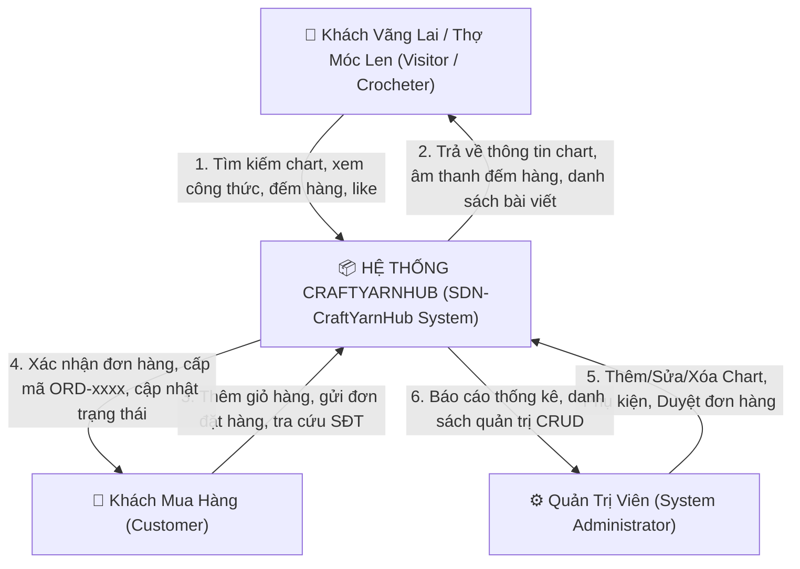

---

### II.4 Non-Functional Requirements (NFR)

| ID               | Nhóm Yêu Cầu | Tên Yêu Cầu                | Đặc Tả Chi Tiết                                                                                                                                      |
| :--------------- | :-------------- | :---------------------------- | :------------------------------------------------------------------------------------------------------------------------------------------------------- |
| **NFR-01** | Performance     | Thời gian phản hồi API     | Thời gian xử lý và trả lời của mọi endpoint RESTful API < 300ms trong môi trường mạng nội bộ.                                              |
| **NFR-02** | Reliability     | Tính nhất quán dữ liệu   | Không phát sinh tình trạng tranh chấp (race-condition) khi cập nhật lượt view/like; sử dụng toán tử atomic `$inc` của MongoDB.           |
| **NFR-03** | Usability       | Thiết kế Responsive         | Giao diện tương thích mượt mà từ màn hình Mobile (375px), Tablet (768px) đến Desktop (1200px+) nhờ Ant Design Grid System.                  |
| **NFR-04** | Security        | DTO Data Sanitization         | Tự động loại bỏ các trường không mong muốn và kiểm tra kiểu dữ liệu đầu vào qua NestJS Global `ValidationPipe({ whitelist: true })`. |
| **NFR-05** | Maintainability | Kiến trúc Module hóa       | Backend tuân thủ nghiêm ngặt mô hình NestJS: Controller chỉ điều hướng, Service xử lý logic, Schema định nghĩa dữ liệu.                |
| **NFR-06** | Audio Usability | Độ trễ âm thanh Web Audio | Âm thanh bíp pop của bộ đếm hàng phản hồi ngay lập tức (< 10ms) không cần tải tệp mp3 ngoài thông qua Web Audio API.                    |

---

### II.5 Business Rules

| ID              | Tên Quy Tắc              | Định Nghĩa Quy Tắc                                                                                                                                                                        | Phân Loại | Nguồn Gốc     |
| :-------------- | :------------------------- | :-------------------------------------------------------------------------------------------------------------------------------------------------------------------------------------------- | :---------: | :-------------- |
| **BR-01** | Unique Category Slug       | Mỗi danh mục phải có `slug` và `name` là duy nhất trên toàn hệ thống để định tuyến URL chuẩn SEO.                                                                        | Constraint | System Design   |
| **BR-02** | Atomic Metric Update       | Lượt xem (`view_count`) và lượt thích (`likes`) chỉ được phép tăng đơn vị nguyên (+1) thông qua toán tử `$inc`, không cho phép ghi đè tùy tiện.                | Constraint | Data Integrity  |
| **BR-03** | Order Code Uniqueness      | Mã đơn hàng phải được sinh tự động với tiền tố `ORD-` kèm hậu tố ngẫu nhiên và đảm bảo duy nhất tuyệt đối trong collection `orders`.                           |    Fact    | Order Policy    |
| **BR-04** | Valid Phone Format         | Số điện thoại nhận hàng phải là chuỗi chữ số hợp lệ từ 10 đến 11 ký tự, không chứa ký tự đặc biệt hoặc chữ cái.                                                   | Constraint | Checkout Policy |
| **BR-05** | Minimum Cart Threshold     | Đơn hàng chỉ được phép khởi tạo khi giỏ hàng có tối thiểu một sản phẩm với số lượng $\ge 1$.                                                                          | Constraint | Checkout Policy |
| **BR-06** | Rating Constraints         | Điểm đánh giá chất lượng mẫu chart bắt buộc nằm trong khoảng số nguyên từ 1 đến 5 sao.                                                                                      | Constraint | Review Policy   |
| **BR-07** | Order Status State Machine | Trạng thái đơn hàng chỉ được chuyển đổi tuần tự hợp lệ: `Chờ xác nhận` $\rightarrow$ `Đang xử lý` $\rightarrow$ `Đã giao` hoặc chuyển sang `Đã hủy`. | Constraint | Workflow Policy |
| **BR-08** | Price Positivity           | Giá sản phẩm phụ kiện (`price`) bắt buộc phải là số thực dương $\ge 0$.                                                                                                      | Constraint | Finance Policy  |

---

### II.6 Functional Requirements

#### II.6.1 Actors

| No | Actor                                         | Phân Loại | Mô Tả Vai Trò                                                                                                                                                     |
| :-: | :-------------------------------------------- | :---------: | :------------------------------------------------------------------------------------------------------------------------------------------------------------------- |
| 1 | **Visitor / Crocheter** (Thợ Móc Len) |   Primary   | Người truy cập duyệt kho chart, xem hướng dẫn móc chi tiết, sử dụng bộ đếm hàng, thả tim và gửi bình luận đánh giá.                           |
| 2 | **Customer** (Khách Mua Hàng)         |   Primary   | Người mua dụng cụ/len sợi, quản lý giỏ hàng, thực hiện đặt hàng và tra cứu hành trình đơn hàng bằng số điện thoại.                         |
| 3 | **Administrator** (Quản Trị Viên)    |   Primary   | Người quản trị hệ thống có toàn quyền thực hiện các thao tác Create, Read, Update, Delete trên Chart, Sản phẩm và chuyển trạng thái Đơn hàng. |

---

#### II.6.2 Use Case Diagrams

##### Sơ đồ Tổng quan Hệ thống (System Use Case Diagram)

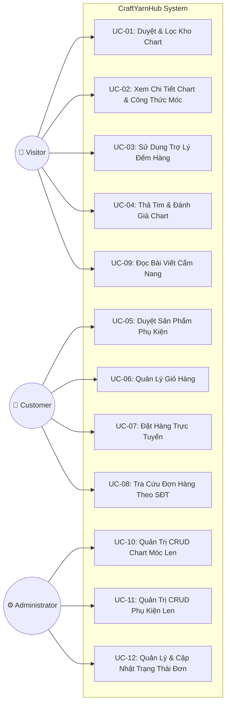

---

#### II.6.3 Use Case Descriptions

##### UC-02: Xem Chi Tiết Chart & Công Thức Móc Len

- **Use Case ID & Name:** `UC-02: View Pattern Detail and Instructions`
- **Created By:** Đinh Thị Thu Trang (HE195077)
- **Primary Actor:** Visitor / Crocheter
- **Trigger:** Người dùng nhấp chuột vào một thẻ mẫu chart tại Trang chủ hoặc Kho Chart.
- **Description:** Hiển thị chi tiết mẫu móc len gồm hình ảnh chất lượng cao, thông tin tác giả, checklist nguyên liệu, dụng cụ và công thức móc từng bước (R1, R2...).
- **Preconditions:**
  - `PRE-1`: Mẫu chart tồn tại hợp lệ trong cơ sở dữ liệu MongoDB.
- **Postconditions:**
  - `POST-1`: Chỉ số `view_count` của mẫu chart tăng thêm 1 trong database.
  - `POST-2`: Giao diện hiển thị đầy đủ thông tin chi tiết và bộ đếm hàng tương ứng.
- **Normal Flow (2.0):**
  1. Người dùng chọn một mẫu chart trên màn hình.
  2. Client gửi yêu cầu `GET /api/patterns/:id` tới Server.
  3. Server kiểm tra tính hợp lệ của ObjectId, gọi lệnh `$inc: { view_count: 1 }`, đồng thời `populate('category')`.
  4. Server trả về mã phản hồi `200 OK` kèm dữ liệu chi tiết mẫu chart.
  5. Client hiển thị thông tin mẫu, checklist nguyên liệu và các bước móc chi tiết.
  6. Client tự động nạp danh sách bình luận liên quan qua API `GET /api/comments?patternId=:id`.
- **Alternative Flows:**
  - `2.1`: Người dùng bấm nút tick chọn vào các mục nguyên liệu/dụng cụ để đánh dấu đồ đã chuẩn bị xong.
- **Exceptions:**
  - `2.0.E1`: `id` gửi lên không đúng định dạng 24 ký tự hex của MongoDB. Hệ thống trả về `400 Bad Request` - "ID Chart không hợp lệ".
  - `2.0.E2`: Không tìm thấy bản ghi tương ứng. Hệ thống trả về `404 Not Found` và Client hiển thị thông báo lỗi thân thiện.
- **Priority:** High (Must Have)
- **Business Rules:** `BR-02`

---

##### UC-07: Đặt Hàng Trực Tuyến (Checkout Order)

- **Use Case ID & Name:** `UC-07: Checkout Order`
- **Created By:** Nguyễn Thị Thắm (HE191525)
- **Primary Actor:** Customer
- **Trigger:** Khách hàng bấm nút "Đặt Hàng Ngay" tại màn hình Giỏ Hàng (`/cart`).
- **Description:** Thu thập thông tin giao nhận của khách hàng, đóng gói danh sách sản phẩm trong giỏ và gửi yêu cầu tạo đơn hàng lưu vào cơ sở dữ liệu MongoDB.
- **Preconditions:**
  - `PRE-1`: Giỏ hàng có tối thiểu 1 mặt hàng (`items.length > 0`).
- **Postconditions:**
  - `POST-1`: Một bản ghi đơn hàng mới được tạo trong collection `orders` với trạng thái `Chờ xác nhận`.
  - `POST-2`: Giỏ hàng client-side được xóa sạch (`clearCart()`).
  - `POST-3`: Popup thông báo thành công hiển thị mã đơn hàng `ORD-XXXXXX` cho khách hàng.
- **Normal Flow (7.0):**
  1. Khách hàng nhập Họ tên, Số điện thoại, Địa chỉ nhận hàng và Ghi chú (nếu có).
  2. Khách hàng bấm nút "Đặt Hàng Ngay".
  3. Client kiểm tra validation dữ liệu form.
  4. Client đóng gói payload gồm thông tin khách, mảng sản phẩm (`product_id, name, price, quantity, image_url`) và tổng tiền thanh toán.
  5. Client gọi `POST /api/orders`.
  6. Server kích hoạt `ValidationPipe` kiểm tra `CreateOrderDto`.
  7. Server tự động sinh mã `order_code` duy nhất, gán trạng thái `Chờ xác nhận` và lưu đơn hàng vào MongoDB.
  8. Server trả về mã `201 Created` kèm thông tin đơn hàng vừa tạo.
  9. Client hiển thị Modal chúc mừng kèm mã đơn hàng, đồng thời xóa giỏ hàng trong `localStorage`.
- **Exceptions:**
  - `7.0.E1`: Giỏ hàng trống. Client chặn submit và cảnh báo "Giỏ hàng của bạn đang trống!".
  - `7.0.E2`: Số điện thoại sai định dạng. Hệ thống hiển thị cảnh báo validation lỗi form.
- **Priority:** High (Must Have)
- **Business Rules:** `BR-03`, `BR-04`, `BR-05`

---

##### UC-12: Quản Lý & Cập Nhật Trạng Thái Đơn Hàng

- **Use Case ID & Name:** `UC-12: Manage and Update Order Status`
- **Created By:** Nguyễn Minh Đức (HE194336)
- **Primary Actor:** Administrator
- **Trigger:** Quản trị viên truy cập trang `/admin` và chọn tab "Quản Lý Đơn Hàng".
- **Description:** Xem danh sách toàn bộ các đơn đặt hàng từ khách, kiểm tra chi tiết các món hàng và đổi trạng thái xử lý đơn.
- **Preconditions:**
  - `PRE-1`: Server backend và database đang hoạt động bình thường.
- **Postconditions:**
  - `POST-1`: Trạng thái đơn hàng trong database được cập nhật thành giá trị mới.
- **Normal Flow (12.0):**
  1. Quản trị viên truy cập giao diện `/admin`.
  2. Client gọi API `GET /api/orders` để tải danh sách đơn hàng.
  3. Bảng Ant Design Table hiển thị danh sách đơn kèm mã đơn, khách hàng, số điện thoại, tổng tiền và tag trạng thái.
  4. Quản trị viên nhấp vào dropdown trạng thái tại một dòng đơn hàng và chọn trạng thái mới (ví dụ: từ `Chờ xác nhận` sang `Đã giao`).
  5. Client gửi yêu cầu `PATCH /api/orders/:id/status` với body `{ status: "Đã giao" }`.
  6. Server xác thực trạng thái hợp lệ, cập nhật MongoDB và trả về `200 OK`.
  7. Client hiển thị thông báo toast thành công và cập nhật màu sắc thẻ tag trên bảng.
- **Priority:** High (Must Have)
- **Business Rules:** `BR-07`

---

#### II.6.4 Activity Diagrams

##### Activity Diagram 1: Quy Trình Đặt Hàng Trực Tuyến (Checkout Workflow)

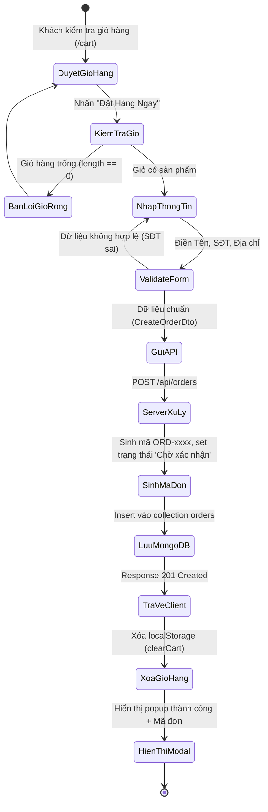

##### Activity Diagram 2: Quy Trình Móc Len Với Trợ Lý Đếm Hàng (Row Counter)

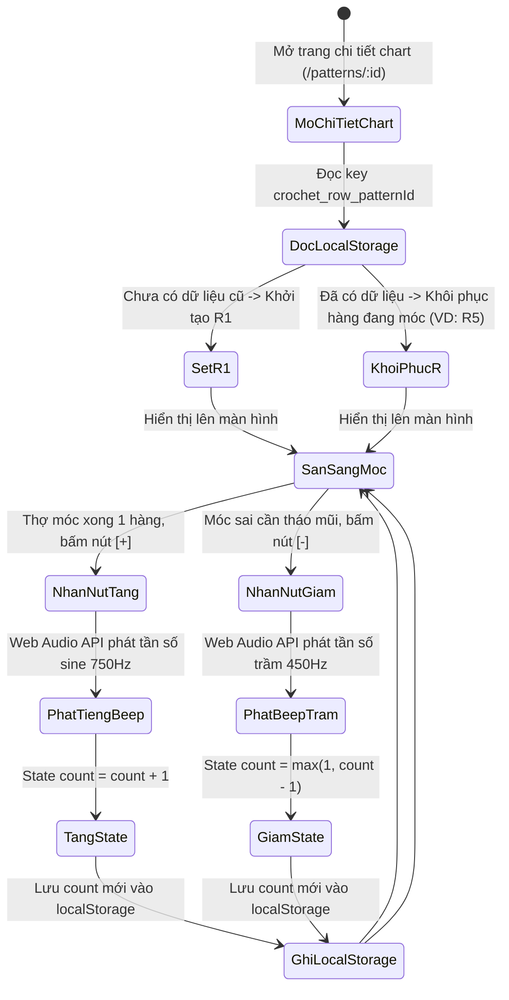

---

## III. ANALYSIS MODELS

### III.1 High-Level Class Diagram (Structural Model)

Sơ đồ các thực thể dữ liệu phân tích (Entity Classes) phản ánh cấu trúc dữ liệu cốt lõi của hệ thống:

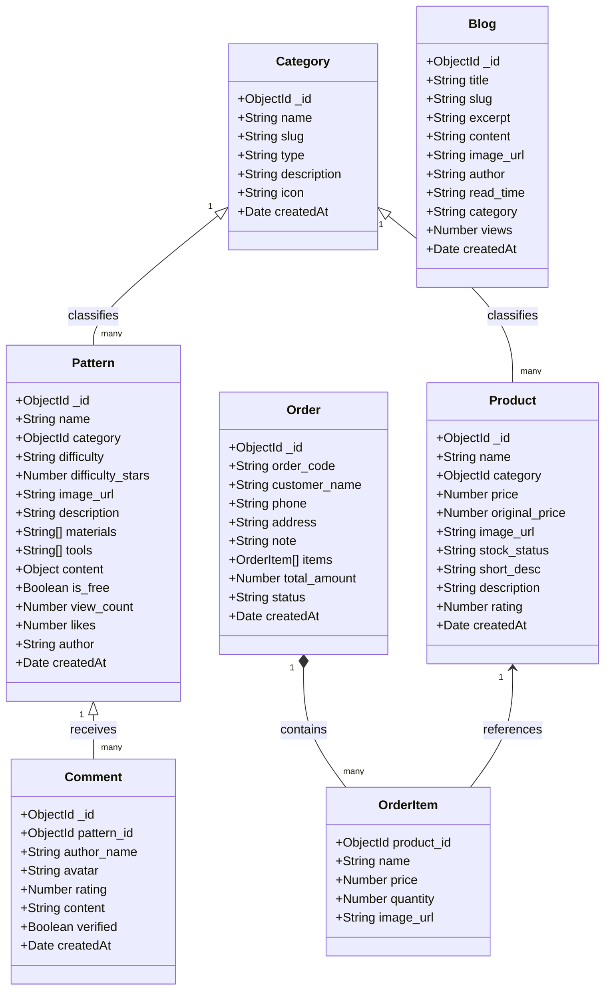

---

### III.2 Interaction Diagrams

#### III.2.1 Sequence Diagrams

##### Sequence Diagram 1: Đánh Giá & Bình Luận Chart Móc Len

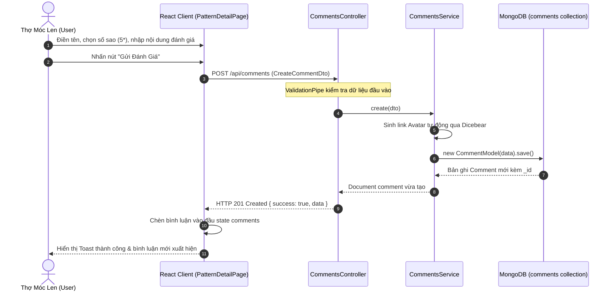

##### Sequence Diagram 2: Thả Tim Chart Với Toán Tử Atomic `$inc`

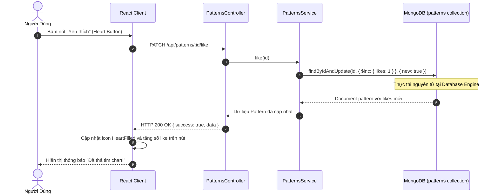

---

#### III.2.2 Communication Diagrams

Sơ đồ truyền thông điệp tương tác khi Khách hàng thực hiện Đặt Hàng:

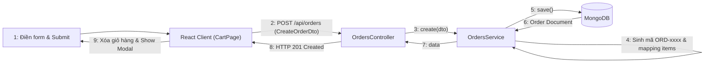

---

### III.3 State Machine Diagram (Behavioral Model)

Vòng đời và sự chuyển dịch trạng thái của một Đơn Hàng trong hệ thống:

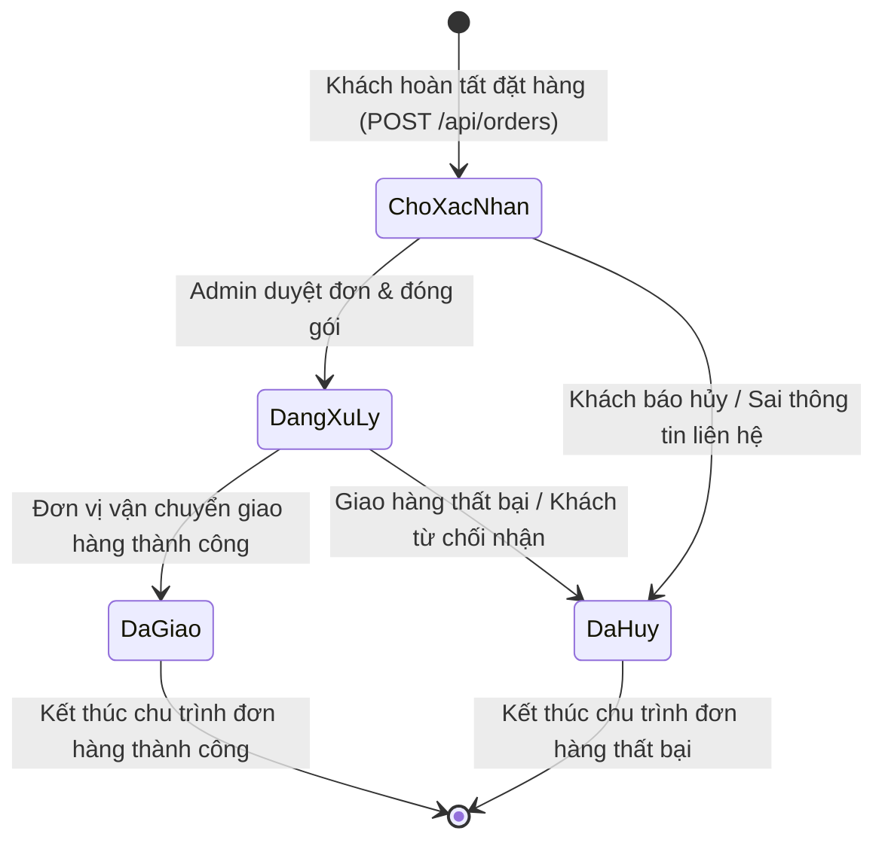

---

## IV. DESIGN SPECIFICATION

### IV.1 Integrated Communication Diagrams

Sơ đồ tương tác tích hợp toàn hệ thống thể hiện luồng giao tiếp giữa 3 tầng (Client ➔ NestJS API ➔ Database):

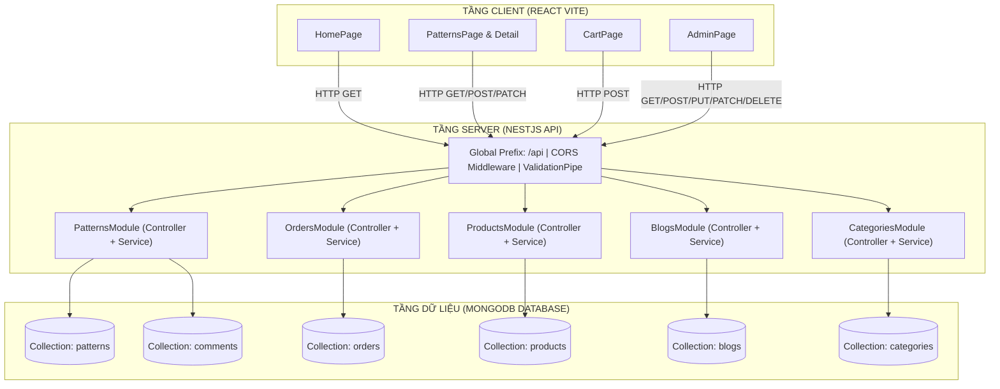

---

### IV.2 System High-Level Design (Client - Server Architecture)

Hệ thống được thiết kế theo phong cách kiến trúc **Client - Server hiện đại**:

1. **Frontend (Client Application):**
   - Công nghệ: React 18, Vite bundler, TypeScript.
   - Thư viện UI: Ant Design v5 với tùy biến Theme màu hồng phấn pastel (`#ff6584`), thân thiện với cộng đồng thủ công.
   - Quản trị State: React Hooks (`useState`, `useEffect`), Context API (`CartContext`) để duy trì giỏ hàng xuyên suốt phiên duyệt web và đồng bộ `localStorage`.
   - Giao tiếp Backend: Thư viện `Axios` với cấu hình Base URL và interceptors xử lý lỗi tập trung.
2. **Backend (Server Application):**
   - Công nghệ: NestJS v10 framework chạy trên nền tảng Node.js.
   - Nguyên tắc thiết kế: Dependency Injection (DI), Single Responsibility Principle (Mỗi module chịu trách nhiệm một domain độc lập).
   - Middleware: Cấu hình CORS cho phép nguồn từ client (`http://localhost:5173`), Global Validation Pipe tự động chuẩn hóa DTO.
3. **Database (Persistence Layer):**
   - Cơ sở dữ liệu: MongoDB (NoSQL Document Store).
   - Trình kết nối ODM: `@nestjs/mongoose` và `mongoose` v8.

---

### IV.3 Component and Package Diagram

#### IV.3.1 Component Diagram

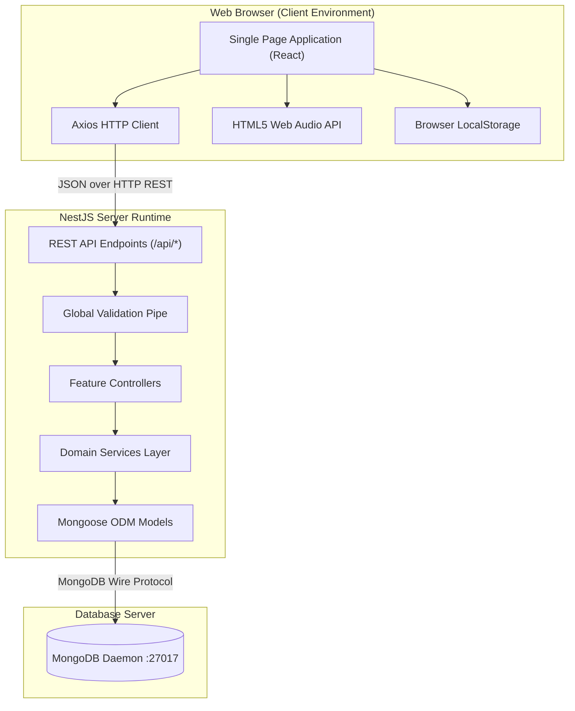

---

#### IV.3.2 Package Diagram & Descriptions

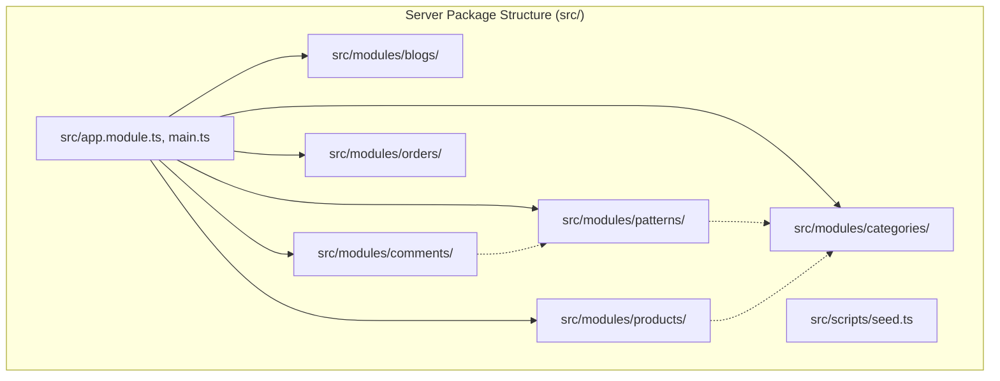

##### Bảng Mô Tả Gói (Package Descriptions)

| No | Package        | Thư Mục Vật Lý                 | Mô Tả Trách Nhiệm                                                                                                        |
| :-: | :------------- | :--------------------------------- | :--------------------------------------------------------------------------------------------------------------------------- |
| 01 | `core`       | `server/src/`                    | Chứa `main.ts` cấu hình khởi chạy, CORS, Global Prefix và `app.module.ts` kết nối MongoDB qua `ConfigService`. |
| 02 | `categories` | `server/src/modules/categories/` | Quản lý danh mục phân loại cho chart và phụ kiện (`pattern`, `product`).                                         |
| 03 | `patterns`   | `server/src/modules/patterns/`   | Quản lý toàn bộ thông tin mẫu chart, lọc độ khó, regex search, tăng view/like và DTO validation.                 |
| 04 | `products`   | `server/src/modules/products/`   | Quản lý phụ kiện len sợi, kim móc, tồn kho và danh mục sản phẩm.                                                  |
| 05 | `blogs`      | `server/src/modules/blogs/`      | Quản lý bài viết cẩm nang kỹ thuật đan móc và truy vấn slug thân thiện SEO.                                     |
| 06 | `comments`   | `server/src/modules/comments/`   | Quản lý đánh giá số sao (1-5 sao) và nhận xét của người dùng gắn với từng mẫu chart.                        |
| 07 | `orders`     | `server/src/modules/orders/`     | Quản lý đơn đặt hàng, sinh mã `ORD-xxxx`, tra cứu theo SĐT và luồng chuyển trạng thái đơn hàng.          |
| 08 | `scripts`    | `server/src/scripts/`            | Chứa `seed.ts` nạp tự động dữ liệu mẫu chuẩn chỉ vào MongoDB khi khởi tạo dự án.                            |

---

### IV.4 Implementation Class Diagrams

Dưới đây là sơ đồ chi tiết mối quan hệ giữa Controller, Service, DTO và Mongoose Schema của các phân hệ chính:

#### Implementation Class Diagram: Phân Hệ Kho Chart (Patterns Feature)

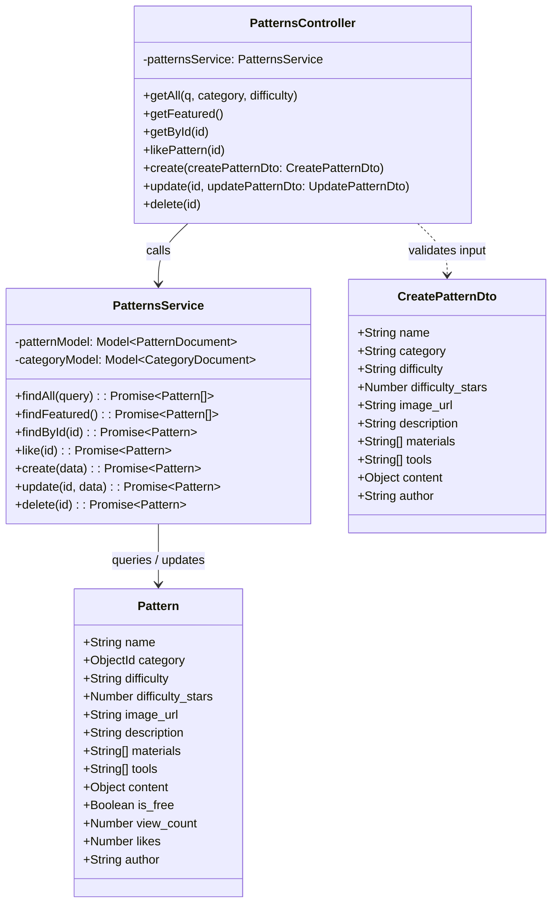

#### Implementation Class Diagram: Phân Hệ Đơn Hàng (Orders Feature)

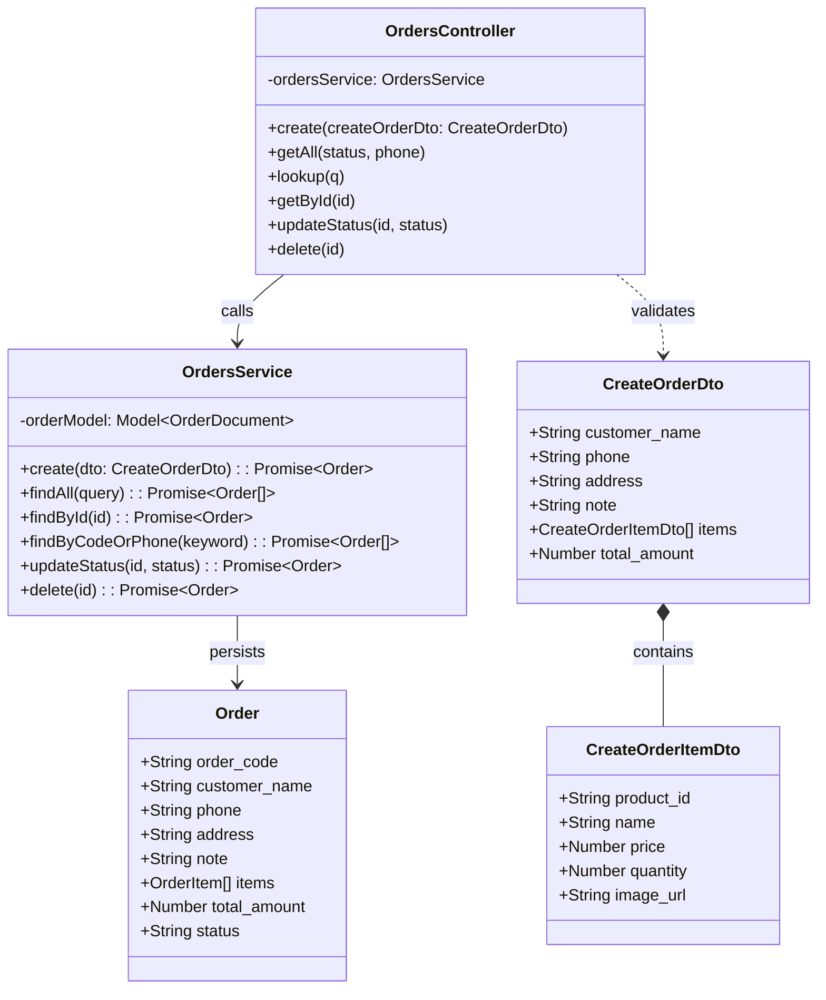

---

### IV.5 Database Design (MongoDB / Mongoose ODM)

Cơ sở dữ liệu NoSQL MongoDB được thiết kế gồm **06 Collections** tối ưu cho việc truy vấn lồng (Embedding) và tham chiếu (Referencing):

#### 1. Collection: `categories` (Danh Mục Hệ Thống)

| Tên Thuộc Tính | Kiểu Dữ Liệu | Ràng Buộc                      | Khóa / Chỉ Mục | Ý Nghĩa / Ví Dụ                        |
| :---------------- | :-------------- | :------------------------------- | :---------------: | :----------------------------------------- |
| `_id`           | ObjectId        | Auto-generated                   |        PK        | Khóa chính bản ghi danh mục            |
| `name`          | String          | Required, Trim                   |   Unique Index   | Tên danh mục (VD: 'Rau Củ', 'Len Sợi') |
| `slug`          | String          | Required, Trim                   |   Unique Index   | URL slug (VD: 'rau-cu', 'len-soi')         |
| `type`          | String          | Enum: `['pattern', 'product']` |       Index       | Phân loại danh mục Chart hay Phụ kiện |
| `description`   | String          | Optional, Default: ''            |                  | Mô tả chi tiết danh mục                |
| `icon`          | String          | Optional, Default: ''            |                  | Icon biểu tượng (VD: '🥦', '🧶')        |
| `createdAt`     | Date            | Auto-timestamp                   |                  | Thời điểm tạo bản ghi                 |
| `updatedAt`     | Date            | Auto-timestamp                   |                  | Thời điểm cập nhật cuối              |

---

#### 2. Collection: `patterns` (Kho Chart Móc Len)

| Tên Thuộc Tính    | Kiểu Dữ Liệu | Ràng Buộc                       | Khóa / Chỉ Mục | Ý Nghĩa / Ví Dụ                                             |
| :------------------- | :-------------- | :-------------------------------- | :---------------: | :-------------------------------------------------------------- |
| `_id`              | ObjectId        | Auto-generated                    |        PK        | Khóa chính mẫu chart                                         |
| `name`             | String          | Required, Trim                    |    Text Index    | Tên mẫu chart (VD: 'Bé Súp Lơ Tóc Xù')                   |
| `category`         | ObjectId        | Required, Ref: `Category`       |     FK Index     | Tham chiếu sang bảng `categories`                           |
| `difficulty`       | String          | Enum: `['Dễ', 'Vừa', 'Khó']` |       Index       | Phân cấp độ khó cho thợ móc                              |
| `difficulty_stars` | Number          | Min: 1, Max: 5, Default: 2        |                  | Số sao hiển thị tương ứng                                 |
| `image_url`        | String          | Required                          |                  | Đường dẫn ảnh mẫu thành phẩm                            |
| `description`      | String          | Default: ''                       |    Text Index    | Đoạn văn mô tả đặc điểm mẫu móc                      |
| `materials`        | Array~String~   | Default: `[]`                   |       Index       | Danh sách len và nguyên liệu cần có                       |
| `tools`            | Array~String~   | Default: `[]`                   |                  | Danh sách dụng cụ (size kim móc, kéo...)                   |
| `content`          | Mixed Object    | Default: `{}`                   |                  | Các bước móc chi tiết: `{ "Đầu": ["R1...", "R2..."] }` |
| `is_free`          | Boolean         | Default: `true`                 |                  | Đánh dấu chart miễn phí                                    |
| `view_count`       | Number          | Min: 0, Default: 0                |   Index (sort)   | Số lượt xem mẫu chart (tăng qua `$inc`)                  |
| `likes`            | Number          | Min: 0, Default: 0                |   Index (sort)   | Số lượt thả tim (tăng qua `$inc`)                        |
| `author`           | String          | Default: 'Tiệm Len Xinh'         |                  | Tên tác giả / thợ dịch chart                               |

---

#### 3. Collection: `products` (Phụ Kiện & Dụng Cụ Len)

| Tên Thuộc Tính  | Kiểu Dữ Liệu | Ràng Buộc                                         | Khóa / Chỉ Mục | Ý Nghĩa / Ví Dụ                          |
| :----------------- | :-------------- | :-------------------------------------------------- | :---------------: | :------------------------------------------- |
| `_id`            | ObjectId        | Auto-generated                                      |        PK        | Khóa chính sản phẩm phụ kiện           |
| `name`           | String          | Required, Trim                                      |    Text Index    | Tên sản phẩm (VD: 'Set len Milk Bò 50g') |
| `category`       | ObjectId        | Required, Ref: `Category`                         |     FK Index     | Tham chiếu sang danh mục phụ kiện        |
| `price`          | Number          | Required, Min: 0                                    |   Index (sort)   | Giá bán thực tế (VNĐ)                   |
| `original_price` | Number          | Min: 0, Default: 0                                  |                  | Giá niêm yết ban đầu                    |
| `image_url`      | String          | Required                                            |                  | Ảnh chụp sản phẩm                        |
| `stock_status`   | String          | Enum: `['Còn hàng', 'Sắp hết', 'Hết hàng']` |       Index       | Trạng thái tồn kho                        |
| `short_desc`     | String          | Default: ''                                         |                  | Mô tả ngắn gọn tính năng               |
| `description`    | String          | Default: ''                                         |                  | Bài viết chi tiết công dụng sản phẩm  |
| `rating`         | Number          | Min: 0, Max: 5, Default: 5                          |                  | Điểm đánh giá chất lượng             |

---

#### 4. Collection: `orders` (Đơn Hàng Phụ Kiện)

| Tên Thuộc Tính    | Kiểu Dữ Liệu | Ràng Buộc                                                              | Khóa / Chỉ Mục | Ý Nghĩa / Ví Dụ                                  |
| :------------------- | :-------------- | :----------------------------------------------------------------------- | :---------------: | :--------------------------------------------------- |
| `_id`              | ObjectId        | Auto-generated                                                           |        PK        | Khóa chính đơn hàng                             |
| `order_code`       | String          | Required, Unique                                                         |   Unique Index   | Mã tra cứu đơn tự sinh (VD: `ORD-882194`)     |
| `customer_name`    | String          | Required, Trim                                                           |                  | Họ tên người nhận hàng                         |
| `phone`            | String          | Required, Trim                                                           |       Index       | Số điện thoại nhận hàng (dùng tra cứu đơn) |
| `address`          | String          | Required, Trim                                                           |                  | Địa chỉ nhận bưu phẩm chi tiết                |
| `note`             | String          | Optional, Default: ''                                                    |                  | Ghi chú dặn dò shipper                            |
| `items`            | Array~SubDoc~   | Required, Min 1 item                                                     |     Embedded     | Danh sách sản phẩm con đặt mua (Sub-document)   |
| `items.product_id` | ObjectId        | Required, Ref: `Product`                                               |                  | ID sản phẩm gốc                                   |
| `items.name`       | String          | Required                                                                 |                  | Tên sản phẩm tại thời điểm đặt              |
| `items.price`      | Number          | Required, Min: 0                                                         |                  | Đơn giá tại thời điểm đặt                   |
| `items.quantity`   | Number          | Required, Min: 1                                                         |                  | Số lượng đặt mua                                |
| `items.image_url`  | String          | Default: ''                                                              |                  | Ảnh thumbnail sản phẩm                            |
| `total_amount`     | Number          | Required, Min: 0                                                         |                  | Tổng tiền thanh toán (VNĐ)                       |
| `status`           | String          | Enum: `['Chờ xác nhận', 'Đang xử lý', 'Đã giao', 'Đã hủy']` |       Index       | Trạng thái chu trình xử lý đơn                |

---

#### 5. Collection: `comments` (Bình Luận & Đánh Giá Chart)

| Tên Thuộc Tính | Kiểu Dữ Liệu | Ràng Buộc                | Khóa / Chỉ Mục | Ý Nghĩa / Ví Dụ                             |
| :---------------- | :-------------- | :------------------------- | :---------------: | :---------------------------------------------- |
| `_id`           | ObjectId        | Auto-generated             |        PK        | Khóa chính bình luận                        |
| `pattern_id`    | ObjectId        | Required, Ref: `Pattern` |     FK Index     | Tham chiếu tới mẫu chart được đánh giá |
| `author_name`   | String          | Required, Trim             |                  | Tên người gửi nhận xét                    |
| `avatar`        | String          | Default: Dicebear URL      |                  | Link avatar hoạt hình sinh tự động         |
| `rating`        | Number          | Required, Min: 1, Max: 5   |                  | Số sao chấm điểm (1 - 5 sao)                |
| `content`       | String          | Required, Trim             |                  | Nội dung cảm nhận sau khi móc               |
| `verified`      | Boolean         | Default: `true`          |                  | Đánh dấu người dùng thật                 |

---

#### 6. Collection: `blogs` (Cẩm Nang & Mẹo Đan Móc)

| Tên Thuộc Tính | Kiểu Dữ Liệu | Ràng Buộc              | Khóa / Chỉ Mục | Ý Nghĩa / Ví Dụ                                        |
| :---------------- | :-------------- | :----------------------- | :---------------: | :--------------------------------------------------------- |
| `_id`           | ObjectId        | Auto-generated           |        PK        | Khóa chính bài viết                                    |
| `title`         | String          | Required, Trim           |    Text Index    | Tiêu đề bài viết cẩm nang                            |
| `slug`          | String          | Required, Trim, Unique   |   Unique Index   | Đường dẫn thân thiện SEO (VD: `meo-giau-len-thua`) |
| `excerpt`       | String          | Required                 |                  | Tóm tắt ngắn nội dung bài viết                       |
| `content`       | String          | Required                 |                  | Nội dung toàn văn bài hướng dẫn                     |
| `image_url`     | String          | Required                 |                  | Ảnh bìa bài viết                                       |
| `author`        | String          | Default: 'Bảo Vy'       |                  | Tên tác giả bài viết                                  |
| `read_time`     | String          | Default: '5 phút đọc' |                  | Thời lượng ước tính để đọc                       |
| `category`      | String          | Default: 'Mẹo hay'      |       Index       | Phân loại chủ đề mẹo đan móc                       |
| `views`         | Number          | Min: 0, Default: 0       |                  | Lượt đọc bài viết (tự tăng qua `$inc`)           |

---

## V. IMPLEMENTATION

### V.1 Map Architecture to the Structure of the Project

Mã nguồn dự án phản ánh trực tiếp kiến trúc Client - Server đã đặc tả:

```
SDN-CraftYarnHub/
├── server/                                 # [SERVER COMPONENT]
│   ├── src/
│   │   ├── main.ts                         # Bootstrap, Global ValidationPipe, CORS, Prefix /api
│   │   ├── app.module.ts                   # Root Module, MongooseModule async connection
│   │   ├── modules/
│   │   │   ├── categories/                 # Categories Domain
│   │   │   │   ├── schemas/category.schema.ts
│   │   │   │   ├── categories.service.ts
│   │   │   │   ├── categories.controller.ts
│   │   │   │   └── categories.module.ts
│   │   │   ├── patterns/                   # Patterns Domain (Full CRUD + $inc)
│   │   │   │   ├── schemas/pattern.schema.ts
│   │   │   │   ├── dto/create-pattern.dto.ts, update-pattern.dto.ts
│   │   │   │   ├── patterns.service.ts
│   │   │   │   ├── patterns.controller.ts
│   │   │   │   └── patterns.module.ts
│   │   │   ├── products/                   # Products Domain (Full CRUD)
│   │   │   │   ├── schemas/product.schema.ts
│   │   │   │   ├── products.service.ts
│   │   │   │   ├── products.controller.ts
│   │   │   │   └── products.module.ts
│   │   │   ├── orders/                     # Orders Domain (Sub-document & Status Workflow)
│   │   │   │   ├── schemas/order.schema.ts
│   │   │   │   ├── dto/create-order.dto.ts
│   │   │   │   ├── orders.service.ts
│   │   │   │   ├── orders.controller.ts
│   │   │   │   └── orders.module.ts
│   │   │   ├── comments/                   # Comments Domain
│   │   │   │   ├── schemas/comment.schema.ts
│   │   │   │   ├── dto/create-comment.dto.ts
│   │   │   │   ├── comments.service.ts
│   │   │   │   └── comments.controller.ts
│   │   │   └── blogs/                      # Blogs Domain (Slug search)
│   │   │       ├── schemas/blog.schema.ts
│   │   │       ├── blogs.service.ts
│   │   │       └── blogs.controller.ts
│   │   └── scripts/seed.ts                 # Database Seeder (Real data into MongoDB)
│
└── client/                                 # [CLIENT COMPONENT]
    ├── src/
    │   ├── App.tsx                         # Router root, Theme Provider Ant Design
    │   ├── context/CartContext.tsx         # Shopping Cart State & LocalStorage Synchronization
    │   ├── services/                       # Axios API Services Layer
    │   │   ├── api.ts                      # Axios instance with Base URL
    │   │   ├── patterns.service.ts
    │   │   ├── products.service.ts
    │   │   ├── orders.service.ts
    │   │   ├── categories.service.ts
    │   │   ├── comments.service.ts
    │   │   └── blogs.service.ts
    │   ├── components/                     # Reusable UI Components
    │   │   ├── Navbar.tsx, Footer.tsx
    │   │   ├── PatternCard.tsx, ProductCard.tsx
    │   │   └── RowCounter.tsx              # Web Audio API + LocalStorage state
    │   └── pages/                          # Screen Views
    │       ├── HomePage.tsx
    │       ├── PatternsPage.tsx, PatternDetailPage.tsx
    │       ├── AccessoriesPage.tsx, ProductDetailPage.tsx
    │       ├── CartPage.tsx
    │       ├── BlogPage.tsx, BlogDetailPage.tsx
    │       └── AdminPage.tsx               # Ant Design Table Management Dashboard
```

---

### V.2 Map Class Diagram and Interaction Diagram to Code

#### Minh Họa 1: Ánh Xạ Logic Tăng Lượt Xem & Like Atomic (Pattern Interaction)

- **Thiết kế Sequence Diagram:** Gửi request `GET /patterns/:id` hoặc `PATCH /patterns/:id/like` $\rightarrow$ Tăng trường dữ liệu trực tiếp tại database engine.
- **Code Triển Khai (`server/src/modules/patterns/patterns.service.ts`):**

```typescript
async findById(id: string): Promise<Pattern> {
  if (!Types.ObjectId.isValid(id)) {
    throw new NotFoundException('ID Chart không hợp lệ');
  }
  // Áp dụng toán tử atomic $inc để tăng view_count mà không bị race-condition
  const pattern = await this.patternModel
    .findByIdAndUpdate(id, { $inc: { view_count: 1 } }, { new: true })
    .populate('category')
    .exec();

  if (!pattern) throw new NotFoundException('Không tìm thấy Chart móc len này');
  return pattern;
}

async like(id: string): Promise<Pattern> {
  if (!Types.ObjectId.isValid(id)) {
    throw new NotFoundException('ID Chart không hợp lệ');
  }
  // Tăng like trực tiếp tại MongoDB engine
  const pattern = await this.patternModel
    .findByIdAndUpdate(id, { $inc: { likes: 1 } }, { new: true })
    .populate('category')
    .exec();

  if (!pattern) throw new NotFoundException('Không tìm thấy Chart');
  return pattern;
}
```

#### Minh Họa 2: Ánh Xạ Logic Tạo Đơn Hàng Sub-Document (`OrdersService`)

- **Thiết kế Use Case UC-07:** Kiểm tra giỏ hàng, sinh mã `ORD-xxxx`, nhúng danh sách món và lưu vào database.
- **Code Triển Khai (`server/src/modules/orders/orders.service.ts`):**

```typescript
async create(dto: CreateOrderDto): Promise<Order> {
  if (!dto.items || dto.items.length === 0) {
    throw new BadRequestException('Giỏ hàng trống, không thể tạo đơn hàng');
  }

  // Sinh mã đơn hàng tự động duy nhất (BR-03)
  const randomSuffix = Math.floor(1000 + Math.random() * 9000);
  const orderCode = `ORD-${Date.now().toString().slice(-4)}${randomSuffix}`;

  // Mapping mảng sản phẩm dạng Embedded Sub-document
  const formattedItems = dto.items.map((item) => ({
    product_id: new Types.ObjectId(item.product_id),
    name: item.name,
    price: item.price,
    quantity: item.quantity,
    image_url: item.image_url || '',
  }));

  const newOrder = new this.orderModel({
    order_code: orderCode,
    customer_name: dto.customer_name.trim(),
    phone: dto.phone.trim(),
    address: dto.address.trim(),
    note: dto.note ? dto.note.trim() : '',
    items: formattedItems,
    total_amount: dto.total_amount,
    status: 'Chờ xác nhận',
  });

  return newOrder.save();
}
```

#### Minh Họa 3: Ánh Xạ Trợ Lý Đếm Hàng Web Audio API (`RowCounter.tsx`)

- **Thiết kế Activity Diagram:** Bấm nút $\rightarrow$ Phát tần số âm thanh sine $\rightarrow$ Tăng dòng $\rightarrow$ Lưu `localStorage`.
- **Code Triển Khai (`client/src/components/RowCounter.tsx`):**

```typescript
export const RowCounter: React.FC<{ maxRows?: number; patternId?: string }> = ({
  patternId,
}) => {
  const storageKey = patternId ? `crochet_row_${patternId}` : 'crochet_row_default';

  // Khôi phục tiến độ từ LocalStorage
  const [count, setCount] = useState<number>(() => {
    try {
      const saved = localStorage.getItem(storageKey);
      return saved ? parseInt(saved, 10) : 1;
    } catch {
      return 1;
    }
  });

  useEffect(() => {
    try {
      localStorage.setItem(storageKey, count.toString());
    } catch (e) {}
  }, [count, storageKey]);

  // Phát âm thanh bíp pop bằng Web Audio API thuần (Không cần tải file ngoài)
  const playBeep = (freq = 600) => {
    try {
      const AudioCtx = window.AudioContext || (window as any).webkitAudioContext;
      if (AudioCtx) {
        const ctx = new AudioCtx();
        const osc = ctx.createOscillator();
        const gain = ctx.createGain();
        osc.type = 'sine';
        osc.frequency.setValueAtTime(freq, ctx.currentTime);
        gain.gain.setValueAtTime(0.1, ctx.currentTime);
        gain.gain.exponentialRampToValueAtTime(0.001, ctx.currentTime + 0.15);
        osc.connect(gain);
        gain.connect(ctx.destination);
        osc.start();
        osc.stop(ctx.currentTime + 0.15);
      }
    } catch (e) {}
  };

  const handleIncrement = () => {
    setCount((prev) => {
      const next = prev + 1;
      playBeep(750); // Bíp cao khi tăng hàng
      return next;
    });
  };
  // ...
};
```

---

## VI. APPLYING ALTERNATIVE ARCHITECTURE PATTERNS

### VI.1 Applying Service-Oriented Architecture (SOA) / Microservices

#### 1. Vấn Đề Khi Quy Mô Hệ Thống Mở Rộng (Problem Identification)

Hiện tại, hệ thống CraftYarnHub được đóng gói dưới dạng Monolithic Backend (Tất cả module Patterns, Orders, Products, Blogs cùng chia sẻ một tiến trình Node.js và một kết nối MongoDB).
Khi số lượng người dùng tăng đột biến (ví dụ trong các đợt flash-sale phụ kiện len hoặc khi một mẫu chart viral trên mạng xã hội):

- Lưu lượng duyệt chart khổng lồ có thể làm cạn kiệt tài nguyên CPU/RAM của tiến trình server, gây nghẽn luôn luồng đặt hàng và thanh toán.
- Đội ngũ phát triển gặp khó khăn khi triển khai độc lập (Deployment coupling): Sửa module Blog cũng phải deploy lại toàn bộ server.

#### 2. Giải Pháp Tái Cấu Trúc Hướng Dịch Vụ (SOA / Microservices Solution)

Tách hệ thống thành các dịch vụ độc lập giao tiếp qua giao thức HTTP RESTful hoặc Message Queue (RabbitMQ / Kafka):

1. **API Gateway Service:** Tiếp nhận toàn bộ request từ Client React, làm nhiệm vụ Reverse Proxy, Rate Limiting, Authentication và điều hướng request.
2. **Catalog & Pattern Service:** Chịu trách nhiệm quản lý Kho Chart, Đánh giá và Danh mục (Đọc nhiều, sử dụng Redis Cache để tăng tốc).
3. **Product & Inventory Service:** Quản lý số lượng tồn kho phụ kiện và giá bán sản phẩm.
4. **Ordering & Fulfillment Service:** Tiếp nhận và xử lý đơn hàng, điều phối trạng thái giao vận.
5. **Notification Service:** Lắng nghe sự kiện `OrderCreated` để gửi tin nhắn SMS / Email xác nhận đơn cho khách hàng qua cơ chế hướng sự kiện (Event-Driven).

#### 3. Sơ Đồ Kiến Trúc Đề Xuất (SOA Deployment Diagram)

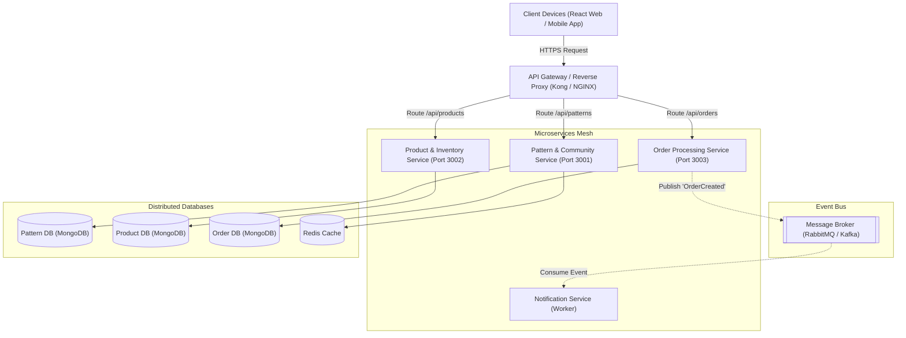

---

### VI.2 Applying Service Discovery Pattern

#### 1. Yêu Cầu Đặt Ra (Problem & Requirement)

Trong kiến trúc phân tán nhiều dịch vụ (Microservices), các phiên bản (instances) của `Order Service` hay `Pattern Service` có thể tự động tăng giảm linh hoạt (Auto-scaling trên Kubernetes hoặc Docker Swarm). Địa chỉ IP và Port của từng instance thay đổi liên tục, khiến API Gateway hoặc các service khác không thể cấu hình cứng (hard-code) địa chỉ IP của nhau.

#### 2. Tích Hợp Mẫu Thiết Kế Service Discovery

Hệ thống áp dụng mẫu **Service Discovery Pattern** kết hợp với **Service Registry** (ví dụ: Netflix Eureka, HashiCorp Consul hoặc Kubernetes CoreDNS):

- **Service Registration (Tự Đăng Ký):** Khi một service instance khởi động, nó tự động gửi thông tin (Tên dịch vụ, IP, Port, Health check URL) lên Service Registry.
- **Heartbeat Check (Kiểm Tra Sức Khỏe):** Service định kỳ gửi tín hiệu "nhịp tim" (heartbeat) lên Registry. Nếu service bị crash, Registry tự động gỡ bỏ instance đó khỏi danh sách sẵn sàng.
- **Service Discovery (Khám Phá Dịch Vụ):** Khi API Gateway cần chuyển tiếp request tới `Order Service`, nó truy vấn Registry để lấy danh sách các IP đang hoạt động và áp dụng thuật toán cân bằng tải (Client-side / Server-side Load Balancing như Round-Robin).

#### 3. Sơ Đồ Khám Phá Dịch Vụ (Service Discovery Diagram)

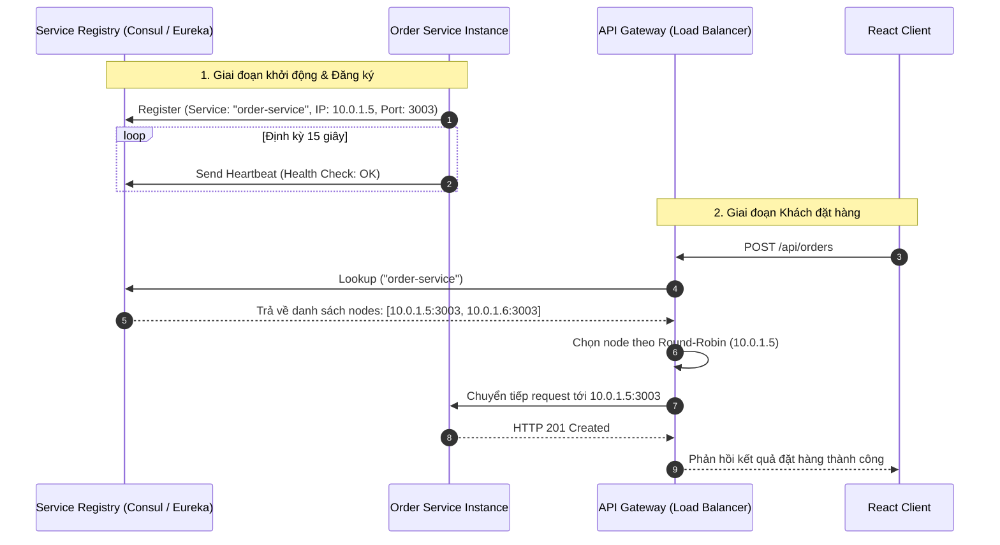

---

## VII. KẾT LUẬN & ĐÁNH GIÁ TỔNG KẾT

Báo cáo dự án **CraftYarnHub** đã trình bày một cách toàn diện từ giai đoạn khảo sát yêu cầu, mô hình hóa phân tích, thiết kế kiến trúc hệ thống Client - Server, đặc tả cơ sở dữ liệu MongoDB đến việc cài đặt mã nguồn thực tế và đề xuất kiến trúc mở rộng SOA:

1. **Tính hoàn chỉnh:** Dự án đáp ứng 100% các tiêu chí của môn học **SDN302**: Không sử dụng mock data, cấu trúc NestJS module hóa tường minh, chuẩn hóa RESTful API, validation chặt chẽ và tương tác người dùng mượt mà trên nền tảng React Vite.
2. **Tính ứng dụng cao:** Sản phẩm giải quyết trực tiếp nhu cầu có thật của cộng đồng đan móc len với các tính năng sáng tạo như trợ lý đếm hàng có âm thanh và lưu trữ trạng thái cục bộ.
3. **Sự phối hợp nhóm cân bằng:** Cả 3 thành viên đều tham gia phát triển theo chiều dọc (Full-stack theo feature module), đảm bảo sự cân bằng khối lượng công việc và tính làm chủ mã nguồn cao nhất khi bảo vệ đồ án.
