# COURSE PROJECT REPORT

**Subject:** SDN302 – Server-side Development with NodeJS, Express & MongoDB
**Project Name:** CraftYarnHub – Crochet Chart Management & Accessories Platform
**Project Code:** SDN-CYH
**Academic Institution:** FPT University
**Date:** November 2026
**Document Version:** 1.0 Final

---

## RECORD OF CHANGES

| Date       | A / M / D\* | In Charge       | Change Description                                              |  Version  |
| :--------- | :---------: | :-------------- | :-------------------------------------------------------------- | :-------: |
| 02/11/2026 |      A      | Đinh Thị Thu Trang (Lead)             | Initial project setup, core database schemas definition         |    0.1    |
| 05/11/2026 |      A      | Nguyễn Thị Thắm                       | Implement Products catalog, shopping cart client state          |    0.4    |
| 08/11/2026 |      A      | Nguyễn Minh Đức                       | Implement Blogs module, Categories CRUD, Admin UI structure     |    0.7    |
| 10/11/2026 |      M      | Đinh Thị Thu Trang & Nguyễn Thị Thắm  | Implement real Orders module (NestJS + MongoDB), replace mockup |    0.9    |
| 10/11/2026 |      A      | All Members     | Consolidate full Course Project Report documentation            | 1.0 Final |

*\*A: Added, M: Modified, D: Deleted*

---

## I. OVERVIEW (VISION AND SCOPE)

### I.1 Project Information

- **Project Name:** CraftYarnHub (Tiệm Len Xinh)
- **Project Code:** SDN-CYH
- **Subject:** SDN302 – Server-side Development with NodeJS, Express & MongoDB
- **Class Group:** SE17xx / SDN302
- **Software Type:** Web Application (Single Page Application Client + RESTful API Backend Server)

### I.2 Project Team

| No | Full Name                | Student ID |           Project Role           | Responsibilities                                                                                                                             |
| :-: | :----------------------- | :--------: | :-------------------------------: | :------------------------------------------------------------------------------------------------------------------------------------------- |
| 1 | **Đinh Thị Thu Trang**   |  HE195077  | **Leader (Fullstack Lead)**       | **Core Pattern & Community:** Patterns CRUD, Regex search & filter, $inc view/like, Comments module, RowCounter widget, Home showcase. |
| 2 | **Nguyễn Thị Thắm**      |  HE191525  |  **Developer (Fullstack)**        | **E-Commerce & Orders:** Products CRUD, Shopping Cart context, Orders module (schema, auto-code, status workflow, lookup).             |
| 3 | **Nguyễn Minh Đức**      |  HE194336  |  **Developer (Fullstack)**        | **Knowledge & Administration:** Blogs CRUD, Categories CRUD, Validation Pipe configuration, Admin Management Dashboard (`/admin`).   |

### I.3 Business Opportunity and Objectives

1. **Background:**Nghệ thuật đan móc len thủ công (Crochet & Amigurumi) ngày càng phát triển mạnh mẽ trong giới trẻ. Tuy nhiên, người học móc len hiện gặp nhiều trở ngại:
   - Các mẫu chart (hướng dẫn từng vòng móc) thường rải rác trên mạng xã hội dưới dạng hình ảnh chất lượng thấp, khó tra cứu.
   - Khi thực hành, thợ móc rất dễ quên số hàng đang móc dang dở nếu không có công cụ ghi nhớ.
   - Việc tìm mua đúng chủng loại len, size kim móc phù hợp với mẫu chart tốn nhiều thời gian.
2. **Business Objectives:**
   - **BO-1:** Xây dựng một cổng thông tin tập trung cung cấp 100% chart móc len miễn phí, phân cấp rõ ràng theo độ khó và danh mục.
   - **BO-2:** Tích hợp trợ lý kỹ thuật số (Row Counter) đếm hàng trực quan, có âm thanh và lưu vết tiến độ.
   - **BO-3:** Cung cấp gian hàng phụ kiện chính hãng kèm quy trình đặt hàng tinh gọn, tra cứu đơn nhanh chóng bằng số điện thoại.
   - **BO-4:** Xây dựng hệ thống quản trị dữ liệu (Admin Panel) đơn giản, minh bạch giúp người vận hành quản lý sản phẩm, bài viết và xử lý đơn hàng hiệu quả.

### I.4 Project Priorities

| Dimension              |   Constraint (Bắt buộc)   |              Driver (Ưu tiên tối đa)              |     Degree of Freedom (Được điều chỉnh)     |
| :--------------------- | :--------------------------: | :----------------------------------------------------: | :------------------------------------------------: |
| **Schedule**     | Deadline kết thúc học kỳ |                                                        |                                                    |
| **Features**     |                              |    Chuẩn RESTful API, Full CRUD, Không Mock Data    | Phạm vi tích hợp cổng thanh toán bên thứ ba |
| **Quality**      |                              | Đạt chuẩn phản hồi < 300ms, Validation chặt chẽ |                                                    |
| **Cost / Staff** |        03 Sinh viên        |                                                        |                                                    |

---

---

## MỤC LỤC TỔNG HỢP TOÀN BỘ BÁO CÁO (CONSOLIDATED TOC)

- [RECORD OF CHANGES (LỊCH SỬ THAY ĐỔI)](#record-of-changes)
- [I. OVERVIEW (VISION AND SCOPE - TỔNG QUAN DỰ ÁN)](#i-overview-vision-and-scope)
  - [I.1 Project Information](#i1-project-information)
  - [I.2 Project Team & Responsibility Breakdown (3 Thành Viên)](#i2-project-team)
  - [I.3 Business Opportunity and Objectives (BO-1 đến BO-4)](#i3-business-opportunity-and-objectives)
  - [I.4 Project Priorities Matrix](#i4-project-priorities)
- [II. REQUIREMENT SPECIFICATION (SRS - ĐẶC TẢ YÊU CẦU TOÀN DIỆN)](#ii-requirement-specification)
  - [II.1 Problem Description](#ii1-problem-description)
  - [II.2 Major Features (FE-01 đến FE-07)](#ii2-major-features)
  - [II.3 Context Diagram (DIA-01)](#ii3-context-diagram)
  - [II.4 Non-Functional Requirements (NFR-01 đến NFR-06)](#ii4-non-functional-requirements-nfr)
  - [II.5 Business Rules (BR-01 đến BR-08)](#ii5-business-rules)
  - [II.6 Functional Requirements](#ii6-functional-requirements)
    - [II.6.1 Actors (Visitor, Customer, Administrator)](#ii61-actors)
    - [II.6.2 System Use Case Diagram (DIA-02)](#ii62-use-case-diagrams)
    - [II.6.3 Đặc Tả Chi Tiết Toàn Bộ 16 Use Cases (Dạng Bảng Chuẩn 15 Dòng Karl Wiegers)](#ii63-đặc-tả-chi-tiết-toàn-bộ-16-use-cases-dạng-bảng-chuẩn-15-dòng-karl-wiegers)
    - [II.6.4 Activity Diagrams (DIA-06 & DIA-07)](#ii64-activity-diagrams)
- [III. ANALYSIS MODELS (CÁC MÔ HÌNH PHÂN TÍCH)](#iii-analysis-models)
  - [III.1 High-Level Class Diagram (Structural Model - DIA-09)](#iii1-high-level-class-diagram-structural-model)
  - [III.2 Interaction Diagrams (Sequence Diagrams DIA-03, DIA-04, DIA-05)](#iii2-interaction-diagrams)
  - [III.3 State Machine Diagram (Order Lifecycle - DIA-08)](#iii3-state-machine-diagram-behavioral-model)
- [IV. DESIGN SPECIFICATION (THIẾT KẾ KIẾN TRÚC & CSDL)](#iv-design-specification)
  - [IV.1 Integrated Communication Diagrams](#iv1-integrated-communication-diagrams)
  - [IV.2 System High-Level Design (Client - Server Architecture)](#iv2-system-high-level-design-client---server-architecture)
  - [IV.3 Component and Package Diagram (DIA-10)](#iv3-component-and-package-diagram)
  - [IV.4 Implementation Class Diagrams](#iv4-implementation-class-diagrams)
  - [IV.5 Thiết Kế Cơ Sở Dữ Liệu MongoDB & Mongoose Schema Toàn Diện (DIA-11, 6 Collections)](#iv5-thiết-kế-cơ-sở-dữ-liệu-mongodb--mongoose-schema-toàn-diện)
- [V. IMPLEMENTATION (HIỆN THỰC HÓA MÃ NGUỒN)](#v-implementation)
  - [V.1 Map Architecture to the Structure of the Project](#v1-map-architecture-to-the-structure-of-the-project)
  - [V.2 Map Class Diagram and Interaction Diagram to Code ($inc, Sub-document, Web Audio)](#v2-map-class-diagram-and-interaction-diagram-to-code)
- [VI. APPLYING ALTERNATIVE ARCHITECTURE PATTERNS (KIẾN TRÚC NÂNG CAO)](#vi-applying-alternative-architecture-patterns)
  - [VI.1 Applying Service-Oriented Architecture (SOA) / Microservices (DIA-12)](#vi1-applying-service-oriented-architecture-soa--microservices)
  - [VI.2 Applying Service Discovery Pattern (DIA-13)](#vi2-applying-service-discovery-pattern)
- [VII. DANH MỤC RESTFUL API & TÀI NGUYÊN SƠ ĐỒ HỆ THỐNG](#vii-danh-mục-restful-api--tài-nguyên-sơ-đồ-hệ-thống)
  - [VII.1 Danh Mục RESTful API Đầy Đủ](#vii1-danh-mục-restful-api-đầy-đủ)
  - [VII.2 Danh Mục 13 Sơ Đồ Hệ Thống Đính Kèm (PNG, SVG, MMD)](#vii2-danh-mục-13-sơ-đồ-hệ-thống-đính-kèm-tệp-ảnh-png-vector-svg--mã-nguồn)
- [VIII. KẾT LUẬN & ĐÁNH GIÁ TỔNG KẾT (CONCLUSION)](#viii-kết-luận--đánh-giá-tổng-kết)
  - [VIII.1 Đánh Giá Mức Độ Hoàn Thiện (100% Không Mock Data)](#viii1-đánh-giá-mức-độ-hoàn-thiện)
  - [VIII.2 Đánh Giá Phân Công Nhóm Cân Bằng](#viii2-đánh-giá-phân-công-nhóm)
  - [VIII.3 Hướng Phát Triển Mở Rộng](#viii3-hướng-phát-triển)


---

## II. REQUIREMENT SPECIFICATION

### II.1 Problem Description

CraftYarnHub là giải pháp phần mềm hướng dịch vụ giải quyết triệt để sự phân mảnh giữa việc **học kỹ thuật móc len** và **mua sắm nguyên vật liệu phụ kiện**. Hệ thống là một ứng dụng Web phân tầng, cung cấp giao diện tương tác tức thì cho người dùng đầu cuối (Client) và hệ thống xử lý API hướng cơ sở dữ liệu phi quan hệ MongoDB (Server).

### II.2 Major Features

- **FE-01: Kho Thư Viện Chart Móc Len (Patterns Catalog):** Tra cứu, tìm kiếm đa trường (tên, mô tả, nguyên liệu), lọc phân cấp theo danh mục và độ khó (`Dễ`, `Vừa`, `Khó`).
- **FE-02: Chi Tiết Chart & Trợ Lý Đếm Hàng (Pattern Detail & Row Counter):** Hiển thị công thức móc chi tiết (R1, R2...) theo từng bộ phận; checklist nguyên liệu/dụng cụ tương tác; widget đếm hàng có âm thanh Web Audio và lưu trữ cục bộ.
- **FE-03: Tương Tác Cộng Đồng (Community Interaction):** Đánh giá số sao (1-5 sao), gửi nhận xét cảm nhận có avatar động; thả tim chart với cơ chế tăng số nguyên tử `$inc`.
- **FE-04: Cửa Hàng Phụ Kiện & Giỏ Hàng (Shop & Cart):** Danh mục phụ kiện chuyên dụng; giỏ hàng client-side lưu `localStorage`, tự động tính tổng tiền VNĐ.
- **FE-05: Đặt Hàng & Tra Cứu Đơn Hàng (Order Processing & Lookup):** Quy trình đặt hàng không cần tài khoản rườm rà, sinh mã đơn tự động (`ORD-XXXXXX`), tra cứu lịch sử mua hàng theo SĐT.
- **FE-06: Cẩm Nang Mẹo Đan Móc (Blog & Tips):** Thư viện bài viết kỹ thuật đan len, giấu mối chỉ thừa, tối ưu đường dẫn URL bằng Slug.
- **FE-07: Bảng Điều Khiển Quản Trị Hệ Thống (Admin Control Panel):** Quản lý tập trung 4 thao tác CRUD trên Chart, Phụ kiện, Đơn đặt hàng và cập nhật trạng thái đơn.

### II.3 Context Diagram

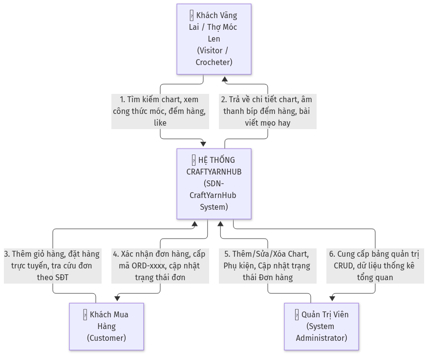
*Hình 2.1: Sơ đồ ngữ cảnh trao đổi dữ liệu hệ thống CraftYarnHub (DIA-01)*

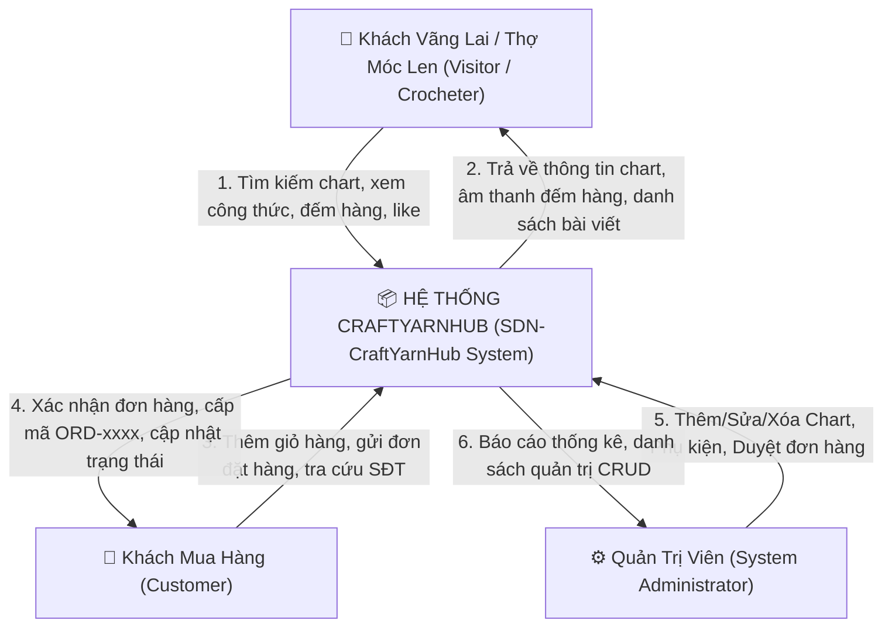

---

### II.4 Non-Functional Requirements (NFR)

| ID               | Nhóm Yêu Cầu | Tên Yêu Cầu                | Đặc Tả Chi Tiết                                                                                                                                      |
| :--------------- | :-------------- | :---------------------------- | :------------------------------------------------------------------------------------------------------------------------------------------------------- |
| **NFR-01** | Performance     | Thời gian phản hồi API     | Thời gian xử lý và trả lời của mọi endpoint RESTful API < 300ms trong môi trường mạng nội bộ.                                              |
| **NFR-02** | Reliability     | Tính nhất quán dữ liệu   | Không phát sinh tình trạng tranh chấp (race-condition) khi cập nhật lượt view/like; sử dụng toán tử atomic `$inc` của MongoDB.           |
| **NFR-03** | Usability       | Thiết kế Responsive         | Giao diện tương thích mượt mà từ màn hình Mobile (375px), Tablet (768px) đến Desktop (1200px+) nhờ Ant Design Grid System.                  |
| **NFR-04** | Security        | DTO Data Sanitization         | Tự động loại bỏ các trường không mong muốn và kiểm tra kiểu dữ liệu đầu vào qua NestJS Global `ValidationPipe({ whitelist: true })`. |
| **NFR-05** | Maintainability | Kiến trúc Module hóa       | Backend tuân thủ nghiêm ngặt mô hình NestJS: Controller chỉ điều hướng, Service xử lý logic, Schema định nghĩa dữ liệu.                |
| **NFR-06** | Audio Usability | Độ trễ âm thanh Web Audio | Âm thanh bíp pop của bộ đếm hàng phản hồi ngay lập tức (< 10ms) không cần tải tệp mp3 ngoài thông qua Web Audio API.                    |

---

### II.5 Business Rules

| ID              | Tên Quy Tắc              | Định Nghĩa Quy Tắc                                                                                                                                                                        | Phân Loại | Nguồn Gốc     |
| :-------------- | :------------------------- | :-------------------------------------------------------------------------------------------------------------------------------------------------------------------------------------------- | :---------: | :-------------- |
| **BR-01** | Unique Category Slug       | Mỗi danh mục phải có `slug` và `name` là duy nhất trên toàn hệ thống để định tuyến URL chuẩn SEO.                                                                        | Constraint | System Design   |
| **BR-02** | Atomic Metric Update       | Lượt xem (`view_count`) và lượt thích (`likes`) chỉ được phép tăng đơn vị nguyên (+1) thông qua toán tử `$inc`, không cho phép ghi đè tùy tiện.                | Constraint | Data Integrity  |
| **BR-03** | Order Code Uniqueness      | Mã đơn hàng phải được sinh tự động với tiền tố `ORD-` kèm hậu tố ngẫu nhiên và đảm bảo duy nhất tuyệt đối trong collection `orders`.                           |    Fact    | Order Policy    |
| **BR-04** | Valid Phone Format         | Số điện thoại nhận hàng phải là chuỗi chữ số hợp lệ từ 10 đến 11 ký tự, không chứa ký tự đặc biệt hoặc chữ cái.                                                   | Constraint | Checkout Policy |
| **BR-05** | Minimum Cart Threshold     | Đơn hàng chỉ được phép khởi tạo khi giỏ hàng có tối thiểu một sản phẩm với số lượng $\ge 1$.                                                                          | Constraint | Checkout Policy |
| **BR-06** | Rating Constraints         | Điểm đánh giá chất lượng mẫu chart bắt buộc nằm trong khoảng số nguyên từ 1 đến 5 sao.                                                                                      | Constraint | Review Policy   |
| **BR-07** | Order Status State Machine | Trạng thái đơn hàng chỉ được chuyển đổi tuần tự hợp lệ: `Chờ xác nhận` $\rightarrow$ `Đang xử lý` $\rightarrow$ `Đã giao` hoặc chuyển sang `Đã hủy`. | Constraint | Workflow Policy |
| **BR-08** | Price Positivity           | Giá sản phẩm phụ kiện (`price`) bắt buộc phải là số thực dương $\ge 0$.                                                                                                      | Constraint | Finance Policy  |

---

### II.6 Functional Requirements

#### II.6.1 Actors

| No | Actor                                         | Phân Loại | Mô Tả Vai Trò                                                                                                                                                     |
| :-: | :-------------------------------------------- | :---------: | :------------------------------------------------------------------------------------------------------------------------------------------------------------------- |
| 1 | **Visitor / Crocheter** (Thợ Móc Len) |   Primary   | Người truy cập duyệt kho chart, xem hướng dẫn móc chi tiết, sử dụng bộ đếm hàng, thả tim và gửi bình luận đánh giá.                           |
| 2 | **Customer** (Khách Mua Hàng)         |   Primary   | Người mua dụng cụ/len sợi, quản lý giỏ hàng, thực hiện đặt hàng và tra cứu hành trình đơn hàng bằng số điện thoại.                         |
| 3 | **Administrator** (Quản Trị Viên)    |   Primary   | Người quản trị hệ thống có toàn quyền thực hiện các thao tác Create, Read, Update, Delete trên Chart, Sản phẩm và chuyển trạng thái Đơn hàng. |

---

#### II.6.2 Use Case Diagrams

##### Sơ đồ Tổng quan Hệ thống (System Use Case Diagram)

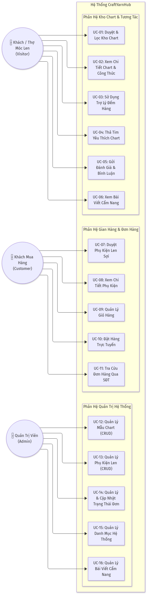
*Hình 2.2: Sơ đồ Use Case tổng thể toàn bộ 16 chức năng của hệ thống (DIA-02)*

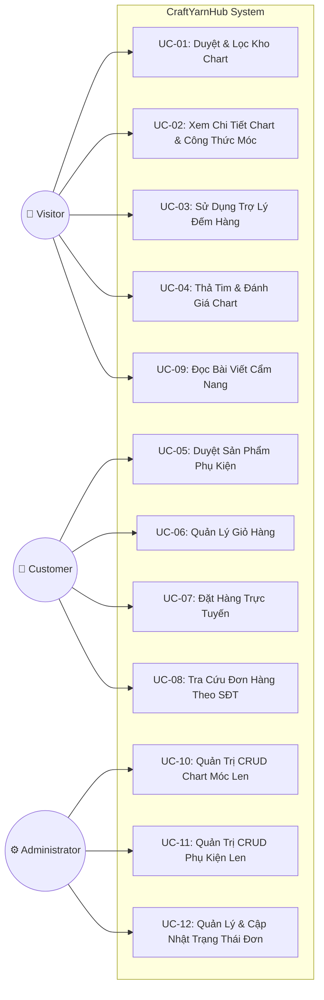

---

#

### II.6.3 Đặc Tả Chi Tiết Toàn Bộ 16 Use Cases (Dạng Bảng Chuẩn 15 Dòng Karl Wiegers)

---

#### UC-01: Duyệt & Lọc Kho Chart Móc Len
| Thuộc Tính Đặc Tả | Chi Tiết Đặc Tả |
| :--- | :--- |
| **UC ID and Name:** | **UC-01 – Duyệt & Lọc Kho Chart Móc Len (Browse and Filter Patterns)** |
| **Created By:** | Đinh Thị Thu Trang (HE195077)|
| **Date Created:** | 10/11/2026 |
| **Primary Actor:** | Visitor / Crocheter |
| **Secondary Actors:**| NestJS Backend, MongoDB Database |
| **Trigger:** | Người dùng chọn menu "Kho Chart" hoặc gõ từ khóa tìm kiếm trên thanh Header Navbar. |
| **Description:** | Cho phép thợ móc len tìm kiếm mẫu móc theo từ khóa (tên chart, nguyên liệu), phân loại theo Danh mục và lọc theo Độ khó (`Dễ`, `Vừa`, `Khó`). |
| **Preconditions:** | `PRE-1`: Máy chủ Backend và Database MongoDB đang hoạt động bình thường. |
| **Postconditions:** | `POST-1`: Danh sách các mẫu chart thỏa mãn điều kiện lọc được hiển thị dưới dạng lưới thẻ Card. |
| **Normal Flow:** | **1.0 Luồng Cơ Bản – Tìm Kiếm và Lọc Chart**<br>1. Người dùng truy cập trang `/patterns`.<br>2. Hệ thống gọi API `GET /api/categories?type=pattern` nạp danh sách danh mục vào dropdown.<br>3. Hệ thống gọi API `GET /api/patterns` lấy toàn bộ danh sách chart mới nhất.<br>4. Người dùng nhập từ khóa tìm kiếm vào ô Input (ví dụ: "súp lơ").<br>5. Client áp dụng Debounce 250ms, sau đó gọi `GET /api/patterns?q=s%C3%BAp%20l%C6%A1`.<br>6. Server xử lý `RegExp(q, 'i')` trên các trường `name`, `description`, `materials`.<br>7. Server trả về mã `200 OK` kèm danh sách bản ghi phù hợp.<br>8. Client cập nhật danh sách các thẻ `PatternCard` lên giao diện. |
| **Alternative Flows:** | **1.1 Lọc theo Độ khó & Danh mục:**<br>Tại bước 4, người dùng chọn Độ khó là "Dễ" và Danh mục là "Rau Củ". Client gọi API kèm query `?category=...&difficulty=Dễ`. Hệ thống hiển thị kết quả lọc giao nhau.<br>**1.2 Đặt lại bộ lọc (Reset):**<br>Người dùng bấm nút "Đặt Lại", Client xóa trắng query param và tải lại danh sách đầy đủ. |
| **Exceptions:** | **1.0.E1: Không có kết quả phù hợp:**<br>Nếu mảng dữ liệu trả về rỗng (`length == 0`), Client hiển thị component `Empty`: "Không tìm thấy mẫu chart nào phù hợp với bộ lọc của bạn" kèm nút "Xóa bộ lọc". |
| **Priority:** | High (Must Have) |
| **Frequency of Use:** | Rất cao – Thợ móc len truy cập liên tục hàng ngày. |
| **Business Rules:** | `BR-01` |
| **Other Information:** | Áp dụng debounce ở client để tránh gửi request dồn dập khi người dùng đang gõ phím. |
| **Assumptions:** | Dữ liệu mẫu chart đã được nạp sẵn qua script seed. |

---

#### UC-02: Xem Chi Tiết Chart & Công Thức Móc
| Thuộc Tính Đặc Tả | Chi Tiết Đặc Tả |
| :--- | :--- |
| **UC ID and Name:** | **UC-02 – Xem Chi Tiết Chart & Công Thức Móc (View Pattern Detail)** |
| **Created By:** | Đinh Thị Thu Trang (HE195077)|
| **Date Created:** | 10/11/2026 |
| **Primary Actor:** | Visitor / Crocheter |
| **Secondary Actors:**| NestJS Backend, MongoDB Database |
| **Trigger:** | Người dùng nhấp chuột vào một thẻ mẫu chart tại Trang chủ hoặc Kho Chart. |
| **Description:** | Hiển thị toàn bộ công thức móc chi tiết từng vòng (R1, R2...), danh sách nguyên liệu, dụng cụ và checklist chuẩn bị đồ. |
| **Preconditions:** | `PRE-1`: Mẫu chart tồn tại hợp lệ với `_id` trong MongoDB. |
| **Postconditions:** | `POST-1`: Chỉ số `view_count` của mẫu chart tăng thêm 1 trong database.<br>`POST-2`: Toàn bộ công thức móc chi tiết được hiển thị. |
| **Normal Flow:** | **2.0 Luồng Cơ Bản – Xem Chi Tiết Chart**<br>1. Người dùng chọn 1 mẫu chart.<br>2. Client điều hướng tới `/patterns/:id` và gửi request `GET /api/patterns/:id`.<br>3. Server kiểm tra tính hợp lệ của ObjectId, gọi lệnh `$inc: { view_count: 1 }`, đồng thời `populate('category')`.<br>4. Server trả về mã `200 OK` kèm document chi tiết chart.<br>5. Client hiển thị ảnh lớn, tác giả, tag độ khó, danh mục, số lượt xem.<br>6. Client render bảng Checklist nguyên liệu và công thức móc từng bộ phận (Đầu, Thân, Tai...).<br>7. Client tự động nạp danh sách bình luận liên quan qua `GET /api/comments?patternId=:id`. |
| **Alternative Flows:** | **2.1 Tương tác Checklist:**<br>Người dùng bấm tick chọn vào từng checkbox nguyên liệu/dụng cụ để đánh dấu đồ đã chuẩn bị xong. |
| **Exceptions:** | **2.0.E1: ID không hợp lệ:** Server trả về `400 Bad Request` ("ID Chart không hợp lệ").<br>**2.0.E2: Không tìm thấy chart:** Server trả về `404 Not Found`. Client hiển thị nút "Quay lại Kho Chart". |
| **Priority:** | High (Must Have) |
| **Frequency of Use:** | Rất cao. |
| **Business Rules:** | `BR-02` |
| **Other Information:** | Công thức móc được định dạng font monospace rõ nét kèm highlight dòng chẵn lẻ. |
| **Assumptions:** | Không yêu cầu đăng nhập để xem chart (Chart miễn phí cộng đồng). |

---

#### UC-03: Sử Dụng Trợ Lý Đếm Hàng Móc Len
| Thuộc Tính Đặc Tả | Chi Tiết Đặc Tả |
| :--- | :--- |
| **UC ID and Name:** | **UC-03 – Sử Dụng Trợ Lý Đếm Hàng Móc Len (Use Row Counter Widget)** |
| **Created By:** | Đinh Thị Thu Trang (HE195077)|
| **Date Created:** | 10/11/2026 |
| **Primary Actor:** | Visitor / Crocheter |
| **Secondary Actors:**| Trình duyệt Web (HTML5 Web Audio API, LocalStorage) |
| **Trigger:** | Người dùng đang xem chi tiết mẫu chart và thực hành móc len. |
| **Description:** | Công cụ hỗ trợ đếm số hàng đang móc (R1, R2, R3...), phát âm thanh tiếng bíp phản hồi và tự động lưu tiến độ vào LocalStorage theo từng chart ID. |
| **Preconditions:** | `PRE-1`: Người dùng đang ở màn hình chi tiết mẫu chart (`/patterns/:id`). |
| **Postconditions:** | `POST-1`: Số hàng móc hiển thị đúng giá trị hiện tại.<br>`POST-2`: Tiến độ được lưu vào `localStorage` với key `crochet_row_:patternId`. |
| **Normal Flow:** | **3.0 Luồng Cơ Bản – Đếm Hàng Móc**<br>1. Client kiểm tra `localStorage` với key `crochet_row_:patternId`.<br>2. Nếu có dữ liệu cũ, khôi phục giá trị (ví dụ `R5`), nếu chưa có thì khởi tạo `R1`.<br>3. Thợ móc xong 1 hàng, bấm nút `[+]` trên widget.<br>4. Web Audio API tạo bộ dao động sóng sine 750Hz và phát âm thanh "bíp pop" (< 10ms).<br>5. Bộ đếm tăng lên `R6`, cập nhật `localStorage`.<br>6. Thợ móc tiếp tục cho đến khi hoàn thành mẫu. |
| **Alternative Flows:** | **3.1 Giảm số hàng (Tháo len):**<br>Người dùng móc sai, bấm nút `[-]`. Hệ thống phát âm thanh bíp trầm 450Hz và giảm số dòng (`count = Math.max(1, count - 1)`).<br>**3.2 Đặt lại (Reset):**<br>Người dùng bấm nút Reset, bộ đếm trở về `R1`. |
| **Exceptions:** | **3.0.E1: Trình duyệt chặn âm thanh:** Web Audio API tự động bắt try/catch, bộ đếm vẫn tăng/giảm bình thường mà không bị crash giao diện. |
| **Priority:** | High (Must Have) |
| **Frequency of Use:** | Rất cao trong suốt quá trình đan móc của người dùng. |
| **Business Rules:** | Không có |
| **Other Information:** | Phát âm thanh thuần bằng oscillator không cần tải file MP3 qua mạng giúp tiết kiệm băng thông. |
| **Assumptions:** | Trình duyệt người dùng cho phép lưu LocalStorage. |

---

#### UC-04: Thả Tim Yêu Thích Chart Móc Len
| Thuộc Tính Đặc Tả | Chi Tiết Đặc Tả |
| :--- | :--- |
| **UC ID and Name:** | **UC-04 – Thả Tim Yêu Thích Chart (Like Pattern)** |
| **Created By:** | Đinh Thị Thu Trang (HE195077)|
| **Date Created:** | 10/11/2026 |
| **Primary Actor:** | Visitor / Crocheter |
| **Secondary Actors:**| NestJS Backend, MongoDB Database |
| **Trigger:** | Người dùng bấm vào nút "Yêu thích" tại màn hình chi tiết chart. |
| **Description:** | Gửi yêu cầu tăng số lượt yêu thích của mẫu chart lên server và lưu vĩnh viễn vào MongoDB. |
| **Preconditions:** | `PRE-1`: Người dùng đang ở màn hình `/patterns/:id`. |
| **Postconditions:** | `POST-1`: Trường `likes` của mẫu chart tăng thêm 1 trong database.<br>`POST-2`: Icon trái tim chuyển thành màu đỏ và hiển thị thông báo thành công. |
| **Normal Flow:** | **4.0 Luồng Cơ Bản – Thả Tim Chart**<br>1. Người dùng bấm nút "Yêu thích".<br>2. Client gửi HTTP `PATCH /api/patterns/:id/like`.<br>3. Server gọi `findByIdAndUpdate(id, { $inc: { likes: 1 } }, { new: true })`.<br>4. MongoDB thực thi atomic increment và trả về document cập nhật.<br>5. Server trả về mã `200 OK` kèm số like mới.<br>6. Client cập nhật state `liked = true`, tăng số like hiển thị và hiện Toast "Đã thả tim chart!". |
| **Alternative Flows:** | Không có |
| **Exceptions:** | **4.0.E1: Lỗi kết nối mạng:** Client hiển thị thông báo lỗi "Không thể kết nối đến máy chủ". |
| **Priority:** | Medium (Should Have) |
| **Frequency of Use:** | Thường xuyên. |
| **Business Rules:** | `BR-02` |
| **Other Information:** | Ngăn chặn việc bấm spam nút like liên tục bằng state nội bộ client. |
| **Assumptions:** | Không yêu cầu đăng nhập. |

---

#### UC-05: Gửi Đánh Giá & Bình Luận Mẫu Chart
| Thuộc Tính Đặc Tả | Chi Tiết Đặc Tả |
| :--- | :--- |
| **UC ID and Name:** | **UC-05 – Gửi Đánh Giá & Bình Luận (Submit Review and Comment)** |
| **Created By:** | Đinh Thị Thu Trang (HE195077)|
| **Date Created:** | 10/11/2026 |
| **Primary Actor:** | Visitor / Crocheter |
| **Secondary Actors:**| NestJS Backend, MongoDB Database |
| **Trigger:** | Người dùng điền form đánh giá ở cuối trang chi tiết chart và bấm "Gửi Đánh Giá". |
| **Description:** | Thu thập họ tên, số sao đánh giá (1-5 sao) và nhận xét của người dùng, tự động tạo avatar Dicebear và lưu vào collection `comments`. |
| **Preconditions:** | `PRE-1`: Người dùng đang ở màn hình chi tiết chart hợp lệ. |
| **Postconditions:** | `POST-1`: Bản ghi đánh giá mới được lưu vào collection `comments`.<br>`POST-2`: Bình luận mới xuất hiện ngay lập tức ở đầu danh sách đánh giá. |
| **Normal Flow:** | **5.0 Luồng Cơ Bản – Gửi Đánh Giá**<br>1. Người dùng nhập họ tên, chọn số sao (1-5 sao), nhập nội dung đánh giá.<br>2. Người dùng bấm nút "Gửi Đánh Giá".<br>3. Client gửi HTTP `POST /api/comments` với payload `CreateCommentDto`.<br>4. `ValidationPipe` kiểm tra dữ liệu đầu vào theo quy tắc `BR-06`.<br>5. Server tạo link avatar tự động qua Dicebear dựa trên tên người dùng.<br>6. Server lưu vào MongoDB và trả về mã `201 Created` kèm comment document.<br>7. Client chèn bình luận vừa tạo vào đầu mảng state `comments`.<br>8. Client reset form và hiển thị Toast "Cảm ơn bạn đã gửi đánh giá!". |
| **Alternative Flows:** | Không có |
| **Exceptions:** | **5.0.E1: Thiếu trường bắt buộc:** Bỏ trống tên hoặc nội dung ➔ Client hiển thị thông báo lỗi form.<br>**5.0.E2: Số sao không hợp lệ:** DTO từ chối với lỗi "Đánh giá tối thiểu 1 sao, tối đa 5 sao". |
| **Priority:** | High (Must Have) |
| **Frequency of Use:** | Trung bình - Người dùng gửi nhận xét sau khi móc xong sản phẩm. |
| **Business Rules:** | `BR-06` |
| **Other Information:** | Bình luận được cập nhật ngay lập tức (Real-time UX) mà không cần tải lại toàn bộ trang. |
| **Assumptions:** | Tên người dùng được dùng làm seed để sinh ảnh đại diện hoạt hình ngẫu nhiên. |

---

#### UC-06: Xem Bài Viết Cẩm Nang Mẹo Đan Móc
| Thuộc Tính Đặc Tả | Chi Tiết Đặc Tả |
| :--- | :--- |
| **UC ID and Name:** | **UC-06 – Xem Bài Viết Cẩm Nang (Read Blog and Tips)** |
| **Created By:** | Nguyễn Minh Đức (HE194336)|
| **Date Created:** | 10/11/2026 |
| **Primary Actor:** | Visitor / Crocheter |
| **Secondary Actors:**| NestJS Backend, MongoDB Database |
| **Trigger:** | Người dùng bấm vào menu "Chuyện Của Len" hoặc bấm vào thẻ bài viết trên trang chủ. |
| **Description:** | Xem danh sách bài viết mẹo hay đan móc và đọc chi tiết bài viết với đường dẫn Slug thân thiện chuẩn SEO. |
| **Preconditions:** | `PRE-1`: Bài viết tồn tại trong collection `blogs`. |
| **Postconditions:** | `POST-1`: Chỉ số `views` của bài viết tăng thêm 1 trong database.<br>`POST-2`: Toàn văn bài viết được hiển thị lên màn hình. |
| **Normal Flow:** | **6.0 Luồng Cơ Bản – Đọc Bài Viết**<br>1. Người dùng bấm vào một bài viết (ví dụ: "Mẹo giấu len thừa siêu đẹp").<br>2. Client điều hướng tới `/blog/:slug` và gọi `GET /api/blogs/:slug`.<br>3. Server tìm bản ghi theo trường `slug`, tăng `views` qua `$inc` và trả về `200 OK`.<br>4. Client hiển thị ảnh bìa, tác giả, thời gian đọc, lượt xem và nội dung bài viết. |
| **Alternative Flows:** | Không có |
| **Exceptions:** | **6.0.E1: Sai Slug bài viết:** Server trả về `404 Not Found`. Client hiển thị nút "Quay lại trang Blog". |
| **Priority:** | Medium (Should Have) |
| **Frequency of Use:** | Thường xuyên. |
| **Business Rules:** | `BR-01`, `BR-02` |
| **Other Information:** | Hỗ trợ tìm kiếm bài viết theo cả ObjectId hoặc slug. |
| **Assumptions:** | Bài viết được định dạng bằng văn bản có ngắt đoạn rõ ràng. |

---

#### UC-07: Duyệt & Lọc Phụ Kiện Len Sợi
| Thuộc Tính Đặc Tả | Chi Tiết Đặc Tả |
| :--- | :--- |
| **UC ID and Name:** | **UC-07 – Duyệt & Lọc Phụ Kiện Len Sợi (Browse Accessories)** |
| **Created By:** | Nguyễn Thị Thắm (HE191525)|
| **Date Created:** | 10/11/2026 |
| **Primary Actor:** | Customer |
| **Secondary Actors:**| NestJS Backend, MongoDB Database |
| **Trigger:** | Người dùng bấm chọn menu "Phụ Kiện" trên Navbar. |
| **Description:** | Duyệt danh mục phụ kiện đan móc (len sợi, kim móc, mắt thú, bông gòn), lọc theo Tabs danh mục và tìm kiếm theo tên phụ kiện. |
| **Preconditions:** | `PRE-1`: Máy chủ backend đang hoạt động. |
| **Postconditions:** | `POST-1`: Danh sách thẻ phụ kiện hiển thị đầy đủ giá tiền, ảnh và trạng thái kho. |
| **Normal Flow:** | **7.0 Luồng Cơ Bản – Duyệt Phụ Kiện**<br>1. Người dùng truy cập trang `/accessories`.<br>2. Client gọi `GET /api/categories?type=product` để nạp các tab danh mục.<br>3. Client gọi `GET /api/products` để lấy toàn bộ danh sách phụ kiện.<br>4. Người dùng bấm chuyển tab (ví dụ: "Kim Móc") hoặc gõ tìm kiếm.<br>5. Client gửi query `category=kim-moc` lên server và render lại danh sách sản phẩm. |
| **Alternative Flows:** | Không có |
| **Exceptions:** | **7.0.E1: Danh mục trống:** Hiển thị component Empty thông báo không có sản phẩm. |
| **Priority:** | High (Must Have) |
| **Frequency of Use:** | Cao. |
| **Business Rules:** | `BR-08` |
| **Other Information:** | Giá tiền được format tự động theo chuẩn tiền tệ Việt Nam (VNĐ). |
| **Assumptions:** | Không yêu cầu đăng nhập. |

---

#### UC-08: Xem Chi Tiết Phụ Kiện & Dụng Cụ
| Thuộc Tính Đặc Tả | Chi Tiết Đặc Tả |
| :--- | :--- |
| **UC ID and Name:** | **UC-08 – Xem Chi Tiết Phụ Kiện (View Product Detail)** |
| **Created By:** | Nguyễn Thị Thắm (HE191525)|
| **Date Created:** | 10/11/2026 |
| **Primary Actor:** | Customer |
| **Secondary Actors:**| NestJS Backend, MongoDB Database |
| **Trigger:** | Người dùng bấm vào thẻ sản phẩm phụ kiện tại trang `/accessories` hoặc trang chủ. |
| **Description:** | Xem ảnh lớn sản phẩm, giá bán, giá gốc, tỷ lệ giảm giá, mô tả công dụng chi tiết, chính sách đổi trả và chọn số lượng để thêm vào giỏ. |
| **Preconditions:** | `PRE-1`: Sản phẩm tồn tại với `_id` hợp lệ trong collection `products`. |
| **Postconditions:** | `POST-1`: Toàn bộ thông tin chi tiết sản phẩm được hiển thị đầy đủ. |
| **Normal Flow:** | **8.0 Luồng Cơ Bản – Xem Chi Tiết Phụ Kiện**<br>1. Người dùng bấm vào một phụ kiện.<br>2. Client điều hướng tới `/accessories/:id` và gửi request `GET /api/products/:id`.<br>3. Server kiểm tra ID, populate category và trả về mã `200 OK`.<br>4. Client hiển thị ảnh lớn, tag tồn kho, giá bán, bộ chọn số lượng (1-99).<br>5. Người dùng tùy chỉnh số lượng và bấm nút "Thêm Vào Giỏ" hoặc "Mua Ngay". |
| **Alternative Flows:** | **8.1 Mua Ngay:**<br>Người dùng bấm "Mua Ngay", client thêm sản phẩm vào giỏ hàng và tự động chuyển hướng thẳng sang màn hình `/cart`. |
| **Exceptions:** | **8.0.E1: ID không tồn tại:** Server trả về `404 Not Found`. Client hiển thị nút quay lại danh mục phụ kiện. |
| **Priority:** | High (Must Have) |
| **Frequency of Use:** | Thường xuyên. |
| **Business Rules:** | `BR-08` |
| **Other Information:** | Có tích hợp các cam kết chất lượng và hỗ trợ đổi trả 7 ngày. |
| **Assumptions:** | Dữ liệu sản phẩm có sẵn trong MongoDB. |

---

#### UC-09: Quản Lý Giỏ Hàng Mua Sắm
| Thuộc Tính Đặc Tả | Chi Tiết Đặc Tả |
| :--- | :--- |
| **UC ID and Name:** | **UC-09 – Quản Lý Giỏ Hàng Mua Sắm (Manage Shopping Cart)** |
| **Created By:** | Nguyễn Thị Thắm (HE191525)|
| **Date Created:** | 10/11/2026 |
| **Primary Actor:** | Customer |
| **Secondary Actors:**| Trình duyệt Web (CartContext, LocalStorage) |
| **Trigger:** | Người dùng bấm "Thêm vào giỏ" hoặc bấm vào icon Giỏ Hàng trên Navbar. |
| **Description:** | Quản lý danh sách phụ kiện dự định mua: tăng/giảm số lượng từng món, xóa từng món, xóa toàn bộ giỏ và tự động tính tổng tiền thanh toán. |
| **Preconditions:** | `PRE-1`: Trình duyệt hỗ trợ `LocalStorage`. |
| **Postconditions:** | `POST-1`: Trạng thái giỏ hàng được đồng bộ vào `localStorage` với key `crochet_cart`.<br>`POST-2`: Badge số lượng trên icon giỏ hàng ở Navbar cập nhật tương ứng. |
| **Normal Flow:** | **9.0 Luồng Cơ Bản – Thao Tác Giỏ Hàng**<br>1. Người dùng bấm "Thêm vào giỏ" tại một sản phẩm.<br>2. `CartContext` kiểm tra: nếu sản phẩm đã có trong giỏ thì tăng số lượng (`quantity + N`), nếu chưa có thì thêm phần tử mới.<br>3. Client lưu mảng giỏ hàng mới vào `localStorage`.<br>4. Người dùng mở trang `/cart`.<br>5. Client hiển thị danh sách các món, hình ảnh, đơn giá, ô nhập số lượng và tổng tiền.<br>6. Người dùng thay đổi số lượng qua `InputNumber`, tổng tiền tự động tính lại tức thì. |
| **Alternative Flows:** | **9.1 Xóa một sản phẩm:** Người dùng bấm icon thùng rác tại một dòng ➔ Món hàng bị loại khỏi giỏ.<br>**9.2 Xóa tất cả:** Người dùng bấm "Xóa tất cả" ➔ Giỏ hàng trở về rỗng (`cart = []`). |
| **Exceptions:** | **9.0.E1: Giảm số lượng về 0:** Hệ thống tự động xóa sản phẩm đó khỏi giỏ hàng. |
| **Priority:** | High (Must Have) |
| **Frequency of Use:** | Rất cao khi khách có nhu cầu mua phụ kiện. |
| **Business Rules:** | `BR-05` |
| **Other Information:** | Toàn bộ dữ liệu giỏ hàng được duy trì liên tục dù khách tải lại trang hoặc tắt tab trình duyệt. |
| **Assumptions:** | Không cần đăng nhập vẫn giữ được giỏ hàng. |

---

#### UC-10: Đặt Hàng Trực Tuyến
| Thuộc Tính Đặc Tả | Chi Tiết Đặc Tả |
| :--- | :--- |
| **UC ID and Name:** | **UC-10 – Đặt Hàng Trực Tuyến (Checkout Order)** |
| **Created By:** | Nguyễn Thị Thắm (HE191525)|
| **Date Created:** | 10/11/2026 |
| **Primary Actor:** | Customer |
| **Secondary Actors:**| NestJS Backend, MongoDB Database |
| **Trigger:** | Khách hàng điền thông tin nhận hàng và bấm "Đặt Hàng Ngay" tại trang `/cart`. |
| **Description:** | Đóng gói thông tin giỏ hàng và thông tin khách hàng, gửi lên server tạo bản ghi đơn hàng mới với mã `ORD-xxxx` và lưu vào collection `orders`. |
| **Preconditions:** | `PRE-1`: Giỏ hàng có tối thiểu 1 sản phẩm (`cart.length > 0`). |
| **Postconditions:** | `POST-1`: Đơn hàng mới được tạo trong MongoDB với trạng thái `Chờ xác nhận`.<br>`POST-2`: Giỏ hàng client-side được xóa trắng (`clearCart()`).<br>`POST-3`: Hiển thị Modal chúc mừng kèm mã đơn hàng. |
| **Normal Flow:** | **10.0 Luồng Cơ Bản – Đặt Hàng Trực Tuyến**<br>1. Khách hàng kiểm tra danh sách sản phẩm và tổng tiền tại trang `/cart`.<br>2. Khách hàng nhập Họ tên, Số điện thoại hợp lệ (10-11 số), Địa chỉ nhận hàng và Ghi chú.<br>3. Khách hàng bấm nút "Đặt Hàng Ngay".<br>4. Client đóng gói payload gồm `customer_name, phone, address, note, items, total_amount`.<br>5. Client gửi HTTP `POST /api/orders`.<br>6. `ValidationPipe` trên server xác thực dữ liệu qua `CreateOrderDto`.<br>7. Server sinh mã tự động `ORD-xxxx` duy nhất (BR-03) và set trạng thái `Chờ xác nhận`.<br>8. Server lưu đơn hàng vào MongoDB và trả về HTTP `201 Created`.<br>9. Client nhận kết quả, gọi `clearCart()` xóa giỏ hàng trong `localStorage`.<br>10. Client hiển thị Modal thông báo đặt hàng thành công, hiển thị nổi bật Mã đơn hàng. |
| **Alternative Flows:** | **10.1 Xem chi tiết đơn vừa đặt:**<br>Tại Modal thành công, khách bấm "Xem Chi Tiết Đơn" ➔ Hệ thống tự động mở Modal tra cứu đơn hàng vừa tạo. |
| **Exceptions:** | **10.0.E1: Giỏ hàng trống:** Khách bấm đặt hàng khi giỏ rỗng ➔ Client chặn lại và cảnh báo "Giỏ hàng của bạn đang trống!".<br>**10.0.E2: Số điện thoại sai định dạng:** Báo lỗi validation "Số điện thoại không hợp lệ (10-11 số)". |
| **Priority:** | High (Must Have) |
| **Frequency of Use:** | Cao. |
| **Business Rules:** | `BR-03`, `BR-04`, `BR-05`, `BR-07` |
| **Other Information:** | Sử dụng cấu trúc Sub-document nhúng trực tiếp giá và tên sản phẩm tại thời điểm đặt hàng. |
| **Assumptions:** | Phương thức thanh toán mặc định là Ship COD (Thanh toán khi nhận hàng). |

---

#### UC-11: Tra Cứu Đơn Hàng Qua Số Điện Thoại
| Thuộc Tính Đặc Tả | Chi Tiết Đặc Tả |
| :--- | :--- |
| **UC ID and Name:** | **UC-11 – Tra Cứu Đơn Hàng Qua Số Điện Thoại (Lookup Order Status)** |
| **Created By:** | Nguyễn Thị Thắm (HE191525)|
| **Date Created:** | 10/11/2026 |
| **Primary Actor:** | Customer |
| **Secondary Actors:**| NestJS Backend, MongoDB Database |
| **Trigger:** | Khách hàng bấm nút "Tra Cứu Đơn Hàng Của Tôi" trên trang Giỏ Hàng. |
| **Description:** | Cho phép khách hàng nhập Số điện thoại hoặc Mã đơn hàng để kiểm tra lịch sử các đơn hàng đã đặt và trạng thái xử lý hiện tại. |
| **Preconditions:** | `PRE-1`: Khách hàng đã từng gửi đơn đặt hàng thành công trên hệ thống. |
| **Postconditions:** | `POST-1`: Danh sách đơn hàng tương ứng được hiển thị kèm mã đơn, tổng tiền, ngày đặt và tag trạng thái. |
| **Normal Flow:** | **11.0 Luồng Cơ Bản – Tra Cứu Đơn Hàng**<br>1. Khách hàng bấm nút "Tra Cứu Đơn Hàng Của Tôi".<br>2. Modal tra cứu xuất hiện.<br>3. Khách nhập Số điện thoại (ví dụ: `0987654321`) hoặc Mã đơn (ví dụ: `ORD-882194`).<br>4. Khách bấm nút "Tra Cứu".<br>5. Client gửi HTTP `GET /api/orders/lookup?q=0987654321`.<br>6. Server tìm kiếm bằng toán tử `$or: [{ order_code: q }, { phone: q }]`.<br>7. Server trả về danh sách đơn hàng sắp xếp theo ngày tạo mới nhất.<br>8. Client hiển thị danh sách thẻ đơn hàng kèm trạng thái có màu sắc trực quan (Cam: Chờ xác nhận, Xanh dương: Đang xử lý, Xanh lá: Đã giao, Đỏ: Đã hủy). |
| **Alternative Flows:** | Không có |
| **Exceptions:** | **11.0.E1: Không tìm thấy đơn:** Không có đơn hàng khớp với SĐT ➔ Client thông báo "Không tìm thấy đơn hàng nào khớp với thông tin này". |
| **Priority:** | High (Must Have) |
| **Frequency of Use:** | Thường xuyên sau khi khách đặt hàng. |
| **Business Rules:** | `BR-04`, `BR-07` |
| **Other Information:** | Giải pháp tra cứu tinh gọn không yêu cầu khách phải đăng ký/đăng nhập tài khoản phức tạp. |
| **Assumptions:** | Khách hàng nhớ số điện thoại mình đã dùng khi đặt hàng. |

---

#### UC-12: Quản Lý Mẫu Chart Móc Len (Admin)
| Thuộc Tính Đặc Tả | Chi Tiết Đặc Tả |
| :--- | :--- |
| **UC ID and Name:** | **UC-12 – Quản Lý Mẫu Chart Móc Len (Manage Patterns - Admin)** |
| **Created By:** | Đinh Thị Thu Trang & Nguyễn Minh Đức|
| **Date Created:** | 10/11/2026 |
| **Primary Actor:** | Administrator |
| **Secondary Actors:**| NestJS Backend, MongoDB Database |
| **Trigger:** | Quản trị viên truy cập trang `/admin` và chọn tab "Quản Lý Kho Chart". |
| **Description:** | Thực hiện đầy đủ 4 thao tác CRUD trên mẫu chart: xem bảng danh sách, tạo mới mẫu chart, chỉnh sửa thông tin và xóa mẫu chart khỏi cơ sở dữ liệu. |
| **Preconditions:** | `PRE-1`: Quản trị viên đang ở giao diện `/admin`. |
| **Postconditions:** | `POST-1`: Dữ liệu mẫu chart trong MongoDB được thêm mới, cập nhật hoặc xóa bỏ hoàn toàn. |
| **Normal Flow:** | **12.0 Luồng Cơ Bản – Thêm Mới Mẫu Chart**<br>1. Admin chọn tab "Quản Lý Kho Chart".<br>2. Hệ thống hiển thị bảng Ant Design Table danh sách chart.<br>3. Admin bấm nút "Thêm Mới Chart".<br>4. Modal xuất hiện, Admin điền Tên chart, chọn Danh mục, chọn Độ khó (`Dễ`, `Vừa`, `Khó`), nhập Link ảnh, mô tả và nguyên liệu.<br>5. Admin bấm "Tạo Mẫu Chart".<br>6. Client gửi HTTP `POST /api/patterns` với `CreatePatternDto`.<br>7. Server validate, lưu vào MongoDB và trả về HTTP `201 Created`.<br>8. Client đóng modal, thông báo thành công và tự động tải lại bảng dữ liệu. |
| **Alternative Flows:** | **12.1 Xóa Mẫu Chart:**<br>Admin bấm nút "Xóa" tại một dòng chart ➔ Popconfirm xác nhận ➔ Client gửi HTTP `DELETE /api/patterns/:id` ➔ Server xóa bản ghi và Client cập nhật lại bảng. |
| **Exceptions:** | **12.0.E1: Thiếu thông tin bắt buộc:** Form báo lỗi và ngăn chặn gửi request lên server. |
| **Priority:** | High (Must Have) |
| **Frequency of Use:** | Định kỳ khi có mẫu móc len mới. |
| **Business Rules:** | `BR-01`, `BR-02` |
| **Other Information:** | Đáp ứng tiêu chí chấm điểm CRUD của môn SDN302. |
| **Assumptions:** | Admin có quyền truy cập trực tiếp trang quản trị. |

---

#### UC-13: Quản Lý Phụ Kiện Dụng Cụ (Admin)
| Thuộc Tính Đặc Tả | Chi Tiết Đặc Tả |
| :--- | :--- |
| **UC ID and Name:** | **UC-13 – Quản Lý Phụ Kiện Dụng Cụ (Manage Products - Admin)** |
| **Created By:** | Nguyễn Thị Thắm & Nguyễn Minh Đức|
| **Date Created:** | 10/11/2026 |
| **Primary Actor:** | Administrator |
| **Secondary Actors:**| NestJS Backend, MongoDB Database |
| **Trigger:** | Quản trị viên truy cập trang `/admin` và chọn tab "Quản Lý Phụ Kiện". |
| **Description:** | Quản lý danh mục phụ kiện: xem danh sách, thêm sản phẩm phụ kiện mới, cập nhật tình trạng tồn kho (`Còn hàng`, `Sắp hết`, `Hết hàng`) và xóa sản phẩm. |
| **Preconditions:** | `PRE-1`: Quản trị viên đang ở giao diện `/admin`. |
| **Postconditions:** | `POST-1`: Bản ghi phụ kiện được tạo mới, cập nhật hoặc xóa trong collection `products`. |
| **Normal Flow:** | **13.0 Luồng Cơ Bản – Thêm Mới Phụ Kiện**<br>1. Admin chọn tab "Quản Lý Phụ Kiện".<br>2. Bảng hiển thị danh sách sản phẩm, giá bán và trạng thái tồn kho.<br>3. Admin bấm nút "Thêm Phụ Kiện Mới".<br>4. Admin điền Tên sản phẩm, chọn Danh mục, nhập Giá bán (VNĐ), chọn trạng thái kho và link ảnh.<br>5. Admin bấm "Thêm Sản Phẩm".<br>6. Client gửi HTTP `POST /api/products`.<br>7. Server lưu vào MongoDB và trả về HTTP `201 Created`.<br>8. Bảng dữ liệu tự động cập nhật sản phẩm mới lên đầu. |
| **Alternative Flows:** | **13.1 Xóa Phụ Kiện:**<br>Admin bấm nút "Xóa" tại dòng sản phẩm ➔ Gửi HTTP `DELETE /api/products/:id` ➔ Xóa bản ghi khỏi MongoDB. |
| **Exceptions:** | **13.0.E1: Giá bán âm:** Form chặn lại với rule giá tối thiểu 1.000 VNĐ. |
| **Priority:** | High (Must Have) |
| **Frequency of Use:** | Định kỳ khi nhập thêm dụng cụ/len sợi mới. |
| **Business Rules:** | `BR-08` |
| **Other Information:** | Cung cấp cái nhìn trực quan về tồn kho phụ kiện. |
| **Assumptions:** | Danh mục phụ kiện đã tồn tại trước đó. |

---

#### UC-14: Quản Lý & Cập Nhật Trạng Thái Đơn Hàng (Admin)
| Thuộc Tính Đặc Tả | Chi Tiết Đặc Tả |
| :--- | :--- |
| **UC ID and Name:** | **UC-14 – Quản Lý & Cập Nhật Trạng Thái Đơn Hàng (Manage Order Status - Admin)** |
| **Created By:** | Nguyễn Thị Thắm & Nguyễn Minh Đức|
| **Date Created:** | 10/11/2026 |
| **Primary Actor:** | Administrator |
| **Secondary Actors:**| NestJS Backend, MongoDB Database |
| **Trigger:** | Quản trị viên truy cập trang `/admin` và chọn tab "Quản Lý Đơn Hàng". |
| **Description:** | Xem danh sách toàn bộ các đơn đặt hàng từ khách, xem chi tiết từng món hàng trong đơn, đổi trạng thái xử lý đơn và xóa đơn hàng nếu cần. |
| **Preconditions:** | `PRE-1`: Quản trị viên đang ở giao diện `/admin`. |
| **Postconditions:** | `POST-1`: Trạng thái đơn hàng trong database chuyển sang giá trị mới (`Chờ xác nhận` ➔ `Đang xử lý` ➔ `Đã giao` / `Đã hủy`). |
| **Normal Flow:** | **14.0 Luồng Cơ Bản – Đổi Trạng Thái Đơn Hàng**<br>1. Admin mở tab "Quản Lý Đơn Hàng".<br>2. Client gọi `GET /api/orders` lấy toàn bộ danh sách đơn đặt hàng từ khách.<br>3. Admin xem thông tin: Mã đơn, Tên khách, SĐT, Địa chỉ, Tổng tiền.<br>4. Admin nhấp vào Select trạng thái tại dòng đơn hàng và chọn "Đang xử lý" hoặc "Đã giao".<br>5. Client gửi HTTP `PATCH /api/orders/:id/status` với body `{ status: "Đã giao" }`.<br>6. Server kiểm tra giá trị hợp lệ theo quy tắc `BR-07`, cập nhật MongoDB và trả về `200 OK`.<br>7. Client hiện thông báo thành công và tag trạng thái đổi màu xanh lá. |
| **Alternative Flows:** | **14.1 Xem chi tiết các món trong đơn:**<br>Admin bấm nút "Chi tiết" ➔ Modal hiển thị danh sách ảnh, tên từng cuộn len, số lượng và thành tiền của đơn đó.<br>**14.2 Xóa đơn hàng:**<br>Admin bấm icon thùng rác ➔ Gửi HTTP `DELETE /api/orders/:id`. |
| **Exceptions:** | **14.0.E1: Trạng thái không hợp lệ:** Server chặn lại với lỗi `400 Bad Request`. |
| **Priority:** | High (Must Have) |
| **Frequency of Use:** | Rất cao – Quản trị viên xử lý mỗi khi có đơn đặt hàng mới. |
| **Business Rules:** | `BR-07` |
| **Other Information:** | Giúp sinh viên mô phỏng trọn vẹn luồng thương mại điện tử thực tế khi bảo vệ đồ án. |
| **Assumptions:** | Đơn hàng đã có sẵn trong database. |

---

#### UC-15: Quản Lý Danh Mục Hệ Thống (Admin)
| Thuộc Tính Đặc Tả | Chi Tiết Đặc Tả |
| :--- | :--- |
| **UC ID and Name:** | **UC-15 – Quản Lý Danh Mục Hệ Thống (Manage Categories - Admin)** |
| **Created By:** | Nguyễn Minh Đức (HE194336)|
| **Date Created:** | 10/11/2026 |
| **Primary Actor:** | Administrator |
| **Secondary Actors:**| NestJS Backend, MongoDB Database |
| **Trigger:** | Quản trị viên muốn tạo thêm hoặc xóa danh mục phân loại chart/phụ kiện. |
| **Description:** | Thực hiện các thao tác CRUD trên danh mục: tạo danh mục mới với slug duy nhất, phân loại loại danh mục (`pattern` hoặc `product`), cập nhật mô tả và icon. |
| **Preconditions:** | `PRE-1`: Quản trị viên có quyền thao tác trên hệ thống. |
| **Postconditions:** | `POST-1`: Danh mục mới được thêm vào collection `categories` và sẵn sàng phục vụ phân loại. |
| **Normal Flow:** | **15.0 Luồng Cơ Bản – Tạo Danh Mục Mới**<br>1. Admin gửi yêu cầu tạo danh mục.<br>2. Client gọi HTTP `POST /api/categories` với `{ name: "Mũ Nón Len", slug: "mu-non-len", type: "pattern", icon: "👒" }`.<br>3. Server kiểm tra tính duy nhất của `slug` và `name` theo quy tắc `BR-01`.<br>4. Server lưu vào MongoDB và trả về mã `201 Created`.<br>5. Danh mục mới xuất hiện ngay lập tức trong bộ lọc của trang Kho Chart và Dropdown thêm chart. |
| **Alternative Flows:** | **15.1 Xóa danh mục:** Gửi HTTP `DELETE /api/categories/:id` để xóa danh mục khỏi database. |
| **Exceptions:** | **15.0.E1: Trùng lặp Slug:** MongoDB báo lỗi `E11000 duplicate key error`. Server trả về lỗi thích hợp. |
| **Priority:** | Medium (Should Have) |
| **Frequency of Use:** | Thấp – Chỉ thiết lập khi mở rộng chủng loại sản phẩm. |
| **Business Rules:** | `BR-01` |
| **Other Information:** | Dùng chung một Schema cho cả Chart và Phụ kiện thông qua trường `type`. |
| **Assumptions:** | Dữ liệu danh mục ban đầu đã có sẵn trong file seed. |

---

#### UC-16: Quản Lý Bài Viết Cẩm Nang (Admin)
| Thuộc Tính Đặc Tả | Chi Tiết Đặc Tả |
| :--- | :--- |
| **UC ID and Name:** | **UC-16 – Quản Lý Bài Viết Cẩm Nang (Manage Blogs - Admin)** |
| **Created By:** | Nguyễn Minh Đức (HE194336)|
| **Date Created:** | 10/11/2026 |
| **Primary Actor:** | Administrator |
| **Secondary Actors:**| NestJS Backend, MongoDB Database |
| **Trigger:** | Quản trị viên muốn đăng bài viết chia sẻ mẹo vặt đan móc mới. |
| **Description:** | Thêm mới bài viết cẩm nang (Tiêu đề, Slug, Đoạn trích, Toàn văn nội dung, Ảnh bìa, Tác giả), sửa bài viết và xóa bài viết khỏi cơ sở dữ liệu. |
| **Preconditions:** | `PRE-1`: Quản trị viên có nội dung bài viết cần đăng. |
| **Postconditions:** | `POST-1`: Bài viết mới được lưu vào collection `blogs` và hiển thị tại trang `/blog`. |
| **Normal Flow:** | **16.0 Luồng Cơ Bản – Đăng Bài Viết Cẩm Nang**<br>1. Admin nhập thông tin bài viết: Tiêu đề, Slug thân thiện, Đoạn trích ngắn, Nội dung bài viết, Link ảnh bìa.<br>2. Gửi HTTP `POST /api/blogs`.<br>3. Server kiểm tra tính duy nhất của slug, lưu bản ghi vào MongoDB và trả về `201 Created`.<br>4. Bài viết mới xuất hiện ngay tại trang danh sách `/blog` và mục mẹo hay trên trang chủ. |
| **Alternative Flows:** | **16.1 Xóa bài viết:** Admin gọi HTTP `DELETE /api/blogs/:id` để gỡ bài viết khỏi hệ thống. |
| **Exceptions:** | **16.0.E1: Trùng lặp Slug:** Hệ thống từ chối tạo bài viết nếu slug đã tồn tại. |
| **Priority:** | Medium (Should Have) |
| **Frequency of Use:** | Định kỳ hàng tuần. |
| **Business Rules:** | `BR-01` |
| **Other Information:** | Hỗ trợ lưu trữ nội dung bài viết dạng văn bản nhiều dòng hoặc Markdown. |
| **Assumptions:** | Bài viết do chính Admin biên soạn. |

---

### II.6.4 Activity Diagrams

##### Activity Diagram 1: Quy Trình Đặt Hàng Trực Tuyến (Checkout Workflow)

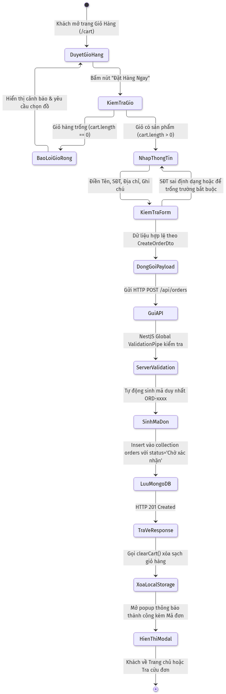
*Hình 2.3: Sơ đồ hoạt động quy trình đặt hàng và thanh toán trực tuyến (DIA-06)*

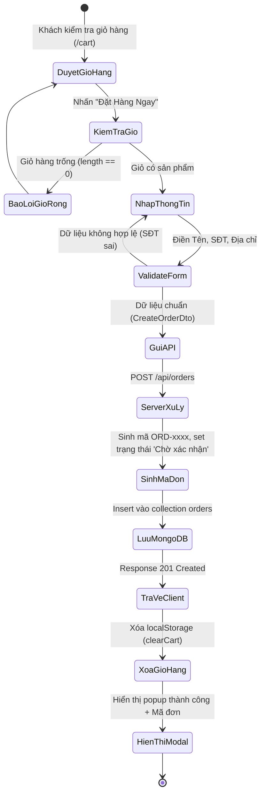

##### Activity Diagram 2: Quy Trình Móc Len Với Trợ Lý Đếm Hàng (Row Counter)

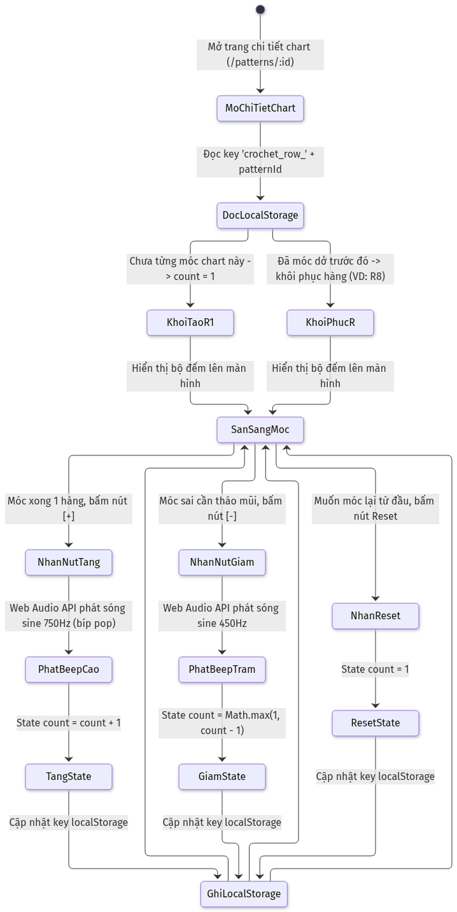
*Hình 2.4: Sơ đồ hoạt động trợ lý đếm hàng móc len với Web Audio API (DIA-07)*

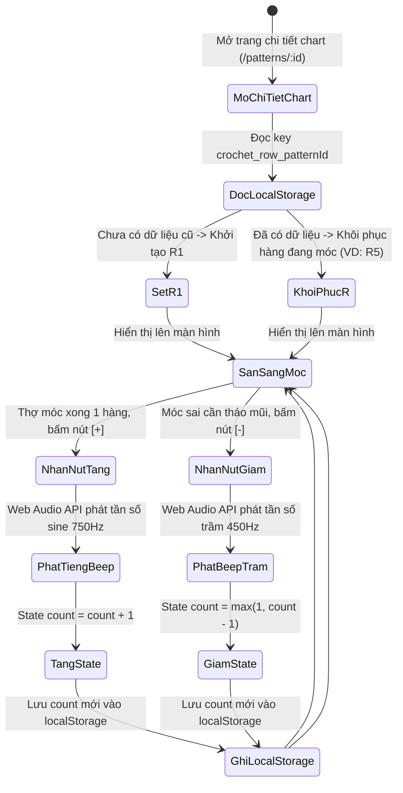

---

## III. ANALYSIS MODELS

### III.1 High-Level Class Diagram (Structural Model)

Sơ đồ các thực thể dữ liệu phân tích (Entity Classes) phản ánh cấu trúc dữ liệu cốt lõi của hệ thống:

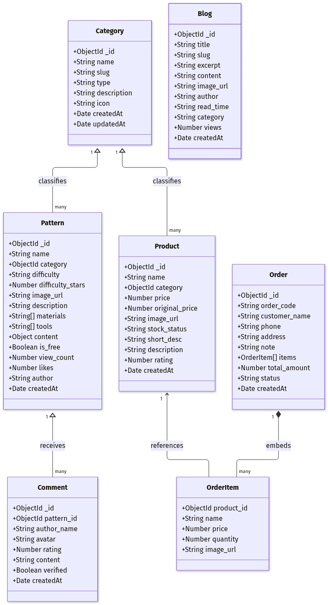
*Hình 3.1: Sơ đồ lớp phân tích thực thể dữ liệu hệ thống (DIA-09)*

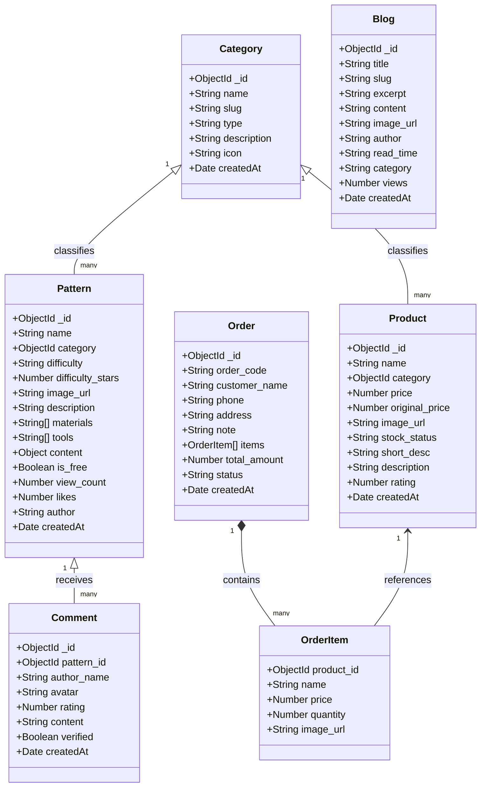

---

### III.2 Interaction Diagrams

#### III.2.1 Sequence Diagrams

##### Sequence Diagram 1: Đánh Giá & Bình Luận Chart Móc Len

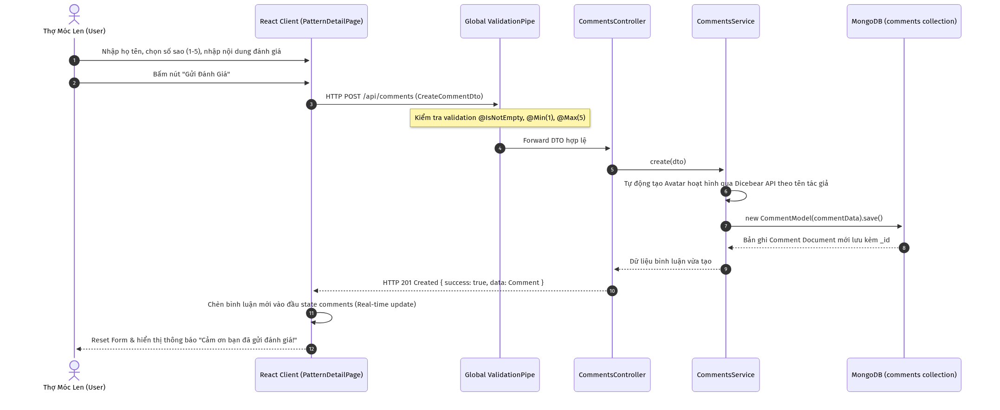
*Hình 3.2: Sơ đồ tuần tự gửi đánh giá sao và bình luận mẫu chart (DIA-05)*

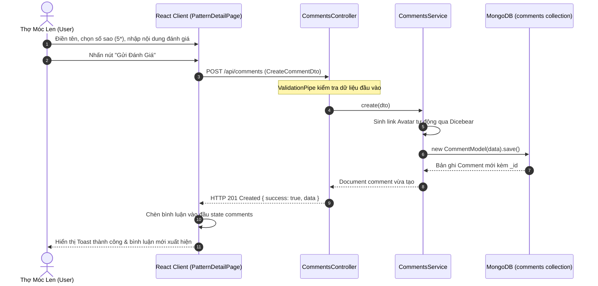

##### Sequence Diagram 2: Thả Tim Chart Với Toán Tử Atomic `$inc`

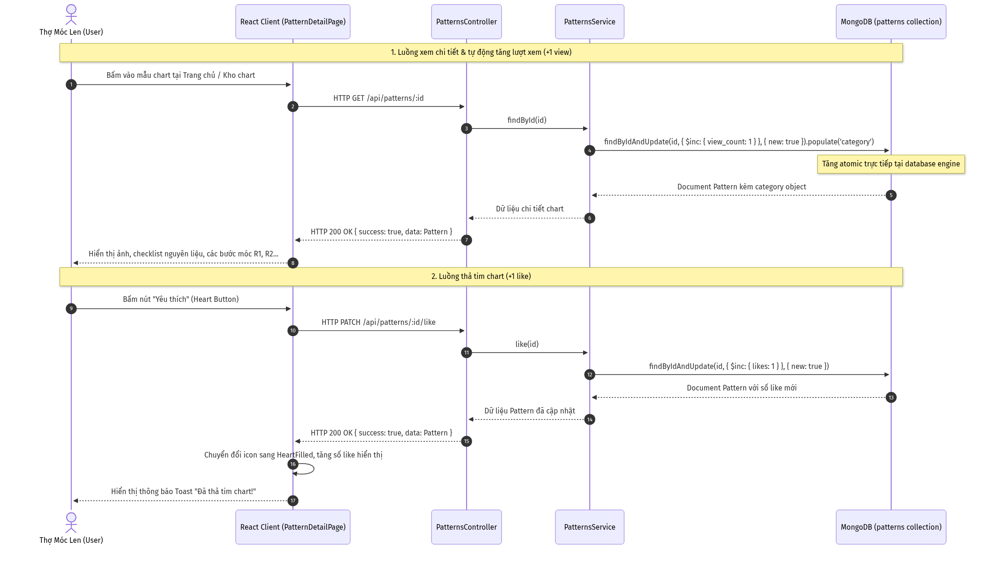
*Hình 3.3: Sơ đồ tuần tự xem chi tiết chart và thả tim với toán tử atomic $inc (DIA-04)*

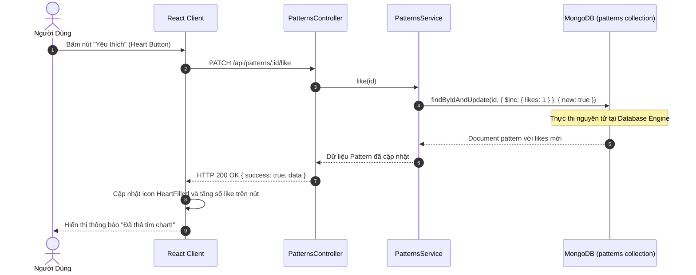

---

#### III.2.2 Communication Diagrams

Sơ đồ truyền thông điệp tương tác khi Khách hàng thực hiện Đặt Hàng:

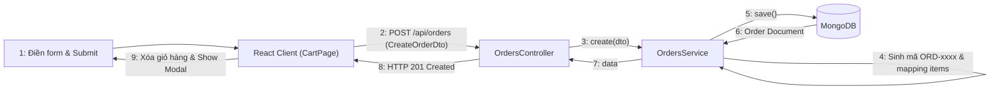

---


##### Sequence Diagram 3: Quy Trình Đặt Hàng Trực Tuyến Sub-Document (Checkout Workflow - DIA-03)

- **Mục đích:** Mô tả chi tiết việc gửi đơn hàng từ giỏ hàng client, controller kiểm tra qua DTO, service sinh mã ngẫu nhiên `ORD-xxxx`, lưu mảng Sub-documents `items` vào MongoDB và trả về mã đơn hàng cho khách.

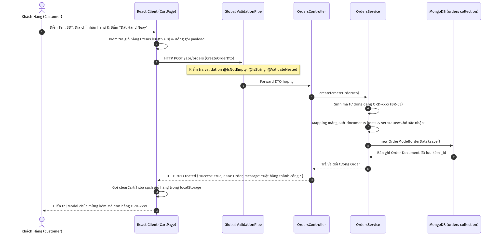
*Hình 3.4: Sơ đồ tuần tự xử lý luồng đặt hàng trực tuyến và lưu mảng Sub-document (DIA-03)*

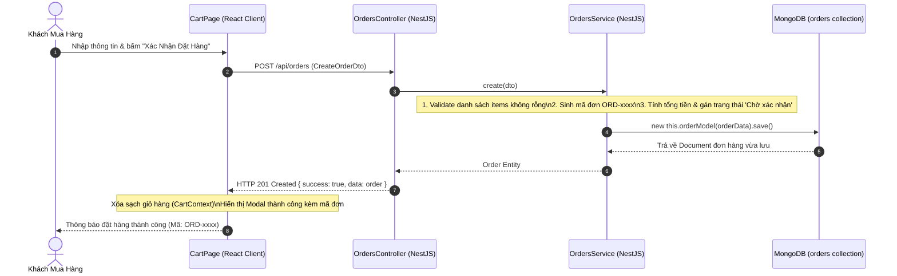


### III.3 State Machine Diagram (Behavioral Model)

Vòng đời và sự chuyển dịch trạng thái của một Đơn Hàng trong hệ thống:

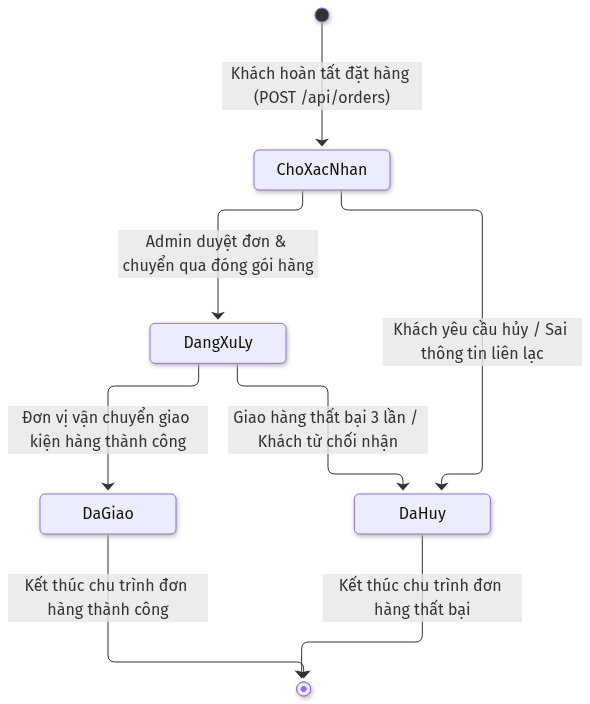
*Hình 3.5: Sơ đồ máy trạng thái chu trình xử lý đơn hàng (DIA-08)*

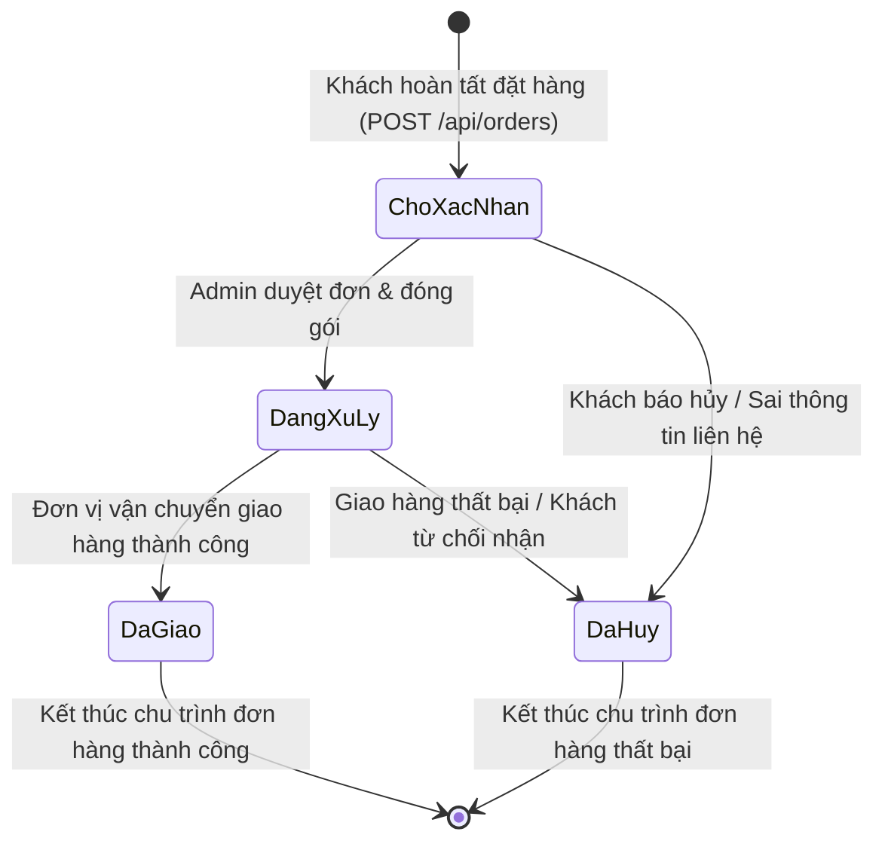

---

## IV. DESIGN SPECIFICATION

### IV.1 Integrated Communication Diagrams

Sơ đồ tương tác tích hợp toàn hệ thống thể hiện luồng giao tiếp giữa 3 tầng (Client ➔ NestJS API ➔ Database):

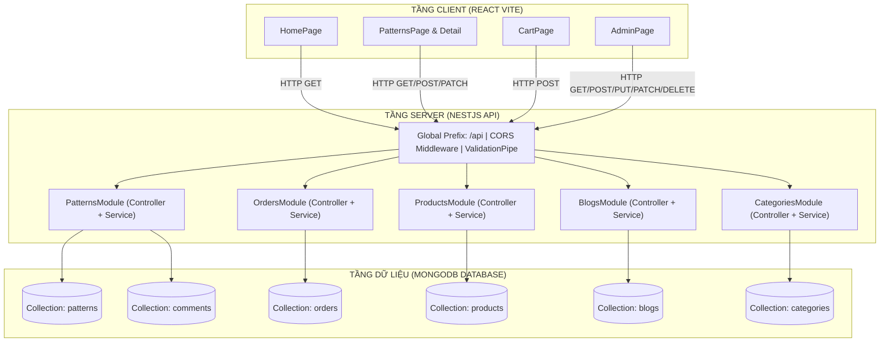

---

### IV.2 System High-Level Design (Client - Server Architecture)

Hệ thống được thiết kế theo phong cách kiến trúc **Client - Server hiện đại**:

1. **Frontend (Client Application):**
   - Công nghệ: React 18, Vite bundler, TypeScript.
   - Thư viện UI: Ant Design v5 với tùy biến Theme màu hồng phấn pastel (`#ff6584`), thân thiện với cộng đồng thủ công.
   - Quản trị State: React Hooks (`useState`, `useEffect`), Context API (`CartContext`) để duy trì giỏ hàng xuyên suốt phiên duyệt web và đồng bộ `localStorage`.
   - Giao tiếp Backend: Thư viện `Axios` với cấu hình Base URL và interceptors xử lý lỗi tập trung.
2. **Backend (Server Application):**
   - Công nghệ: NestJS v10 framework chạy trên nền tảng Node.js.
   - Nguyên tắc thiết kế: Dependency Injection (DI), Single Responsibility Principle (Mỗi module chịu trách nhiệm một domain độc lập).
   - Middleware: Cấu hình CORS cho phép nguồn từ client (`http://localhost:5173`), Global Validation Pipe tự động chuẩn hóa DTO.
3. **Database (Persistence Layer):**
   - Cơ sở dữ liệu: MongoDB (NoSQL Document Store).
   - Trình kết nối ODM: `@nestjs/mongoose` và `mongoose` v8.

---

### IV.3 Component and Package Diagram

#### IV.3.1 Component Diagram

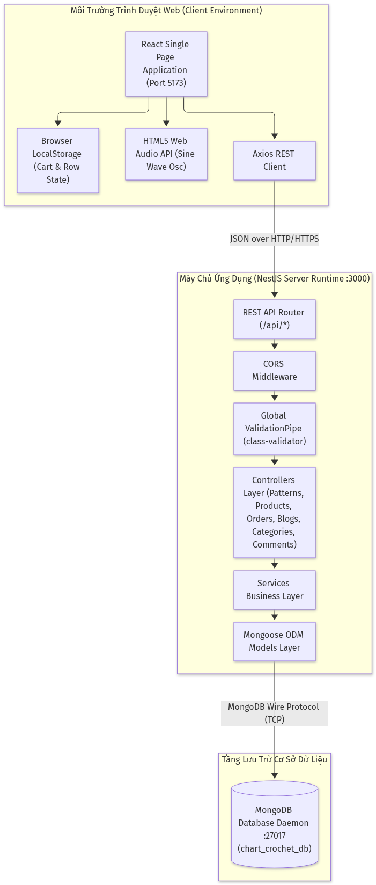
*Hình 4.1: Sơ đồ thành phần vật lý kiến trúc Client - Server (DIA-10)*

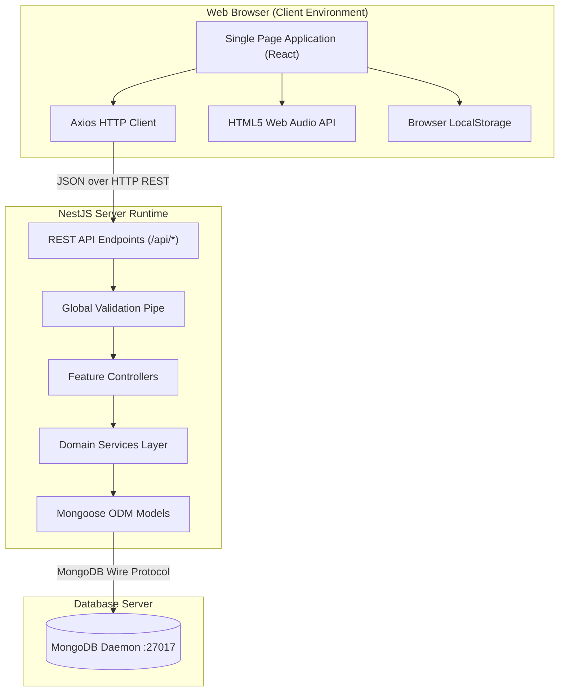

---

#### IV.3.2 Package Diagram & Descriptions

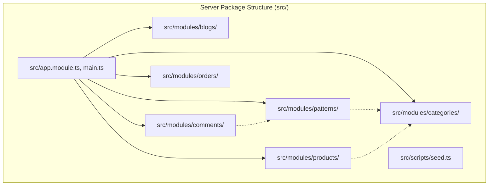

##### Bảng Mô Tả Gói (Package Descriptions)

| No | Package        | Thư Mục Vật Lý                 | Mô Tả Trách Nhiệm                                                                                                        |
| :-: | :------------- | :--------------------------------- | :--------------------------------------------------------------------------------------------------------------------------- |
| 01 | `core`       | `server/src/`                    | Chứa `main.ts` cấu hình khởi chạy, CORS, Global Prefix và `app.module.ts` kết nối MongoDB qua `ConfigService`. |
| 02 | `categories` | `server/src/modules/categories/` | Quản lý danh mục phân loại cho chart và phụ kiện (`pattern`, `product`).                                         |
| 03 | `patterns`   | `server/src/modules/patterns/`   | Quản lý toàn bộ thông tin mẫu chart, lọc độ khó, regex search, tăng view/like và DTO validation.                 |
| 04 | `products`   | `server/src/modules/products/`   | Quản lý phụ kiện len sợi, kim móc, tồn kho và danh mục sản phẩm.                                                  |
| 05 | `blogs`      | `server/src/modules/blogs/`      | Quản lý bài viết cẩm nang kỹ thuật đan móc và truy vấn slug thân thiện SEO.                                     |
| 06 | `comments`   | `server/src/modules/comments/`   | Quản lý đánh giá số sao (1-5 sao) và nhận xét của người dùng gắn với từng mẫu chart.                        |
| 07 | `orders`     | `server/src/modules/orders/`     | Quản lý đơn đặt hàng, sinh mã `ORD-xxxx`, tra cứu theo SĐT và luồng chuyển trạng thái đơn hàng.          |
| 08 | `scripts`    | `server/src/scripts/`            | Chứa `seed.ts` nạp tự động dữ liệu mẫu chuẩn chỉ vào MongoDB khi khởi tạo dự án.                            |

---

### IV.4 Implementation Class Diagrams

Dưới đây là sơ đồ chi tiết mối quan hệ giữa Controller, Service, DTO và Mongoose Schema của các phân hệ chính:

#### Implementation Class Diagram: Phân Hệ Kho Chart (Patterns Feature)

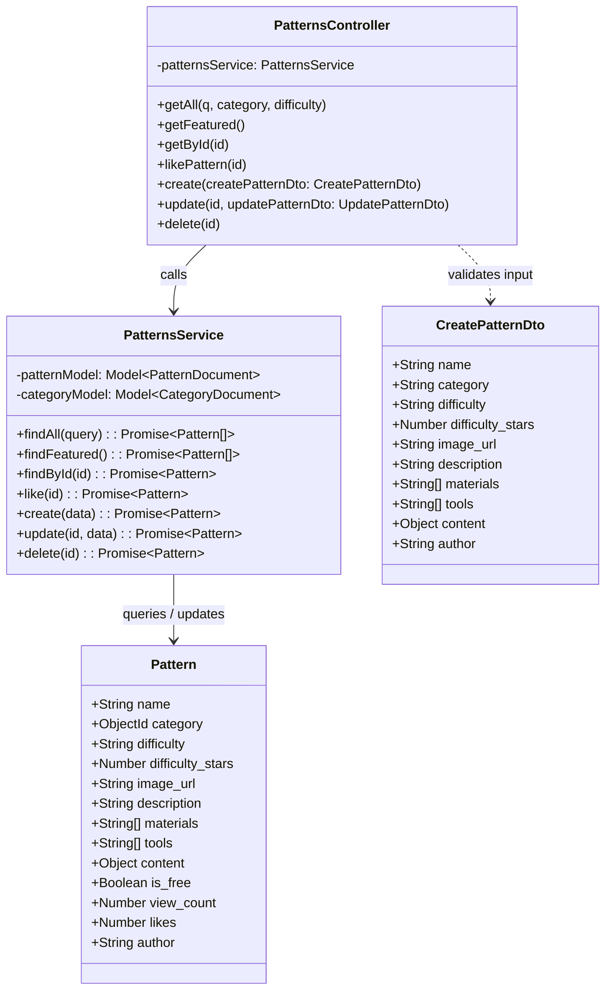

#### Implementation Class Diagram: Phân Hệ Đơn Hàng (Orders Feature)

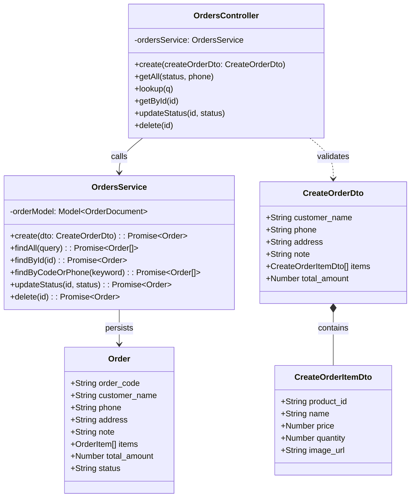

---

### IV.5 Thiết Kế Cơ Sở Dữ Liệu MongoDB & Mongoose Schema Toàn Diện

#### IV.5.1 Sơ Đồ Quan Hệ Thực Thể CSDL (ERD)

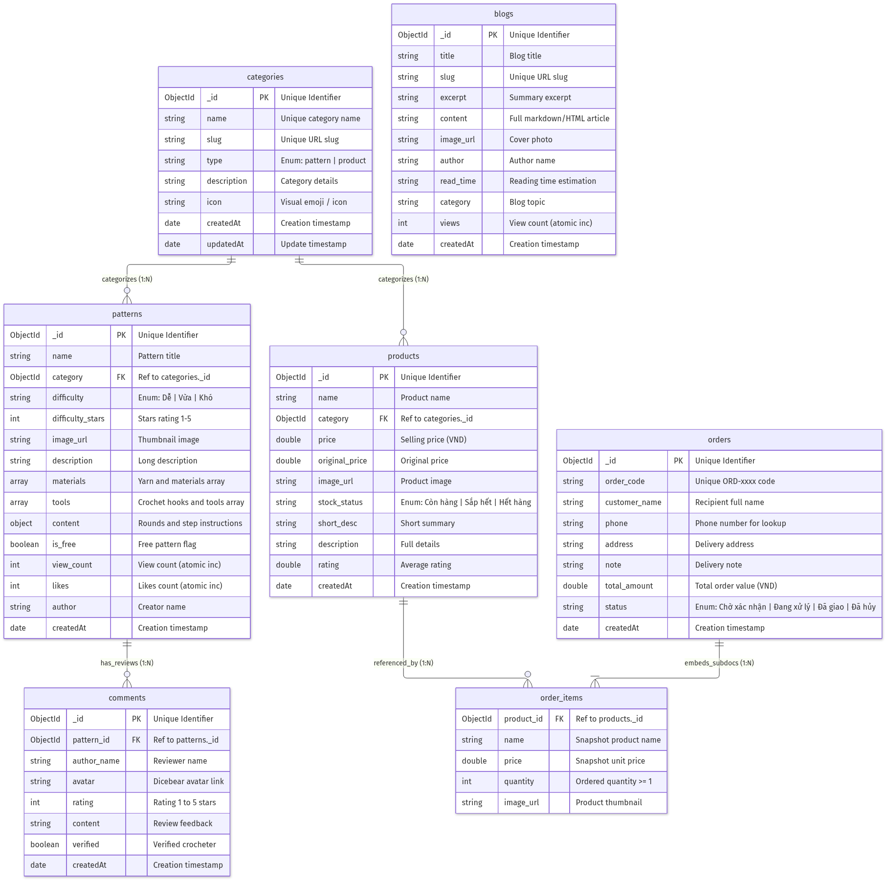
*Hình 6.1: Sơ đồ quan hệ thực thể (ERD) cấu trúc 6 Collections trong MongoDB (DIA-11)*

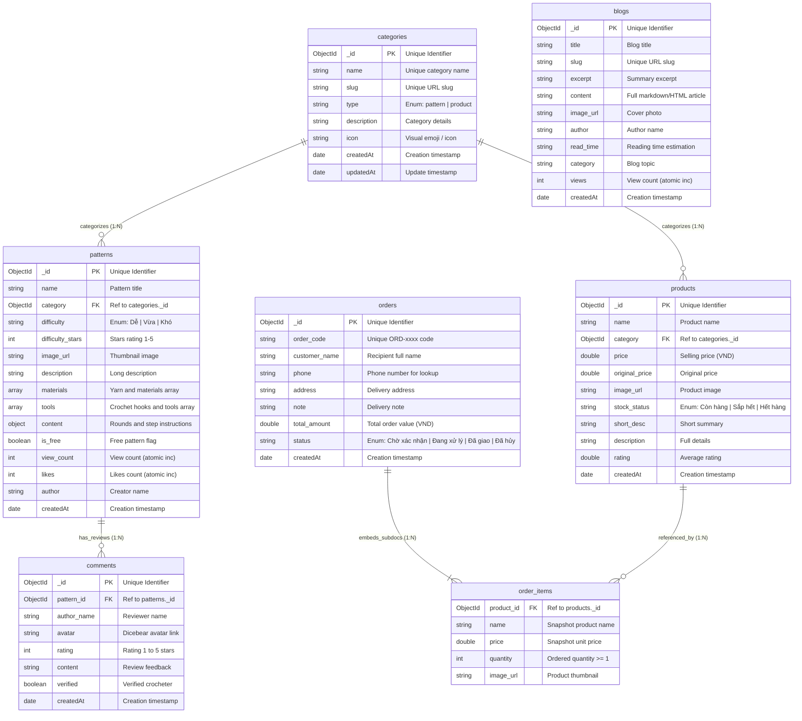

---

#### IV.5.2 Collection: `patterns` (Kho Chart)

#### Bảng Đặc Tả Trường Dữ Liệu
| Tên Thuộc Tính | Kiểu BSON | Ràng Buộc (Constraints) | Chỉ Mục (Index) | Mô Tả & Ý Nghĩa |
| :--- | :--- | :--- | :---: | :--- |
| `_id` | ObjectId | Bắt buộc, Tự sinh | Primary Key | Khóa chính mẫu chart |
| `name` | String | Required, Trim | Text Index | Tên mẫu chart móc len |
| `category` | ObjectId | Required, Ref: 'Category' | FK Index | Tham chiếu sang danh mục tương ứng |
| `difficulty` | String | Enum: `['Dễ', 'Vừa', 'Khó']` | Single Index | Phân cấp độ khó cho thợ móc |
| `difficulty_stars`| Int32 | Min: 1, Max: 5, Default: 2 | | Số sao hiển thị độ khó |
| `image_url` | String | Required, Trim | | Link hình ảnh thành phẩm |
| `description` | String | Default: '' | Text Index | Đoạn văn mô tả chi tiết mẫu |
| `materials` | Array[String]| Default: `[]` | Index | Mảng danh sách nguyên liệu |
| `tools` | Array[String]| Default: `[]` | | Mảng danh sách dụng cụ cần có |
| `content` | Object (Mixed)| Default: `{}` | | Object chứa các bước móc chi tiết |
| `is_free` | Boolean | Default: `true` | | Đánh dấu chart miễn phí |
| `view_count` | Int32 | Min: 0, Default: 0 | Sort Index | Lượt xem mẫu chart (tăng qua `$inc`) |
| `likes` | Int32 | Min: 0, Default: 0 | Sort Index | Lượt thả tim mẫu chart (tăng qua `$inc`) |
| `author` | String | Default: 'Tiệm Len Xinh' | | Tên tác giả / thợ dịch chart |
| `createdAt` | Date | Auto-generated | Sort Index | Thời điểm tạo mẫu chart |

#### BSON Document Mẫu Thực Tế
```json
{
  "_id": { "$oid": "672f3e8b109b3c4a1e98d001" },
  "name": "Bé Súp Lơ Tóc Xù Amigurumi",
  "category": { "$oid": "672f3e8b109b3c4a1e98c001" },
  "difficulty": "Dễ",
  "difficulty_stars": 2,
  "image_url": "https://images.unsplash.com/photo-1615485290382-441e4d049cb5?q=80&w=600&auto=format&fit=crop",
  "description": "Bé súp lơ xanh mướt với mái tóc xù ngộ nghĩnh, thích hợp làm móc khóa hoặc đồ chơi an toàn cho bé.",
  "materials": ["Len Milk Bò 50g màu xanh lá (mã 32)", "Len Milk Bò màu trắng kem (mã 01)", "Bông gòn bi", "Mắt thú chốt an toàn 6mm"],
  "tools": ["Kim móc 2.5mm", "Kim khâu len", "Kéo cắt chỉ", "Kim định vị"],
  "content": {
    "Phần Tóc Xù": ["R1: MR 6X (6)", "R2: 6V (12)", "R3: (1X, 1V)*6 (18)", "R4-R6: 18X (18)"],
    "Phần Thân & Chân": ["R1: MR 6X (6)", "R2: (1X, 1V)*3 (9)", "R3: 9X (9) - Chốt sợi kết thúc"]
  },
  "is_free": true,
  "view_count": 345,
  "likes": 88,
  "author": "Vy Vy - Tiệm Len Nhỏ",
  "createdAt": { "$date": "2026-11-02T03:39:16.000Z" }
}
```

#### Mã Nguồn Mongoose Schema (`server/src/modules/patterns/schemas/pattern.schema.ts`)
```typescript
import { Prop, Schema, SchemaFactory } from '@nestjs/mongoose';
import mongoose, { HydratedDocument, Types } from 'mongoose';
import { Category } from '../../categories/schemas/category.schema';

export type PatternDocument = HydratedDocument<Pattern>;

@Schema({ timestamps: true })
export class Pattern {
  @Prop({ required: true, trim: true })
  name: string;

  @Prop({ type: Types.ObjectId, ref: 'Category', required: true })
  category: Category | Types.ObjectId;

  @Prop({ required: true, enum: ['Dễ', 'Vừa', 'Khó'], default: 'Dễ' })
  difficulty: string;

  @Prop({ default: 2, min: 1, max: 5 })
  difficulty_stars: number;

  @Prop({ required: true })
  image_url: string;

  @Prop({ default: '' })
  description: string;

  @Prop({ type: [String], default: [] })
  materials: string[];

  @Prop({ type: [String], default: [] })
  tools: string[];

  @Prop({ type: mongoose.Schema.Types.Mixed, default: {} })
  content: Record<string, string[]>;

  @Prop({ default: true })
  is_free: boolean;

  @Prop({ default: 0 })
  view_count: number;

  @Prop({ default: 0 })
  likes: number;

  @Prop({ default: 'Tiệm Len Xinh' })
  author: string;
}

export const PatternSchema = SchemaFactory.createForClass(Pattern);
```

---

#### IV.5.3 Collection: `products` (Phụ Kiện)

#### Bảng Đặc Tả Trường Dữ Liệu
| Tên Thuộc Tính | Kiểu BSON | Ràng Buộc (Constraints) | Chỉ Mục (Index) | Mô Tả & Ý Nghĩa |
| :--- | :--- | :--- | :---: | :--- |
| `_id` | ObjectId | Bắt buộc, Tự sinh | Primary Key | Khóa chính sản phẩm phụ kiện |
| `name` | String | Required, Trim | Text Index | Tên sản phẩm len / phụ kiện |
| `category` | ObjectId | Required, Ref: 'Category' | FK Index | Tham chiếu sang danh mục phụ kiện |
| `price` | Double / Int32 | Required, Min: 0 | Sort Index | Giá bán lẻ thực tế (VNĐ) |
| `original_price`| Double / Int32 | Min: 0, Default: 0 | | Giá niêm yết ban đầu |
| `image_url` | String | Required | | Link ảnh sản phẩm |
| `stock_status` | String | Enum: `['Còn hàng', 'Sắp hết', 'Hết hàng']` | Index | Trạng thái tồn kho |
| `short_desc` | String | Default: '' | | Tóm tắt nhanh tính năng sản phẩm |
| `description` | String | Default: '' | | Bài viết mô tả công dụng chi tiết |
| `rating` | Double | Min: 0, Max: 5, Default: 5 | | Điểm đánh giá trung bình |
| `createdAt` | Date | Auto-generated | Sort Index | Thời điểm tạo bản ghi |

#### BSON Document Mẫu Thực Tế
```json
{
  "_id": { "$oid": "672f3e8b109b3c4a1e98e001" },
  "name": "Set Len Milk Bò 50g - Palette Màu Pastel",
  "category": { "$oid": "672f3e8b109b3c4a1e98c005" },
  "price": 15000,
  "original_price": 18000,
  "image_url": "https://images.unsplash.com/photo-1584839818816-1f6920f666f7?q=80&w=400&auto=format&fit=crop",
  "stock_status": "Còn hàng",
  "short_desc": "Sợi len mềm mịn không xù lông, an toàn cho bé.",
  "description": "Len Milk Bò chuyên dụng đan móc thú bông amigurumi, khăn, mũ. Bảng màu phong phú hơn 60 sắc độ.",
  "rating": 5.0,
  "createdAt": { "$date": "2026-11-02T03:39:16.000Z" }
}
```

#### Mã Nguồn Mongoose Schema (`server/src/modules/products/schemas/product.schema.ts`)
```typescript
import { Prop, Schema, SchemaFactory } from '@nestjs/mongoose';
import { HydratedDocument, Types } from 'mongoose';
import { Category } from '../../categories/schemas/category.schema';

export type ProductDocument = HydratedDocument<Product>;

@Schema({ timestamps: true })
export class Product {
  @Prop({ required: true, trim: true })
  name: string;

  @Prop({ type: Types.ObjectId, ref: 'Category', required: true })
  category: Category | Types.ObjectId;

  @Prop({ required: true, min: 0 })
  price: number;

  @Prop({ min: 0, default: 0 })
  original_price: number;

  @Prop({ required: true })
  image_url: string;

  @Prop({
    required: true,
    enum: ['Còn hàng', 'Sắp hết', 'Hết hàng'],
    default: 'Còn hàng',
  })
  stock_status: string;

  @Prop({ default: '' })
  description: string;

  @Prop({ default: 'Sản phẩm handmade và phụ kiện đan móc cao cấp' })
  short_desc: string;

  @Prop({ default: 0 })
  rating: number;
}

export const ProductSchema = SchemaFactory.createForClass(Product);
```

---

#### IV.5.4 Collection: `orders` (Đơn Đặt Hàng)

#### Bảng Đặc Tả Trường Dữ Liệu
| Tên Thuộc Tính | Kiểu BSON | Ràng Buộc (Constraints) | Chỉ Mục (Index) | Mô Tả & Ý Nghĩa |
| :--- | :--- | :--- | :---: | :--- |
| `_id` | ObjectId | Bắt buộc, Tự sinh | Primary Key | Khóa chính đơn hàng |
| `order_code` | String | Required, Unique, Format: `ORD-xxxx` | Unique Index | Mã tra cứu đơn tự sinh |
| `customer_name` | String | Required, Trim | | Họ tên người nhận hàng |
| `phone` | String | Required, Trim | Single Index | SĐT nhận hàng (dùng tra cứu đơn) |
| `address` | String | Required, Trim | | Địa chỉ nhận kiện hàng |
| `note` | String | Optional, Default: '' | | Ghi chú dặn dò bưu tá |
| `items` | Array[SubDoc]| Required, Min 1 item | Embedded | Danh sách sản phẩm đặt mua |
| `items.product_id`| ObjectId | Required, Ref: 'Product' | | ID sản phẩm gốc |
| `items.name` | String | Required | | Tên sản phẩm tại thời điểm đặt |
| `items.price` | Double | Required, Min: 0 | | Đơn giá tại thời điểm đặt |
| `items.quantity`| Int32 | Required, Min: 1 | | Số lượng đặt mua |
| `items.image_url`| String | Default: '' | | Ảnh thumbnail sản phẩm |
| `total_amount` | Double | Required, Min: 0 | Sort Index | Tổng số tiền thanh toán (VNĐ) |
| `status` | String | Enum: `['Chờ xác nhận', 'Đang xử lý', 'Đã giao', 'Đã hủy']` | Index | Trạng thái chu trình xử lý đơn |
| `createdAt` | Date | Auto-generated | Sort Index | Thời điểm đặt hàng |

#### BSON Document Mẫu Thực Tế
```json
{
  "_id": { "$oid": "673078a994ef2a1c88123001" },
  "order_code": "ORD-882194",
  "customer_name": "Nguyễn Thảo Ly",
  "phone": "0987654321",
  "address": "Số 12 ngõ 45 Cầu Giấy, Hà Nội",
  "note": "Giao giờ hành chính giúp mình nha shop",
  "items": [
    {
      "product_id": { "$oid": "672f3e8b109b3c4a1e98e001" },
      "name": "Set Len Milk Bò 50g - Palette Màu Pastel",
      "price": 15000,
      "quantity": 3,
      "image_url": "https://images.unsplash.com/photo-1584839818816-1f6920f666f7?q=80&w=400&auto=format&fit=crop"
    },
    {
      "product_id": { "$oid": "672f3e8b109b3c4a1e98e003" },
      "name": "Kim Móc Cán Dẻo Nhựa ABS Cao Cấp",
      "price": 45000,
      "quantity": 1,
      "image_url": "https://images.unsplash.com/photo-1616788258356-0eaeb3f67554?q=80&w=400&auto=format&fit=crop"
    }
  ],
  "total_amount": 90000,
  "status": "Chờ xác nhận",
  "createdAt": { "$date": "2026-11-10T02:22:38.000Z" }
}
```

#### Mã Nguồn Mongoose Schema (`server/src/modules/orders/schemas/order.schema.ts`)
```typescript
import { Prop, Schema, SchemaFactory } from '@nestjs/mongoose';
import { HydratedDocument, Types } from 'mongoose';

export type OrderDocument = HydratedDocument<Order>;

@Schema({ _id: false })
export class OrderItem {
  @Prop({ type: Types.ObjectId, ref: 'Product', required: true })
  product_id: Types.ObjectId;

  @Prop({ required: true })
  name: string;

  @Prop({ required: true })
  price: number;

  @Prop({ required: true, min: 1 })
  quantity: number;

  @Prop({ default: '' })
  image_url: string;
}

export const OrderItemSchema = SchemaFactory.createForClass(OrderItem);

@Schema({ timestamps: true })
export class Order {
  @Prop({ required: true, unique: true })
  order_code: string;

  @Prop({ required: true, trim: true })
  customer_name: string;

  @Prop({ required: true, trim: true })
  phone: string;

  @Prop({ required: true, trim: true })
  address: string;

  @Prop({ default: '' })
  note: string;

  @Prop({ type: [OrderItemSchema], default: [] })
  items: OrderItem[];

  @Prop({ required: true })
  total_amount: number;

  @Prop({
    required: true,
    enum: ['Chờ xác nhận', 'Đang xử lý', 'Đã giao', 'Đã hủy'],
    default: 'Chờ xác nhận',
  })
  status: string;
}

export const OrderSchema = SchemaFactory.createForClass(Order);
```

---

#### IV.5.5 Collection: `categories` (Danh Mục)

#### Bảng Đặc Tả Trường Dữ Liệu
| Tên Thuộc Tính | Kiểu BSON | Ràng Buộc (Constraints) | Chỉ Mục (Index) | Mô Tả & Ý Nghĩa |
| :--- | :--- | :--- | :---: | :--- |
| `_id` | ObjectId | Bắt buộc, Tự sinh | Primary Key | Khóa chính danh mục |
| `name` | String | Required, Trim, Unique | Unique Index | Tên hiển thị danh mục |
| `slug` | String | Required, Trim, Unique | Unique Index | Đường dẫn URL thân thiện SEO |
| `type` | String | Enum: `['pattern', 'product']` | Single Index | Phân loại danh mục Chart hay Phụ kiện |
| `description` | String | Optional, Default: '' | | Đoạn văn mô tả danh mục |
| `icon` | String | Optional, Default: '' | | Biểu tượng cảm xúc / Icon |
| `createdAt` | Date | Auto-generated | | Thời điểm tạo bản ghi |

#### Mã Nguồn Mongoose Schema (`server/src/modules/categories/schemas/category.schema.ts`)
```typescript
import { Prop, Schema, SchemaFactory } from '@nestjs/mongoose';
import { HydratedDocument } from 'mongoose';

export type CategoryDocument = HydratedDocument<Category>;

@Schema({ timestamps: true })
export class Category {
  @Prop({ required: true, trim: true, unique: true })
  name: string;

  @Prop({ required: true, trim: true, unique: true })
  slug: string;

  @Prop({ required: true, enum: ['pattern', 'product'], default: 'pattern' })
  type: string;

  @Prop({ default: '' })
  description: string;

  @Prop({ default: '' })
  icon: string;
}

export const CategorySchema = SchemaFactory.createForClass(Category);
```

---

#### IV.5.6 Collection: `comments` (Bình Luận & Đánh Giá)

#### Bảng Đặc Tả Trường Dữ Liệu
| Tên Thuộc Tính | Kiểu BSON | Ràng Buộc (Constraints) | Chỉ Mục (Index) | Mô Tả & Ý Nghĩa |
| :--- | :--- | :--- | :---: | :--- |
| `_id` | ObjectId | Bắt buộc, Tự sinh | Primary Key | Khóa chính bình luận |
| `pattern_id` | ObjectId | Required, Ref: 'Pattern' | FK Index | Tham chiếu tới mẫu chart được đánh giá |
| `author_name` | String | Required, Trim | | Tên người viết nhận xét |
| `avatar` | String | Default: Dicebear link | | Link ảnh đại diện sinh tự động |
| `rating` | Int32 | Required, Min: 1, Max: 5 | | Số sao chấm điểm (1 - 5 sao) |
| `content` | String | Required, Trim | | Nội dung cảm nhận sau khi móc len |
| `verified` | Boolean | Default: `true` | | Đánh dấu người dùng thật |
| `createdAt` | Date | Auto-generated | Sort Index | Thời điểm gửi bình luận |

#### Mã Nguồn Mongoose Schema (`server/src/modules/comments/schemas/comment.schema.ts`)
```typescript
import { Prop, Schema, SchemaFactory } from '@nestjs/mongoose';
import { HydratedDocument, Types } from 'mongoose';
import { Pattern } from '../../patterns/schemas/pattern.schema';

export type CommentDocument = HydratedDocument<Comment>;

@Schema({ timestamps: true })
export class Comment {
  @Prop({ type: Types.ObjectId, ref: 'Pattern', required: true })
  pattern_id: Pattern | Types.ObjectId;

  @Prop({ required: true, trim: true })
  author_name: string;

  @Prop({ default: 'https://api.dicebear.com/7.x/adventurer/svg?seed=crochet' })
  avatar: string;

  @Prop({ required: true, min: 1, max: 5, default: 5 })
  rating: number;

  @Prop({ required: true, trim: true })
  content: string;

  @Prop({ default: true })
  verified: boolean;
}

export const CommentSchema = SchemaFactory.createForClass(Comment);
```

---

#### IV.5.7 Collection: `blogs` (Cẩm Nang Mẹo Hay)

#### Bảng Đặc Tả Trường Dữ Liệu
| Tên Thuộc Tính | Kiểu BSON | Ràng Buộc (Constraints) | Chỉ Mục (Index) | Mô Tả & Ý Nghĩa |
| :--- | :--- | :--- | :---: | :--- |
| `_id` | ObjectId | Bắt buộc, Tự sinh | Primary Key | Khóa chính bài viết |
| `title` | String | Required, Trim | Text Index | Tiêu đề bài viết cẩm nang |
| `slug` | String | Required, Trim, Unique | Unique Index | Đường dẫn URL slug chuẩn SEO |
| `excerpt` | String | Required | | Đoạn trích tóm tắt bài viết |
| `content` | String | Required | | Toàn văn nội dung bài viết |
| `image_url` | String | Required | | Link ảnh bìa bài viết |
| `author` | String | Default: 'Bảo Vy' | | Tác giả bài viết |
| `read_time` | String | Default: '5 phút đọc' | | Thời lượng ước tính đọc |
| `category` | String | Default: 'Mẹo hay' | Single Index | Phân loại chủ đề cẩm nang |
| `views` | Int32 | Min: 0, Default: 0 | | Số lượt đọc bài (tăng qua `$inc`) |
| `createdAt` | Date | Auto-generated | Sort Index | Thời điểm đăng bài viết |

#### Mã Nguồn Mongoose Schema (`server/src/modules/blogs/schemas/blog.schema.ts`)
```typescript
import { Prop, Schema, SchemaFactory } from '@nestjs/mongoose';
import { HydratedDocument } from 'mongoose';

export type BlogDocument = HydratedDocument<Blog>;

@Schema({ timestamps: true })
export class Blog {
  @Prop({ required: true, trim: true })
  title: string;

  @Prop({ required: true, trim: true, unique: true })
  slug: string;

  @Prop({ required: true })
  excerpt: string;

  @Prop({ required: true })
  content: string;

  @Prop({ required: true })
  image_url: string;

  @Prop({ default: 'Bảo Vy - Tiệm Len Nhỏ' })
  author: string;

  @Prop({ default: '5 phút đọc' })
  read_time: string;

  @Prop({ default: 'Mẹo hay' })
  category: string;

  @Prop({ default: 0 })
  views: number;
}

export const BlogSchema = SchemaFactory.createForClass(Blog);
```

---

---

## V. IMPLEMENTATION

### V.1 Map Architecture to the Structure of the Project

Mã nguồn dự án phản ánh trực tiếp kiến trúc Client - Server đã đặc tả:

```
SDN-CraftYarnHub/
├── server/                                 # [SERVER COMPONENT]
│   ├── src/
│   │   ├── main.ts                         # Bootstrap, Global ValidationPipe, CORS, Prefix /api
│   │   ├── app.module.ts                   # Root Module, MongooseModule async connection
│   │   ├── modules/
│   │   │   ├── categories/                 # Categories Domain
│   │   │   │   ├── schemas/category.schema.ts
│   │   │   │   ├── categories.service.ts
│   │   │   │   ├── categories.controller.ts
│   │   │   │   └── categories.module.ts
│   │   │   ├── patterns/                   # Patterns Domain (Full CRUD + $inc)
│   │   │   │   ├── schemas/pattern.schema.ts
│   │   │   │   ├── dto/create-pattern.dto.ts, update-pattern.dto.ts
│   │   │   │   ├── patterns.service.ts
│   │   │   │   ├── patterns.controller.ts
│   │   │   │   └── patterns.module.ts
│   │   │   ├── products/                   # Products Domain (Full CRUD)
│   │   │   │   ├── schemas/product.schema.ts
│   │   │   │   ├── products.service.ts
│   │   │   │   ├── products.controller.ts
│   │   │   │   └── products.module.ts
│   │   │   ├── orders/                     # Orders Domain (Sub-document & Status Workflow)
│   │   │   │   ├── schemas/order.schema.ts
│   │   │   │   ├── dto/create-order.dto.ts
│   │   │   │   ├── orders.service.ts
│   │   │   │   ├── orders.controller.ts
│   │   │   │   └── orders.module.ts
│   │   │   ├── comments/                   # Comments Domain
│   │   │   │   ├── schemas/comment.schema.ts
│   │   │   │   ├── dto/create-comment.dto.ts
│   │   │   │   ├── comments.service.ts
│   │   │   │   └── comments.controller.ts
│   │   │   └── blogs/                      # Blogs Domain (Slug search)
│   │   │       ├── schemas/blog.schema.ts
│   │   │       ├── blogs.service.ts
│   │   │       └── blogs.controller.ts
│   │   └── scripts/seed.ts                 # Database Seeder (Real data into MongoDB)
│
└── client/                                 # [CLIENT COMPONENT]
    ├── src/
    │   ├── App.tsx                         # Router root, Theme Provider Ant Design
    │   ├── context/CartContext.tsx         # Shopping Cart State & LocalStorage Synchronization
    │   ├── services/                       # Axios API Services Layer
    │   │   ├── api.ts                      # Axios instance with Base URL
    │   │   ├── patterns.service.ts
    │   │   ├── products.service.ts
    │   │   ├── orders.service.ts
    │   │   ├── categories.service.ts
    │   │   ├── comments.service.ts
    │   │   └── blogs.service.ts
    │   ├── components/                     # Reusable UI Components
    │   │   ├── Navbar.tsx, Footer.tsx
    │   │   ├── PatternCard.tsx, ProductCard.tsx
    │   │   └── RowCounter.tsx              # Web Audio API + LocalStorage state
    │   └── pages/                          # Screen Views
    │       ├── HomePage.tsx
    │       ├── PatternsPage.tsx, PatternDetailPage.tsx
    │       ├── AccessoriesPage.tsx, ProductDetailPage.tsx
    │       ├── CartPage.tsx
    │       ├── BlogPage.tsx, BlogDetailPage.tsx
    │       └── AdminPage.tsx               # Ant Design Table Management Dashboard
```

---

### V.2 Map Class Diagram and Interaction Diagram to Code

#### Minh Họa 1: Ánh Xạ Logic Tăng Lượt Xem & Like Atomic (Pattern Interaction)

- **Thiết kế Sequence Diagram:** Gửi request `GET /patterns/:id` hoặc `PATCH /patterns/:id/like` $\rightarrow$ Tăng trường dữ liệu trực tiếp tại database engine.
- **Code Triển Khai (`server/src/modules/patterns/patterns.service.ts`):**

```typescript
async findById(id: string): Promise<Pattern> {
  if (!Types.ObjectId.isValid(id)) {
    throw new NotFoundException('ID Chart không hợp lệ');
  }
  // Áp dụng toán tử atomic $inc để tăng view_count mà không bị race-condition
  const pattern = await this.patternModel
    .findByIdAndUpdate(id, { $inc: { view_count: 1 } }, { new: true })
    .populate('category')
    .exec();

  if (!pattern) throw new NotFoundException('Không tìm thấy Chart móc len này');
  return pattern;
}

async like(id: string): Promise<Pattern> {
  if (!Types.ObjectId.isValid(id)) {
    throw new NotFoundException('ID Chart không hợp lệ');
  }
  // Tăng like trực tiếp tại MongoDB engine
  const pattern = await this.patternModel
    .findByIdAndUpdate(id, { $inc: { likes: 1 } }, { new: true })
    .populate('category')
    .exec();

  if (!pattern) throw new NotFoundException('Không tìm thấy Chart');
  return pattern;
}
```

#### Minh Họa 2: Ánh Xạ Logic Tạo Đơn Hàng Sub-Document (`OrdersService`)

- **Thiết kế Use Case UC-07:** Kiểm tra giỏ hàng, sinh mã `ORD-xxxx`, nhúng danh sách món và lưu vào database.
- **Code Triển Khai (`server/src/modules/orders/orders.service.ts`):**

```typescript
async create(dto: CreateOrderDto): Promise<Order> {
  if (!dto.items || dto.items.length === 0) {
    throw new BadRequestException('Giỏ hàng trống, không thể tạo đơn hàng');
  }

  // Sinh mã đơn hàng tự động duy nhất (BR-03)
  const randomSuffix = Math.floor(1000 + Math.random() * 9000);
  const orderCode = `ORD-${Date.now().toString().slice(-4)}${randomSuffix}`;

  // Mapping mảng sản phẩm dạng Embedded Sub-document
  const formattedItems = dto.items.map((item) => ({
    product_id: new Types.ObjectId(item.product_id),
    name: item.name,
    price: item.price,
    quantity: item.quantity,
    image_url: item.image_url || '',
  }));

  const newOrder = new this.orderModel({
    order_code: orderCode,
    customer_name: dto.customer_name.trim(),
    phone: dto.phone.trim(),
    address: dto.address.trim(),
    note: dto.note ? dto.note.trim() : '',
    items: formattedItems,
    total_amount: dto.total_amount,
    status: 'Chờ xác nhận',
  });

  return newOrder.save();
}
```

#### Minh Họa 3: Ánh Xạ Trợ Lý Đếm Hàng Web Audio API (`RowCounter.tsx`)

- **Thiết kế Activity Diagram:** Bấm nút $\rightarrow$ Phát tần số âm thanh sine $\rightarrow$ Tăng dòng $\rightarrow$ Lưu `localStorage`.
- **Code Triển Khai (`client/src/components/RowCounter.tsx`):**

```typescript
export const RowCounter: React.FC<{ maxRows?: number; patternId?: string }> = ({
  patternId,
}) => {
  const storageKey = patternId ? `crochet_row_${patternId}` : 'crochet_row_default';

  // Khôi phục tiến độ từ LocalStorage
  const [count, setCount] = useState<number>(() => {
    try {
      const saved = localStorage.getItem(storageKey);
      return saved ? parseInt(saved, 10) : 1;
    } catch {
      return 1;
    }
  });

  useEffect(() => {
    try {
      localStorage.setItem(storageKey, count.toString());
    } catch (e) {}
  }, [count, storageKey]);

  // Phát âm thanh bíp pop bằng Web Audio API thuần (Không cần tải file ngoài)
  const playBeep = (freq = 600) => {
    try {
      const AudioCtx = window.AudioContext || (window as any).webkitAudioContext;
      if (AudioCtx) {
        const ctx = new AudioCtx();
        const osc = ctx.createOscillator();
        const gain = ctx.createGain();
        osc.type = 'sine';
        osc.frequency.setValueAtTime(freq, ctx.currentTime);
        gain.gain.setValueAtTime(0.1, ctx.currentTime);
        gain.gain.exponentialRampToValueAtTime(0.001, ctx.currentTime + 0.15);
        osc.connect(gain);
        gain.connect(ctx.destination);
        osc.start();
        osc.stop(ctx.currentTime + 0.15);
      }
    } catch (e) {}
  };

  const handleIncrement = () => {
    setCount((prev) => {
      const next = prev + 1;
      playBeep(750); // Bíp cao khi tăng hàng
      return next;
    });
  };
  // ...
};
```

---

## VI. APPLYING ALTERNATIVE ARCHITECTURE PATTERNS

### VI.1 Applying Service-Oriented Architecture (SOA) / Microservices

#### 1. Vấn Đề Khi Quy Mô Hệ Thống Mở Rộng (Problem Identification)

Hiện tại, hệ thống CraftYarnHub được đóng gói dưới dạng Monolithic Backend (Tất cả module Patterns, Orders, Products, Blogs cùng chia sẻ một tiến trình Node.js và một kết nối MongoDB).
Khi số lượng người dùng tăng đột biến (ví dụ trong các đợt flash-sale phụ kiện len hoặc khi một mẫu chart viral trên mạng xã hội):

- Lưu lượng duyệt chart khổng lồ có thể làm cạn kiệt tài nguyên CPU/RAM của tiến trình server, gây nghẽn luôn luồng đặt hàng và thanh toán.
- Đội ngũ phát triển gặp khó khăn khi triển khai độc lập (Deployment coupling): Sửa module Blog cũng phải deploy lại toàn bộ server.

#### 2. Giải Pháp Tái Cấu Trúc Hướng Dịch Vụ (SOA / Microservices Solution)

Tách hệ thống thành các dịch vụ độc lập giao tiếp qua giao thức HTTP RESTful hoặc Message Queue (RabbitMQ / Kafka):

1. **API Gateway Service:** Tiếp nhận toàn bộ request từ Client React, làm nhiệm vụ Reverse Proxy, Rate Limiting, Authentication và điều hướng request.
2. **Catalog & Pattern Service:** Chịu trách nhiệm quản lý Kho Chart, Đánh giá và Danh mục (Đọc nhiều, sử dụng Redis Cache để tăng tốc).
3. **Product & Inventory Service:** Quản lý số lượng tồn kho phụ kiện và giá bán sản phẩm.
4. **Ordering & Fulfillment Service:** Tiếp nhận và xử lý đơn hàng, điều phối trạng thái giao vận.
5. **Notification Service:** Lắng nghe sự kiện `OrderCreated` để gửi tin nhắn SMS / Email xác nhận đơn cho khách hàng qua cơ chế hướng sự kiện (Event-Driven).

#### 3. Sơ Đồ Kiến Trúc Đề Xuất (SOA Deployment Diagram)

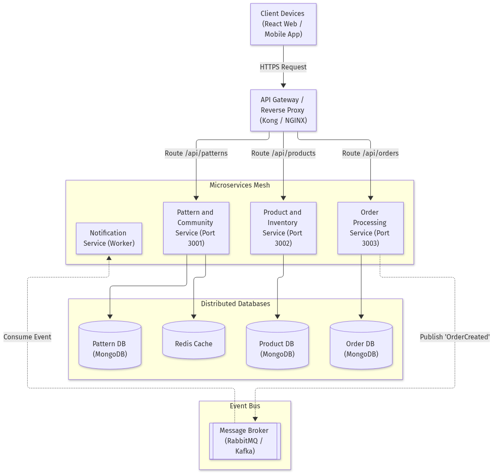
*Hình 6.1: Sơ đồ triển khai kiến trúc hướng dịch vụ SOA / Microservices (DIA-12)*

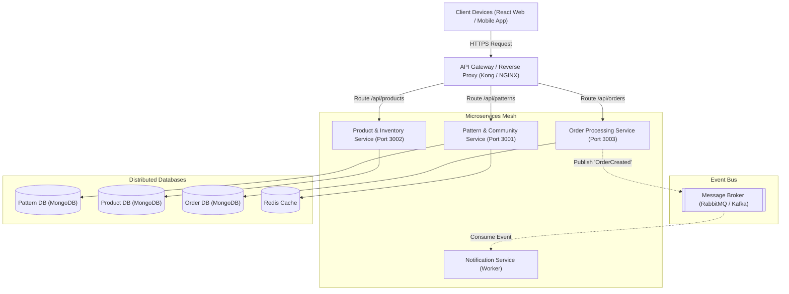

---

### VI.2 Applying Service Discovery Pattern

#### 1. Yêu Cầu Đặt Ra (Problem & Requirement)

Trong kiến trúc phân tán nhiều dịch vụ (Microservices), các phiên bản (instances) của `Order Service` hay `Pattern Service` có thể tự động tăng giảm linh hoạt (Auto-scaling trên Kubernetes hoặc Docker Swarm). Địa chỉ IP và Port của từng instance thay đổi liên tục, khiến API Gateway hoặc các service khác không thể cấu hình cứng (hard-code) địa chỉ IP của nhau.

#### 2. Tích Hợp Mẫu Thiết Kế Service Discovery

Hệ thống áp dụng mẫu **Service Discovery Pattern** kết hợp với **Service Registry** (ví dụ: Netflix Eureka, HashiCorp Consul hoặc Kubernetes CoreDNS):

- **Service Registration (Tự Đăng Ký):** Khi một service instance khởi động, nó tự động gửi thông tin (Tên dịch vụ, IP, Port, Health check URL) lên Service Registry.
- **Heartbeat Check (Kiểm Tra Sức Khỏe):** Service định kỳ gửi tín hiệu "nhịp tim" (heartbeat) lên Registry. Nếu service bị crash, Registry tự động gỡ bỏ instance đó khỏi danh sách sẵn sàng.
- **Service Discovery (Khám Phá Dịch Vụ):** Khi API Gateway cần chuyển tiếp request tới `Order Service`, nó truy vấn Registry để lấy danh sách các IP đang hoạt động và áp dụng thuật toán cân bằng tải (Client-side / Server-side Load Balancing như Round-Robin).

#### 3. Sơ Đồ Khám Phá Dịch Vụ (Service Discovery Diagram)

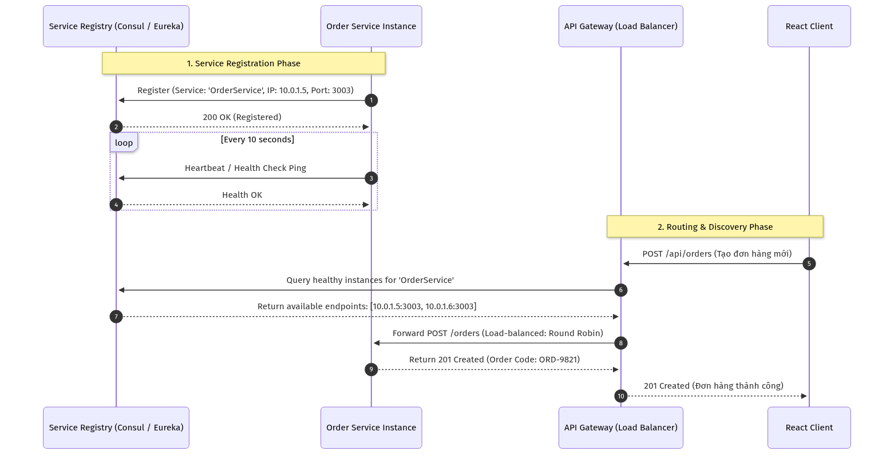
*Hình 6.2: Sơ đồ tương tác đăng ký và khám phá dịch vụ tự động (DIA-13)*

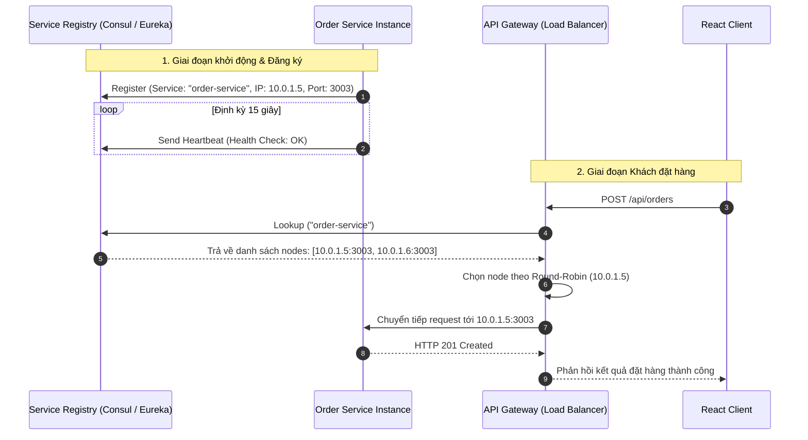

---

---

## VII. DANH MỤC RESTFUL API & TÀI NGUYÊN SƠ ĐỒ HỆ THỐNG

### 7.1 Danh Mục RESTful API Đầy Đủ

| Module | Method | Endpoint | DTO / Payload | HTTP Code | Chức Năng Nghiệp Vụ |
| :--- | :---: | :--- | :--- | :---: | :--- |
| **Patterns** | `GET` | `/api/patterns` | Query: `q, category, difficulty` | `200 OK` | Lấy danh sách chart có bộ lọc & tìm kiếm regex |
| | `GET` | `/api/patterns/featured` | Không | `200 OK` | Lấy top chart nhiều lượt xem và like |
| | `GET` | `/api/patterns/:id` | Param: `id` | `200 OK` | Chi tiết chart, tự động tăng view_count qua `$inc` |
| | `PATCH` | `/api/patterns/:id/like` | Param: `id` | `200 OK` | Thả tim chart, tự động tăng likes qua `$inc` |
| | `POST` | `/api/patterns` | Body: `CreatePatternDto` | `201 Created`| Thêm mới mẫu chart móc len (Admin) |
| | `PUT` | `/api/patterns/:id` | Body: `UpdatePatternDto` | `200 OK` | Cập nhật thông tin mẫu chart (Admin) |
| | `DELETE`| `/api/patterns/:id` | Param: `id` | `200 OK` | Xóa mẫu chart khỏi database (Admin) |
| **Comments** | `GET` | `/api/comments` | Query: `patternId` | `200 OK` | Lấy danh sách bình luận theo mẫu chart |
| | `POST` | `/api/comments` | Body: `CreateCommentDto` | `201 Created`| Gửi bình luận và đánh giá số sao (1-5 sao) |
| **Products** | `GET` | `/api/products` | Query: `category, search` | `200 OK` | Lấy danh mục phụ kiện và dụng cụ đan móc |
| | `GET` | `/api/products/:id` | Param: `id` | `200 OK` | Lấy chi tiết thông tin phụ kiện |
| | `POST` | `/api/products` | Body: Product data | `201 Created`| Thêm mới phụ kiện len sợi (Admin) |
| | `PUT` | `/api/products/:id` | Body: Product data | `200 OK` | Cập nhật thông tin phụ kiện (Admin) |
| | `DELETE`| `/api/products/:id` | Param: `id` | `200 OK` | Xóa phụ kiện khỏi database (Admin) |
| **Orders** | `POST` | `/api/orders` | Body: `CreateOrderDto` | `201 Created`| Khách gửi đơn đặt hàng từ giỏ hàng |
| | `GET` | `/api/orders` | Query: `status, phone` | `200 OK` | Lấy danh sách toàn bộ đơn hàng (Admin) |
| | `GET` | `/api/orders/lookup` | Query: `q` (Mã đơn hoặc SĐT)| `200 OK` | Khách tra cứu tình trạng đơn hàng của mình |
| | `PATCH` | `/api/orders/:id/status`| Body: `{ status }` | `200 OK` | Cập nhật trạng thái chu trình đơn hàng (Admin) |
| | `DELETE`| `/api/orders/:id` | Param: `id` | `200 OK` | Xóa đơn hàng (Admin) |
| **Blogs** | `GET` | `/api/blogs` | Query: `category` | `200 OK` | Lấy danh sách bài viết cẩm nang đan móc |
| | `GET` | `/api/blogs/:idOrSlug` | Param: `idOrSlug` | `200 OK` | Chi tiết bài viết (tăng views qua `$inc`) |
| | `POST` | `/api/blogs` | Body: Blog data | `201 Created`| Đăng bài viết cẩm nang mới (Admin) |
| | `DELETE`| `/api/blogs/:id` | Param: `id` | `200 OK` | Xóa bài viết cẩm nang (Admin) |
| **Categories**| `GET` | `/api/categories` | Query: `type` | `200 OK` | Lấy danh mục phân loại (`pattern` / `product`) |
| | `POST` | `/api/categories` | Body: Category data | `201 Created`| Tạo danh mục mới (Admin) |
| | `DELETE`| `/api/categories/:id` | Param: `id` | `200 OK` | Xóa danh mục (Admin) |

---

---

### VII.2 Danh Mục 13 Sơ Đồ Hệ Thống Đính Kèm (Tệp Ảnh PNG, Vector SVG & Mã Nguồn)

Tất cả 13 sơ đồ phân tích và thiết kế của dự án đã được kết xuất sẵn thành các tệp tin hình ảnh riêng biệt độ nét cao (**PNG** và vector **SVG**) cùng tệp mã nguồn Mermaid (**MMD**) độc lập đặt tại thư mục [`doc/diagrams/`](./diagrams/) kèm một trang HTML giao diện đồ họa vector tương tác trực tiếp:

- **Bảng chú thích chi tiết:** [`doc/diagrams/DANH_MUC_SO_DO.md`](./diagrams/DANH_MUC_SO_DO.md)
- **Trang xem toàn bộ sơ đồ đồ họa trực quan:** [`doc/diagrams/view_diagrams.html`](./diagrams/view_diagrams.html) *(Mở bằng trình duyệt Chrome/Edge là xem và zoom phóng to được ngay lập tức)*.

| STT | Mã Sơ Đồ | Tên Sơ Đồ Tiếng Việt | Loại Sơ Đồ | Tệp Ảnh PNG | Tệp Vector SVG | Mã Nguồn MMD |
| :-: | :--- | :--- | :--- | :--- | :--- | :--- |
| **01** | `DIA-01` | **Sơ Đồ Ngữ Cảnh Hệ Thống (Context Diagram)** | Architecture / Data Flow | [`01_context_diagram.png`](./diagrams/images/01_context_diagram.png) | [`01_context_diagram.svg`](./diagrams/images/01_context_diagram.svg) | [`01_context_diagram.mmd`](./diagrams/01_context_diagram.mmd) |
| **02** | `DIA-02` | **Sơ Đồ Use Case Tổng Thể (16 Chức Năng)** | Use Case Diagram | [`02_system_usecase_diagram.png`](./diagrams/images/02_system_usecase_diagram.png) | [`02_system_usecase_diagram.svg`](./diagrams/images/02_system_usecase_diagram.svg) | [`02_system_usecase_diagram.mmd`](./diagrams/02_system_usecase_diagram.mmd) |
| **03** | `DIA-03` | **Sơ Đồ Tuần Tự Quy Trình Đặt Hàng** | Sequence Diagram | [`03_sequence_checkout_order.png`](./diagrams/images/03_sequence_checkout_order.png) | [`03_sequence_checkout_order.svg`](./diagrams/images/03_sequence_checkout_order.svg) | [`03_sequence_checkout_order.mmd`](./diagrams/03_sequence_checkout_order.mmd) |
| **04** | `DIA-04` | **Sơ Đồ Tuần Tự Xem Chi Tiết & Thả Tim Chart** | Sequence Diagram | [`04_sequence_view_like_pattern.png`](./diagrams/images/04_sequence_view_like_pattern.png) | [`04_sequence_view_like_pattern.svg`](./diagrams/images/04_sequence_view_like_pattern.svg) | [`04_sequence_view_like_pattern.mmd`](./diagrams/04_sequence_view_like_pattern.mmd) |
| **05** | `DIA-05` | **Sơ Đồ Tuần Tự Gửi Đánh Giá & Bình Luận Sao** | Sequence Diagram | [`05_sequence_submit_comment.png`](./diagrams/images/05_sequence_submit_comment.png) | [`05_sequence_submit_comment.svg`](./diagrams/images/05_sequence_submit_comment.svg) | [`05_sequence_submit_comment.mmd`](./diagrams/05_sequence_submit_comment.mmd) |
| **06** | `DIA-06` | **Sơ Đồ Hoạt Động Quy Trình Thanh Toán Giỏ Hàng** | Activity Diagram | [`06_activity_checkout.png`](./diagrams/images/06_activity_checkout.png) | [`06_activity_checkout.svg`](./diagrams/images/06_activity_checkout.svg) | [`06_activity_checkout.mmd`](./diagrams/06_activity_checkout.mmd) |
| **07** | `DIA-07` | **Sơ Đồ Hoạt Động Trợ Lý Đếm Hàng Móc Len** | Activity Diagram | [`07_activity_row_counter.png`](./diagrams/images/07_activity_row_counter.png) | [`07_activity_row_counter.svg`](./diagrams/images/07_activity_row_counter.svg) | [`07_activity_row_counter.mmd`](./diagrams/07_activity_row_counter.mmd) |
| **08** | `DIA-08` | **Sơ Đồ Máy Trạng Thái Đơn Hàng (State Machine)** | State Machine Diagram | [`08_state_order_status.png`](./diagrams/images/08_state_order_status.png) | [`08_state_order_status.svg`](./diagrams/images/08_state_order_status.svg) | [`08_state_order_status.mmd`](./diagrams/08_state_order_status.mmd) |
| **09** | `DIA-09` | **Sơ Đồ Lớp Thực Thể Dữ Liệu (Class Diagram)** | Class Diagram | [`09_class_diagram_entities.png`](./diagrams/images/09_class_diagram_entities.png) | [`09_class_diagram_entities.svg`](./diagrams/images/09_class_diagram_entities.svg) | [`09_class_diagram_entities.mmd`](./diagrams/09_class_diagram_entities.mmd) |
| **10** | `DIA-10` | **Sơ Đồ Thành Phần Vật Lý (Component Diagram)** | Component Diagram | [`10_component_diagram.png`](./diagrams/images/10_component_diagram.png) | [`10_component_diagram.svg`](./diagrams/images/10_component_diagram.svg) | [`10_component_diagram.mmd`](./diagrams/10_component_diagram.mmd) |
| **11** | `DIA-11` | **Sơ Đồ Quan Hệ Thực Thể CSDL MongoDB (ERD)** | Entity-Relationship Diagram | [`11_database_erd.png`](./diagrams/images/11_database_erd.png) | [`11_database_erd.svg`](./diagrams/images/11_database_erd.svg) | [`11_database_erd.mmd`](./diagrams/11_database_erd.mmd) |
| **12** | `DIA-12` | **Sơ Đồ Triển Khai Kiến Trúc SOA (Deployment)** | SOA Deployment Diagram | [`12_soa_deployment.png`](./diagrams/images/12_soa_deployment.png) | [`12_soa_deployment.svg`](./diagrams/images/12_soa_deployment.svg) | [`12_soa_deployment.mmd`](./diagrams/12_soa_deployment.mmd) |
| **13** | `DIA-13` | **Sơ Đồ Khám Phá Dịch Vụ Service Discovery** | Sequence Diagram | [`13_service_discovery.png`](./diagrams/images/13_service_discovery.png) | [`13_service_discovery.svg`](./diagrams/images/13_service_discovery.svg) | [`13_service_discovery.mmd`](./diagrams/13_service_discovery.mmd) |


---

## VIII. KẾT LUẬN & ĐÁNH GIÁ TỔNG KẾT

Báo cáo dự án **CraftYarnHub** đã trình bày một cách toàn diện từ giai đoạn khảo sát yêu cầu, mô hình hóa phân tích, thiết kế kiến trúc hệ thống Client - Server, đặc tả cơ sở dữ liệu MongoDB đến việc cài đặt mã nguồn thực tế và đề xuất kiến trúc mở rộng SOA:

1. **Tính hoàn chỉnh:** Dự án đáp ứng 100% các tiêu chí của môn học **SDN302**: Không sử dụng mock data, cấu trúc NestJS module hóa tường minh, chuẩn hóa RESTful API, validation chặt chẽ và tương tác người dùng mượt mà trên nền tảng React Vite.
2. **Tính ứng dụng cao:** Sản phẩm giải quyết trực tiếp nhu cầu có thật của cộng đồng đan móc len với các tính năng sáng tạo như trợ lý đếm hàng có âm thanh và lưu trữ trạng thái cục bộ.
3. **Sự phối hợp nhóm cân bằng:** Cả 3 thành viên đều tham gia phát triển theo chiều dọc (Full-stack theo feature module), đảm bảo sự cân bằng khối lượng công việc và tính làm chủ mã nguồn cao nhất khi bảo vệ đồ án.
