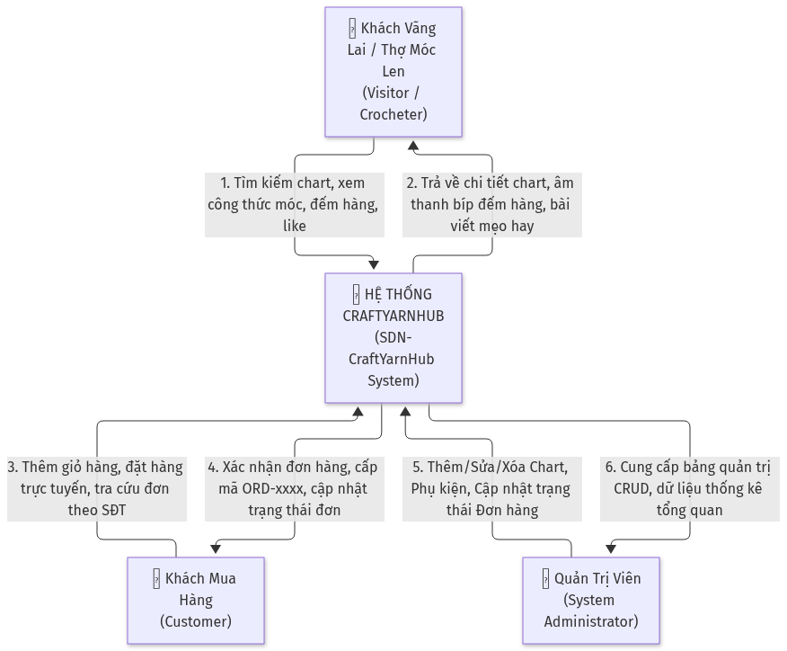
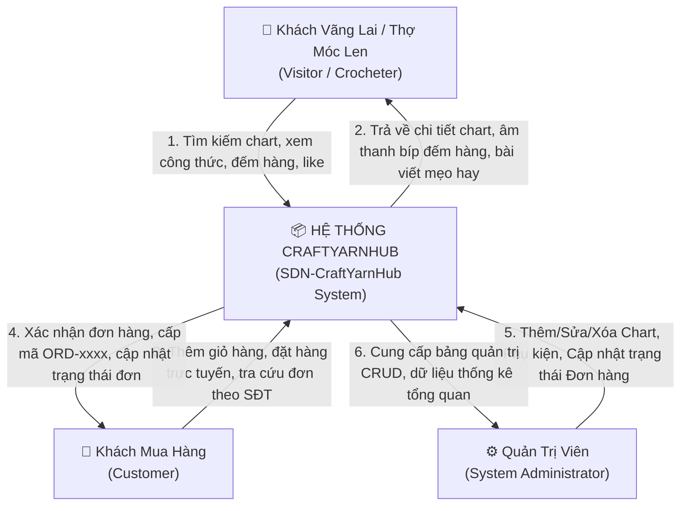
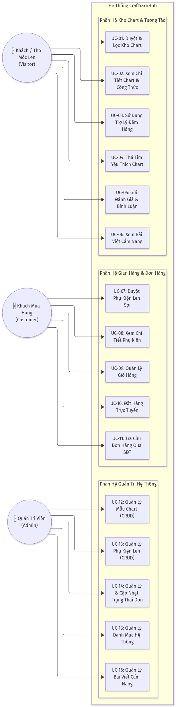
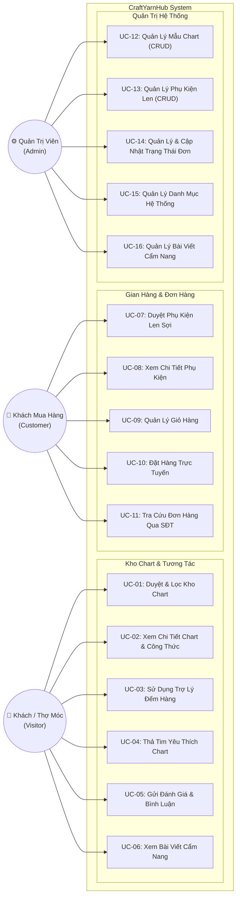
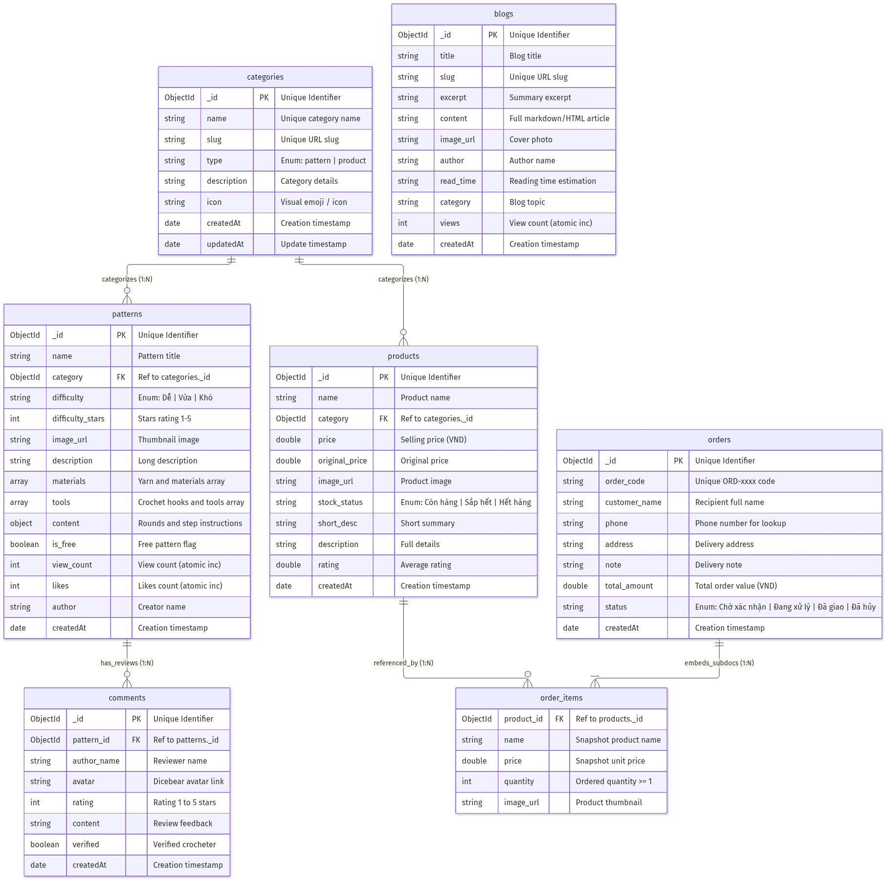
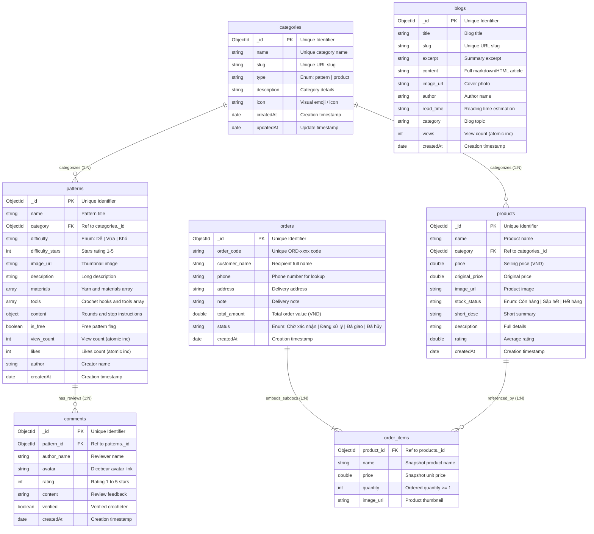

# TÀI LIỆU ĐẶC TẢ YÊU CẦU PHẦN MỀM (SRS)
## SOFTWARE REQUIREMENTS SPECIFICATION

**Dự án:** CraftYarnHub – Hệ Thống Quản Lý & Chia Sẻ Chart Móc Len & Phụ Kiện Handmade  
**Mã dự án:** SDN-CYH  
**Môn học:** SDN302 – Server-side Development with NodeJS, Express & MongoDB (FPT University)  
**Nhóm sinh viên thực hiện:**
- **Thành viên 1 (Trưởng nhóm):** Đinh Thị Thu Trang – MSSV: HE195077
- **Thành viên 2:** Nguyễn Thị Thắm – MSSV: HE191525
- **Thành viên 3:** Nguyễn Minh Đức – MSSV: HE194336  
**Phiên bản:** 1.0 Final  
**Ngôn ngữ:** Tiếng Việt  
**Ngày phát hành:** Tháng 11/2026  

---

## MỤC LỤC TỔNG QUAN

- [1. GIỚI THIỆU TỔNG QUAN](#1-giới-thiệu-tổng-quan)
  - [1.1 Mục Đích Tài Liệu](#11-mục-đích-tài-liệu)
  - [1.2 Quy Ước Tài Liệu](#12-quy-ước-tài-liệu)
  - [1.3 Phạm Vi Dự Án](#13-phạm-vi-dự-án)
  - [1.4 Tài Liệu Tham Khảo](#14-tài-liệu-tham-khảo)
- [2. MÔ TẢ TỔNG THỂ HỆ THỐNG](#2-mô-tả-tổng-thể-hệ-thống)
  - [2.1 Bối Cảnh Sản Phẩm & Sơ Đồ Ngữ Cảnh](#21-bối-cảnh-sản-phẩm--sơ-đồ-ngữ-cảnh)
  - [2.2 Các Tác Nhân Hệ Thống (Actors)](#22-các-tác-nhân-hệ-thống-actors)
  - [2.3 Giả Định & Sự Phụ Thuộc](#23-giả-định--sự-phụ-thuộc)
- [3. QUY TẮC NGHIỆP VỤ (BUSINESS RULES)](#3-quy-tắc-nghiệp-vụ-business-rules)
- [4. YÊU CẦU PHI CHỨC NĂNG (NON-FUNCTIONAL REQUIREMENTS)](#4-yêu-cầu-phi-chức-năng-non-functional-requirements)
- [5. SƠ ĐỒ USE CASE & ĐẶC TẢ CHI TIẾT TẤT CẢ USE CASES (16 USE CASES)](#5-sơ-đồ-use-case--đặc-tả-chi-tiết-tất-cả-use-cases-16-use-cases)
  - [5.1 Sơ Đồ Use Case Tổng Thể](#51-sơ-đồ-use-case-tổng-thể)
  - [5.2 Đặc Tả Chi Tiết 16 Use Cases (Dạng Bảng Chuẩn)](#52-đặc-tả-chi-tiết-16-use-cases-dạng-bảng-chuẩn)
    - [UC-01: Duyệt & Lọc Kho Chart Móc Len](#uc-01-duyệt--lọc-kho-chart-móc-len)
    - [UC-02: Xem Chi Tiết Chart & Công Thức Móc](#uc-02-xem-chi-tiết-chart--công-thức-móc)
    - [UC-03: Sử Dụng Trợ Lý Đếm Hàng Móc Len](#uc-03-sử-dụng-trợ-lý-đếm-hàng-móc-len)
    - [UC-04: Thả Tim Yêu Thích Chart Móc Len](#uc-04-thả-tim-yêu-thích-chart-móc-len)
    - [UC-05: Gửi Đánh Giá & Bình Luận Mẫu Chart](#uc-05-gửi-đánh-giá--bình-luận-mẫu-chart)
    - [UC-06: Xem Bài Viết Cẩm Nang Mẹo Đan Móc](#uc-06-xem-bài-viết-cẩm-nang-mẹo-đan-móc)
    - [UC-07: Duyệt & Lọc Phụ Kiện Len Sợi](#uc-07-duyệt--lọc-phụ-kiện-len-sợi)
    - [UC-08: Xem Chi Tiết Phụ Kiện & Dụng Cụ](#uc-08-xem-chi-tiết-phụ-kiện--dụng-cụ)
    - [UC-09: Quản Lý Giỏ Hàng Mua Sắm](#uc-09-quản-lý-giỏ-hàng-mua-sắm)
    - [UC-10: Đặt Hàng Trực Tuyến](#uc-10-đặt-hàng-trực-tuyến)
    - [UC-11: Tra Cứu Đơn Hàng Qua Số Điện Thoại](#uc-11-tra-cứu-đơn-hàng-qua-số-điện-thoại)
    - [UC-12: Quản Lý Mẫu Chart Móc Len (Admin)](#uc-12-quản-lý-mẫu-chart-móc-len-admin)
    - [UC-13: Quản Lý Phụ Kiện Dụng Cụ (Admin)](#uc-13-quản-lý-phụ-kiện-dụng-cụ-admin)
    - [UC-14: Quản Lý & Cập Nhật Trạng Thái Đơn Hàng (Admin)](#uc-14-quản-lý--cập-nhật-trạng-thái-đơn-hàng-admin)
    - [UC-15: Quản Lý Danh Mục Hệ Thống (Admin)](#uc-15-quản-lý-danh-mục-hệ-thống-admin)
    - [UC-16: Quản Lý Bài Viết Cẩm Nang (Admin)](#uc-16-quản-lý-bài-viết-cẩm-nang-admin)
- [6. CẤU TRÚC CƠ SỞ DỮ LIỆU MONGODB & SCHEMA CODE](#6-cấu-trúc-cơ-sở-dữ-liệu-mongodb--schema-code)
  - [6.1 Sơ Đồ Quan Hệ Thực Thể CSDL (ERD)](#61-sơ-đồ-quan-hệ-thực-thể-csdl-erd)
  - [6.2 Collection: patterns (Kho Chart)](#62-collection-patterns-kho-chart)
  - [6.3 Collection: products (Phụ Kiện)](#63-collection-products-phụ-kiện)
  - [6.4 Collection: orders (Đơn Đặt Hàng)](#64-collection-orders-đơn-đặt-hàng)
  - [6.5 Collection: categories (Danh Mục)](#65-collection-categories-danh-mục)
  - [6.6 Collection: comments (Bình Luận)](#66-collection-comments-bình-luận)
  - [6.7 Collection: blogs (Cẩm Nang)](#67-collection-blogs-cẩm-nang)
- [7. DANH MỤC RESTFUL API & TÀI NGUYÊN SƠ ĐỒ ĐÍNH KÈM](#7-danh-mục-restful-api--tài-nguyên-sơ-đồ-đính-kèm)

---

## 1. GIỚI THIỆU TỔNG QUAN

### 1.1 Mục Đích Tài Liệu
Tài liệu Đặc tả Yêu cầu Phần mềm (Software Requirements Specification - SRS) này mô tả toàn diện và chi tiết các yêu cầu chức năng, yêu cầu phi chức năng, quy tắc nghiệp vụ, cấu trúc cơ sở dữ liệu MongoDB và thiết kế hệ thống cho dự án **CraftYarnHub (Tiệm Len Xinh)**.  
Tài liệu đóng vai trò là hợp đồng kỹ thuật và căn cứ nghiệm thu chính thức cho đồ án môn học **SDN302 (Server-side Development with NodeJS, Express & MongoDB)** tại Đại học FPT.

### 1.2 Quy Ước Tài Liệu
- Các mã định danh yêu cầu và nghiệp vụ được chuẩn hóa như sau:
  - `UC-xx`: Use Case (Trường hợp sử dụng chức năng)
  - `BR-xx`: Business Rule (Quy tắc nghiệp vụ hệ thống)
  - `NFR-xx`: Non-Functional Requirement (Yêu cầu phi chức năng)
  - `FE-xx`: Major Feature (Tính năng chính)
  - `PRE-x` / `POST-x`: Tiền điều kiện / Hậu điều kiện của Use Case
- Mức độ ưu tiên chức năng:
  - `High (Must Have)`: Bắt buộc hoàn thành để nghiệm thu đồ án.
  - `Medium (Should Have)`: Nên có để tăng trải nghiệm người dùng.
  - `Low (Could Have)`: Tùy chọn mở rộng trong tương lai.

### 1.3 Phạm Vi Dự Án
- **Trong phạm vi (In-Scope):**
  - Cung cấp cổng thư viện chart móc len miễn phí, công thức chi tiết R1, R2... và checklist dụng cụ.
  - Tích hợp trợ lý đếm hàng đan móc (Row Counter) phát âm thanh bíp tần số sóng sin và lưu vết cục bộ.
  - Gian hàng phụ kiện len sợi, giỏ hàng client-side đồng bộ `localStorage`, quy trình tạo đơn hàng trực tiếp lưu vào MongoDB.
  - Hệ thống tra cứu đơn hàng nhanh chóng bằng Số điện thoại hoặc Mã đơn không cần đăng nhập.
  - Bảng điều khiển quản trị viên (`/admin`) cho phép thực hiện đầy đủ 4 thao tác CRUD trên Chart, Sản phẩm, Đơn hàng và chuyển đổi trạng thái xử lý đơn.
- **Ngoài phạm vi (Out-of-Scope):**
  - Tích hợp cổng thanh toán trực tuyến bên thứ ba (VNPay, MoMo, ZaloPay sandbox).
  - Tích hợp định vị GPS của đơn vị giao hàng bên thứ ba (GHTK, GHN API).

### 1.4 Tài Liệu Tham Khảo
- Giáo trình môn học **SDN302** – Đại học FPT (Slot 01 - 20).
- Khung tài liệu yêu cầu phần mềm Karl Wiegers & Joy Beatty (Software Requirements, 3rd Edition).
- Tài liệu chính thức NestJS Documentation v10 ([https://docs.nestjs.com](https://docs.nestjs.com)).
- Tài liệu chính thức Mongoose ODM v8 ([https://mongoosejs.com](https://mongoosejs.com)).

---

## 2. MÔ TẢ TỔNG THỂ HỆ THỐNG

### 2.1 Bối Cảnh Sản Phẩm & Sơ Đồ Ngữ Cảnh
CraftYarnHub là hệ thống phần mềm Web Client - Server độc lập, giải quyết nhu cầu tra cứu chart móc len và mua sắm phụ kiện thủ công tập trung.


*Hình 2.1: Sơ đồ ngữ cảnh trao đổi dữ liệu hệ thống CraftYarnHub (DIA-01)*



### 2.2 Các Tác Nhân Hệ Thống (Actors)

| Mã Tác Nhân | Tên Tác Nhân | Vai Trò & Nhiệm Vụ Trong Hệ Thống |
| :---: | :--- | :--- |
| **ACT-01** | **Visitor / Crocheter** (Thợ Móc Len) | Khách truy cập duyệt danh sách chart, tìm kiếm nguyên liệu, xem hướng dẫn chi tiết từng vòng móc, sử dụng trợ lý đếm hàng có âm thanh, thả tim và gửi nhận xét đánh giá sao. |
| **ACT-02** | **Customer** (Khách Mua Hàng) | Người dùng chọn mua phụ kiện, quản lý số lượng trong giỏ hàng, điền thông tin người nhận để gửi đơn đặt hàng và tra cứu hành trình đơn bằng số điện thoại. |
| **ACT-03** | **Administrator** (Quản Trị Viên) | Người quản lý hệ thống có toàn quyền thực hiện CRUD trên mẫu chart, phụ kiện, duyệt và chuyển trạng thái đơn hàng (`Chờ xác nhận` $\rightarrow$ `Đang xử lý` $\rightarrow$ `Đã giao` / `Đã hủy`). |

### 2.3 Giả Định & Sự Phụ Thuộc
- Môi trường máy chủ có cài đặt và duy trì kết nối mạng ổn định với daemon MongoDB (cổng mặc định `27017` hoặc MongoDB Atlas).
- Trình duyệt phía người dùng hỗ trợ chuẩn HTML5 Web Audio API để phát âm thanh tiếng bíp của bộ đếm hàng.
- Trình duyệt cho phép bật tính năng `LocalStorage` để lưu trữ trạng thái giỏ hàng và số hàng đang móc.

---

## 3. QUY TẮC NGHIỆP VỤ (BUSINESS RULES)

| ID | Tên Quy Tắc | Định Nghĩa Quy Tắc | Phân Loại | Phạm Vi Áp Dụng |
| :--- | :--- | :--- | :---: | :--- |
| **BR-01** | Unique Category Slug | Mỗi danh mục phải có chuỗi `slug` và `name` duy nhất trong collection `categories` để phục vụ định tuyến URL thân thiện. | Constraint | Categories Module |
| **BR-02** | Atomic Metric Update | Chỉ số lượt xem (`view_count`) và lượt thích (`likes`) bắt buộc phải tăng qua toán tử nguyên tử `$inc` của MongoDB, nghiêm cấm ghi đè thủ công để chống race-condition. | Constraint | Patterns, Blogs |
| **BR-03** | Order Code Uniqueness | Mã đơn hàng bắt buộc tuân thủ cấu trúc `ORD-` + [Chuỗi ngẫu nhiên 6 chữ số] và là giá trị duy nhất tuyệt đối trên toàn bộ cơ sở dữ liệu. | Fact | Orders Module |
| **BR-04** | Valid Phone Format | Số điện thoại nhận hàng phải là chuỗi số có độ dài từ 10 đến 11 chữ số theo chuẩn mạng viễn thông Việt Nam. | Constraint | Orders Module |
| **BR-05** | Minimum Cart Threshold | Đơn hàng chỉ được phép khởi tạo khi số lượng mặt hàng trong giỏ $\ge 1$ và số lượng mỗi mặt hàng $\ge 1$. | Constraint | Checkout Policy |
| **BR-06** | Rating Constraints | Đánh giá chất lượng chart chỉ chấp nhận giá trị số nguyên từ 1 đến 5 sao. | Constraint | Comments Module |
| **BR-07** | Order Status State Machine | Trạng thái đơn hàng chỉ được chuyển đổi hợp lệ qua 4 trạng thái: `Chờ xác nhận` $\rightarrow$ `Đang xử lý` $\rightarrow$ `Đã giao` hoặc `Đã hủy`. | Constraint | Order Workflow |
| **BR-08** | Positive Pricing | Giá bán (`price`) của phụ kiện phải là số thực không âm ($\ge 0$). | Constraint | Products Module |

---

## 4. YÊU CẦU PHI CHỨC NĂNG (NON-FUNCTIONAL REQUIREMENTS)

| ID | Tiêu Chí | Chi Tiết Đặc Tả | Chỉ Số Đo Lường |
| :--- | :--- | :--- | :--- |
| **NFR-01** | **Thời Gian Phản Hồi** | Toàn bộ các API `GET`, `POST`, `PUT`, `PATCH`, `DELETE` phải hoàn tất xử lý và phản hồi về client dưới 300ms trong mạng nội bộ. | Thời gian đáp ứng < 300ms |
| **NFR-02** | **Tính Toàn Vẹn Dữ Liệu** | Sử dụng DTO (`class-validator`) và NestJS `ValidationPipe` toàn cục để lọc sạch dữ liệu đầu vào, từ chối các request sai kiểu hoặc thiếu trường bắt buộc. | 100% Request được kiểm soát qua DTO |
| **NFR-03** | **Độ Tương Thích Giao Diện** | Giao diện React hiển thị chuẩn xác, không vỡ layout trên mọi kích thước màn hình: Mobile (375px+), Tablet (768px+) và Desktop (1200px+). | Ant Design Grid System chuẩn Responsive |
| **NFR-04** | **Phản Hồi Âm Thanh** | Âm thanh tiếng bíp đếm hàng phát ra tức thì khi click chuột (< 10ms) nhờ tạo sóng trực tiếp từ Web Audio API (không load file âm thanh qua mạng). | Độ trễ âm thanh < 10ms |
| **NFR-05** | **Khả Năng Phục Hồi Dữ Liệu** | Cung cấp sẵn kịch bản `seed.ts` nạp lại 100% dữ liệu mẫu thực tế chỉ bằng một dòng lệnh `npm run seed`. | Khôi phục toàn bộ database < 5 giây |

---

## 5. SƠ ĐỒ USE CASE & ĐẶC TẢ CHI TIẾT TẤT CẢ USE CASES (16 USE CASES)

### 5.1 Sơ Đồ Use Case Tổng Thể


*Hình 5.1: Sơ đồ Use Case tổng thể toàn bộ 16 chức năng của hệ thống (DIA-02)*



---

### 5.2 Đặc Tả Chi Tiết 16 Use Cases (Dạng Bảng Chuẩn)

---

#### UC-01: Duyệt & Lọc Kho Chart Móc Len
| Thuộc Tính Đặc Tả | Chi Tiết Đặc Tả |
| :--- | :--- |
| **UC ID and Name:** | **UC-01 – Duyệt & Lọc Kho Chart Móc Len (Browse and Filter Patterns)** |
| **Created By:** | Đinh Thị Thu Trang (HE195077) |
| **Date Created:** | 10/11/2026 |
| **Primary Actor:** | Visitor / Crocheter |
| **Secondary Actors:**| NestJS Backend, MongoDB Database |
| **Trigger:** | Người dùng chọn menu "Kho Chart" hoặc gõ từ khóa tìm kiếm trên thanh Header Navbar. |
| **Description:** | Cho phép thợ móc len tìm kiếm mẫu móc theo từ khóa (tên chart, nguyên liệu), phân loại theo Danh mục và lọc theo Độ khó (`Dễ`, `Vừa`, `Khó`). |
| **Preconditions:** | `PRE-1`: Máy chủ Backend và Database MongoDB đang hoạt động bình thường. |
| **Postconditions:** | `POST-1`: Danh sách các mẫu chart thỏa mãn điều kiện lọc được hiển thị dưới dạng lưới thẻ Card. |
| **Normal Flow:** | **1.0 Luồng Cơ Bản – Tìm Kiếm và Lọc Chart**<br>1. Người dùng truy cập trang `/patterns`.<br>2. Hệ thống gọi API `GET /api/categories?type=pattern` nạp danh sách danh mục vào dropdown.<br>3. Hệ thống gọi API `GET /api/patterns` lấy toàn bộ danh sách chart mới nhất.<br>4. Người dùng nhập từ khóa tìm kiếm vào ô Input (ví dụ: "súp lơ").<br>5. Client áp dụng Debounce 250ms, sau đó gọi `GET /api/patterns?q=s%C3%BAp%20l%C6%A1`.<br>6. Server xử lý `RegExp(q, 'i')` trên các trường `name`, `description`, `materials`.<br>7. Server trả về mã `200 OK` kèm danh sách bản ghi phù hợp.<br>8. Client cập nhật danh sách các thẻ `PatternCard` lên giao diện. |
| **Alternative Flows:** | **1.1 Lọc theo Độ khó & Danh mục:**<br>Tại bước 4, người dùng chọn Độ khó là "Dễ" và Danh mục là "Rau Củ". Client gọi API kèm query `?category=...&difficulty=Dễ`. Hệ thống hiển thị kết quả lọc giao nhau.<br>**1.2 Đặt lại bộ lọc (Reset):**<br>Người dùng bấm nút "Đặt Lại", Client xóa trắng query param và tải lại danh sách đầy đủ. |
| **Exceptions:** | **1.0.E1: Không có kết quả phù hợp:**<br>Nếu mảng dữ liệu trả về rỗng (`length == 0`), Client hiển thị component `Empty`: "Không tìm thấy mẫu chart nào phù hợp với bộ lọc của bạn" kèm nút "Xóa bộ lọc". |
| **Priority:** | High (Must Have) |
| **Frequency of Use:** | Rất cao – Thợ móc len truy cập liên tục hàng ngày. |
| **Business Rules:** | `BR-01` |
| **Other Information:** | Áp dụng debounce ở client để tránh gửi request dồn dập khi người dùng đang gõ phím. |
| **Assumptions:** | Dữ liệu mẫu chart đã được nạp sẵn qua script seed. |

---

#### UC-02: Xem Chi Tiết Chart & Công Thức Móc
| Thuộc Tính Đặc Tả | Chi Tiết Đặc Tả |
| :--- | :--- |
| **UC ID and Name:** | **UC-02 – Xem Chi Tiết Chart & Công Thức Móc (View Pattern Detail)** |
| **Created By:** | Đinh Thị Thu Trang (HE195077) |
| **Date Created:** | 10/11/2026 |
| **Primary Actor:** | Visitor / Crocheter |
| **Secondary Actors:**| NestJS Backend, MongoDB Database |
| **Trigger:** | Người dùng nhấp chuột vào một thẻ mẫu chart tại Trang chủ hoặc Kho Chart. |
| **Description:** | Hiển thị toàn bộ công thức móc chi tiết từng vòng (R1, R2...), danh sách nguyên liệu, dụng cụ và checklist chuẩn bị đồ. |
| **Preconditions:** | `PRE-1`: Mẫu chart tồn tại hợp lệ với `_id` trong MongoDB. |
| **Postconditions:** | `POST-1`: Chỉ số `view_count` của mẫu chart tăng thêm 1 trong database.<br>`POST-2`: Toàn bộ công thức móc chi tiết được hiển thị. |
| **Normal Flow:** | **2.0 Luồng Cơ Bản – Xem Chi Tiết Chart**<br>1. Người dùng chọn 1 mẫu chart.<br>2. Client điều hướng tới `/patterns/:id` và gửi request `GET /api/patterns/:id`.<br>3. Server kiểm tra tính hợp lệ của ObjectId, gọi lệnh `$inc: { view_count: 1 }`, đồng thời `populate('category')`.<br>4. Server trả về mã `200 OK` kèm document chi tiết chart.<br>5. Client hiển thị ảnh lớn, tác giả, tag độ khó, danh mục, số lượt xem.<br>6. Client render bảng Checklist nguyên liệu và công thức móc từng bộ phận (Đầu, Thân, Tai...).<br>7. Client tự động nạp danh sách bình luận liên quan qua `GET /api/comments?patternId=:id`. |
| **Alternative Flows:** | **2.1 Tương tác Checklist:**<br>Người dùng bấm tick chọn vào từng checkbox nguyên liệu/dụng cụ để đánh dấu đồ đã chuẩn bị xong. |
| **Exceptions:** | **2.0.E1: ID không hợp lệ:** Server trả về `400 Bad Request` ("ID Chart không hợp lệ").<br>**2.0.E2: Không tìm thấy chart:** Server trả về `404 Not Found`. Client hiển thị nút "Quay lại Kho Chart". |
| **Priority:** | High (Must Have) |
| **Frequency of Use:** | Rất cao. |
| **Business Rules:** | `BR-02` |
| **Other Information:** | Công thức móc được định dạng font monospace rõ nét kèm highlight dòng chẵn lẻ. |
| **Assumptions:** | Không yêu cầu đăng nhập để xem chart (Chart miễn phí cộng đồng). |

---

#### UC-03: Sử Dụng Trợ Lý Đếm Hàng Móc Len
| Thuộc Tính Đặc Tả | Chi Tiết Đặc Tả |
| :--- | :--- |
| **UC ID and Name:** | **UC-03 – Sử Dụng Trợ Lý Đếm Hàng Móc Len (Use Row Counter Widget)** |
| **Created By:** | Đinh Thị Thu Trang (HE195077) |
| **Date Created:** | 10/11/2026 |
| **Primary Actor:** | Visitor / Crocheter |
| **Secondary Actors:**| Trình duyệt Web (HTML5 Web Audio API, LocalStorage) |
| **Trigger:** | Người dùng đang xem chi tiết mẫu chart và thực hành móc len. |
| **Description:** | Công cụ hỗ trợ đếm số hàng đang móc (R1, R2, R3...), phát âm thanh tiếng bíp phản hồi và tự động lưu tiến độ vào LocalStorage theo từng chart ID. |
| **Preconditions:** | `PRE-1`: Người dùng đang ở màn hình chi tiết mẫu chart (`/patterns/:id`). |
| **Postconditions:** | `POST-1`: Số hàng móc hiển thị đúng giá trị hiện tại.<br>`POST-2`: Tiến độ được lưu vào `localStorage` với key `crochet_row_:patternId`. |
| **Normal Flow:** | **3.0 Luồng Cơ Bản – Đếm Hàng Móc**<br>1. Client kiểm tra `localStorage` với key `crochet_row_:patternId`.<br>2. Nếu có dữ liệu cũ, khôi phục giá trị (ví dụ `R5`), nếu chưa có thì khởi tạo `R1`.<br>3. Thợ móc xong 1 hàng, bấm nút `[+]` trên widget.<br>4. Web Audio API tạo bộ dao động sóng sine 750Hz và phát âm thanh "bíp pop" (< 10ms).<br>5. Bộ đếm tăng lên `R6`, cập nhật `localStorage`.<br>6. Thợ móc tiếp tục cho đến khi hoàn thành mẫu. |
| **Alternative Flows:** | **3.1 Giảm số hàng (Tháo len):**<br>Người dùng móc sai, bấm nút `[-]`. Hệ thống phát âm thanh bíp trầm 450Hz và giảm số dòng (`count = Math.max(1, count - 1)`).<br>**3.2 Đặt lại (Reset):**<br>Người dùng bấm nút Reset, bộ đếm trở về `R1`. |
| **Exceptions:** | **3.0.E1: Trình duyệt chặn âm thanh:** Web Audio API tự động bắt try/catch, bộ đếm vẫn tăng/giảm bình thường mà không bị crash giao diện. |
| **Priority:** | High (Must Have) |
| **Frequency of Use:** | Rất cao trong suốt quá trình đan móc của người dùng. |
| **Business Rules:** | Không có |
| **Other Information:** | Phát âm thanh thuần bằng oscillator không cần tải file MP3 qua mạng giúp tiết kiệm băng thông. |
| **Assumptions:** | Trình duyệt người dùng cho phép lưu LocalStorage. |

---

#### UC-04: Thả Tim Yêu Thích Chart Móc Len
| Thuộc Tính Đặc Tả | Chi Tiết Đặc Tả |
| :--- | :--- |
| **UC ID and Name:** | **UC-04 – Thả Tim Yêu Thích Chart (Like Pattern)** |
| **Created By:** | Đinh Thị Thu Trang (HE195077) |
| **Date Created:** | 10/11/2026 |
| **Primary Actor:** | Visitor / Crocheter |
| **Secondary Actors:**| NestJS Backend, MongoDB Database |
| **Trigger:** | Người dùng bấm vào nút "Yêu thích" tại màn hình chi tiết chart. |
| **Description:** | Gửi yêu cầu tăng số lượt yêu thích của mẫu chart lên server và lưu vĩnh viễn vào MongoDB. |
| **Preconditions:** | `PRE-1`: Người dùng đang ở màn hình `/patterns/:id`. |
| **Postconditions:** | `POST-1`: Trường `likes` của mẫu chart tăng thêm 1 trong database.<br>`POST-2`: Icon trái tim chuyển thành màu đỏ và hiển thị thông báo thành công. |
| **Normal Flow:** | **4.0 Luồng Cơ Bản – Thả Tim Chart**<br>1. Người dùng bấm nút "Yêu thích".<br>2. Client gửi HTTP `PATCH /api/patterns/:id/like`.<br>3. Server gọi `findByIdAndUpdate(id, { $inc: { likes: 1 } }, { new: true })`.<br>4. MongoDB thực thi atomic increment và trả về document cập nhật.<br>5. Server trả về mã `200 OK` kèm số like mới.<br>6. Client cập nhật state `liked = true`, tăng số like hiển thị và hiện Toast "Đã thả tim chart!". |
| **Alternative Flows:** | Không có |
| **Exceptions:** | **4.0.E1: Lỗi kết nối mạng:** Client hiển thị thông báo lỗi "Không thể kết nối đến máy chủ". |
| **Priority:** | Medium (Should Have) |
| **Frequency of Use:** | Thường xuyên. |
| **Business Rules:** | `BR-02` |
| **Other Information:** | Ngăn chặn việc bấm spam nút like liên tục bằng state nội bộ client. |
| **Assumptions:** | Không yêu cầu đăng nhập. |

---

#### UC-05: Gửi Đánh Giá & Bình Luận Mẫu Chart
| Thuộc Tính Đặc Tả | Chi Tiết Đặc Tả |
| :--- | :--- |
| **UC ID and Name:** | **UC-05 – Gửi Đánh Giá & Bình Luận (Submit Review and Comment)** |
| **Created By:** | Đinh Thị Thu Trang (HE195077) |
| **Date Created:** | 10/11/2026 |
| **Primary Actor:** | Visitor / Crocheter |
| **Secondary Actors:**| NestJS Backend, MongoDB Database |
| **Trigger:** | Người dùng điền form đánh giá ở cuối trang chi tiết chart và bấm "Gửi Đánh Giá". |
| **Description:** | Thu thập họ tên, số sao đánh giá (1-5 sao) và nhận xét của người dùng, tự động tạo avatar Dicebear và lưu vào collection `comments`. |
| **Preconditions:** | `PRE-1`: Người dùng đang ở màn hình chi tiết chart hợp lệ. |
| **Postconditions:** | `POST-1`: Bản ghi đánh giá mới được lưu vào collection `comments`.<br>`POST-2`: Bình luận mới xuất hiện ngay lập tức ở đầu danh sách đánh giá. |
| **Normal Flow:** | **5.0 Luồng Cơ Bản – Gửi Đánh Giá**<br>1. Người dùng nhập họ tên, chọn số sao (1-5 sao), nhập nội dung đánh giá.<br>2. Người dùng bấm nút "Gửi Đánh Giá".<br>3. Client gửi HTTP `POST /api/comments` với payload `CreateCommentDto`.<br>4. `ValidationPipe` kiểm tra dữ liệu đầu vào theo quy tắc `BR-06`.<br>5. Server tạo link avatar tự động qua Dicebear dựa trên tên người dùng.<br>6. Server lưu vào MongoDB và trả về mã `201 Created` kèm comment document.<br>7. Client chèn bình luận vừa tạo vào đầu mảng state `comments`.<br>8. Client reset form và hiển thị Toast "Cảm ơn bạn đã gửi đánh giá!". |
| **Alternative Flows:** | Không có |
| **Exceptions:** | **5.0.E1: Thiếu trường bắt buộc:** Bỏ trống tên hoặc nội dung ➔ Client hiển thị thông báo lỗi form.<br>**5.0.E2: Số sao không hợp lệ:** DTO từ chối với lỗi "Đánh giá tối thiểu 1 sao, tối đa 5 sao". |
| **Priority:** | High (Must Have) |
| **Frequency of Use:** | Trung bình - Người dùng gửi nhận xét sau khi móc xong sản phẩm. |
| **Business Rules:** | `BR-06` |
| **Other Information:** | Bình luận được cập nhật ngay lập tức (Real-time UX) mà không cần tải lại toàn bộ trang. |
| **Assumptions:** | Tên người dùng được dùng làm seed để sinh ảnh đại diện hoạt hình ngẫu nhiên. |

---

#### UC-06: Xem Bài Viết Cẩm Nang Mẹo Đan Móc
| Thuộc Tính Đặc Tả | Chi Tiết Đặc Tả |
| :--- | :--- |
| **UC ID and Name:** | **UC-06 – Xem Bài Viết Cẩm Nang (Read Blog and Tips)** |
| **Created By:** | Nguyễn Minh Đức (HE194336) |
| **Date Created:** | 10/11/2026 |
| **Primary Actor:** | Visitor / Crocheter |
| **Secondary Actors:**| NestJS Backend, MongoDB Database |
| **Trigger:** | Người dùng bấm vào menu "Chuyện Của Len" hoặc bấm vào thẻ bài viết trên trang chủ. |
| **Description:** | Xem danh sách bài viết mẹo hay đan móc và đọc chi tiết bài viết với đường dẫn Slug thân thiện chuẩn SEO. |
| **Preconditions:** | `PRE-1`: Bài viết tồn tại trong collection `blogs`. |
| **Postconditions:** | `POST-1`: Chỉ số `views` của bài viết tăng thêm 1 trong database.<br>`POST-2`: Toàn văn bài viết được hiển thị lên màn hình. |
| **Normal Flow:** | **6.0 Luồng Cơ Bản – Đọc Bài Viết**<br>1. Người dùng bấm vào một bài viết (ví dụ: "Mẹo giấu len thừa siêu đẹp").<br>2. Client điều hướng tới `/blog/:slug` và gọi `GET /api/blogs/:slug`.<br>3. Server tìm bản ghi theo trường `slug`, tăng `views` qua `$inc` và trả về `200 OK`.<br>4. Client hiển thị ảnh bìa, tác giả, thời gian đọc, lượt xem và nội dung bài viết. |
| **Alternative Flows:** | Không có |
| **Exceptions:** | **6.0.E1: Sai Slug bài viết:** Server trả về `404 Not Found`. Client hiển thị nút "Quay lại trang Blog". |
| **Priority:** | Medium (Should Have) |
| **Frequency of Use:** | Thường xuyên. |
| **Business Rules:** | `BR-01`, `BR-02` |
| **Other Information:** | Hỗ trợ tìm kiếm bài viết theo cả ObjectId hoặc slug. |
| **Assumptions:** | Bài viết được định dạng bằng văn bản có ngắt đoạn rõ ràng. |

---

#### UC-07: Duyệt & Lọc Phụ Kiện Len Sợi
| Thuộc Tính Đặc Tả | Chi Tiết Đặc Tả |
| :--- | :--- |
| **UC ID and Name:** | **UC-07 – Duyệt & Lọc Phụ Kiện Len Sợi (Browse Accessories)** |
| **Created By:** | Nguyễn Thị Thắm (HE191525) |
| **Date Created:** | 10/11/2026 |
| **Primary Actor:** | Customer |
| **Secondary Actors:**| NestJS Backend, MongoDB Database |
| **Trigger:** | Người dùng bấm chọn menu "Phụ Kiện" trên Navbar. |
| **Description:** | Duyệt danh mục phụ kiện đan móc (len sợi, kim móc, mắt thú, bông gòn), lọc theo Tabs danh mục và tìm kiếm theo tên phụ kiện. |
| **Preconditions:** | `PRE-1`: Máy chủ backend đang hoạt động. |
| **Postconditions:** | `POST-1`: Danh sách thẻ phụ kiện hiển thị đầy đủ giá tiền, ảnh và trạng thái kho. |
| **Normal Flow:** | **7.0 Luồng Cơ Bản – Duyệt Phụ Kiện**<br>1. Người dùng truy cập trang `/accessories`.<br>2. Client gọi `GET /api/categories?type=product` để nạp các tab danh mục.<br>3. Client gọi `GET /api/products` để lấy toàn bộ danh sách phụ kiện.<br>4. Người dùng bấm chuyển tab (ví dụ: "Kim Móc") hoặc gõ tìm kiếm.<br>5. Client gửi query `category=kim-moc` lên server và render lại danh sách sản phẩm. |
| **Alternative Flows:** | Không có |
| **Exceptions:** | **7.0.E1: Danh mục trống:** Hiển thị component Empty thông báo không có sản phẩm. |
| **Priority:** | High (Must Have) |
| **Frequency of Use:** | Cao. |
| **Business Rules:** | `BR-08` |
| **Other Information:** | Giá tiền được format tự động theo chuẩn tiền tệ Việt Nam (VNĐ). |
| **Assumptions:** | Không yêu cầu đăng nhập. |

---

#### UC-08: Xem Chi Tiết Phụ Kiện & Dụng Cụ
| Thuộc Tính Đặc Tả | Chi Tiết Đặc Tả |
| :--- | :--- |
| **UC ID and Name:** | **UC-08 – Xem Chi Tiết Phụ Kiện (View Product Detail)** |
| **Created By:** | Nguyễn Thị Thắm (HE191525) |
| **Date Created:** | 10/11/2026 |
| **Primary Actor:** | Customer |
| **Secondary Actors:**| NestJS Backend, MongoDB Database |
| **Trigger:** | Người dùng bấm vào thẻ sản phẩm phụ kiện tại trang `/accessories` hoặc trang chủ. |
| **Description:** | Xem ảnh lớn sản phẩm, giá bán, giá gốc, tỷ lệ giảm giá, mô tả công dụng chi tiết, chính sách đổi trả và chọn số lượng để thêm vào giỏ. |
| **Preconditions:** | `PRE-1`: Sản phẩm tồn tại với `_id` hợp lệ trong collection `products`. |
| **Postconditions:** | `POST-1`: Toàn bộ thông tin chi tiết sản phẩm được hiển thị đầy đủ. |
| **Normal Flow:** | **8.0 Luồng Cơ Bản – Xem Chi Tiết Phụ Kiện**<br>1. Người dùng bấm vào một phụ kiện.<br>2. Client điều hướng tới `/accessories/:id` và gửi request `GET /api/products/:id`.<br>3. Server kiểm tra ID, populate category và trả về mã `200 OK`.<br>4. Client hiển thị ảnh lớn, tag tồn kho, giá bán, bộ chọn số lượng (1-99).<br>5. Người dùng tùy chỉnh số lượng và bấm nút "Thêm Vào Giỏ" hoặc "Mua Ngay". |
| **Alternative Flows:** | **8.1 Mua Ngay:**<br>Người dùng bấm "Mua Ngay", client thêm sản phẩm vào giỏ hàng và tự động chuyển hướng thẳng sang màn hình `/cart`. |
| **Exceptions:** | **8.0.E1: ID không tồn tại:** Server trả về `404 Not Found`. Client hiển thị nút quay lại danh mục phụ kiện. |
| **Priority:** | High (Must Have) |
| **Frequency of Use:** | Thường xuyên. |
| **Business Rules:** | `BR-08` |
| **Other Information:** | Có tích hợp các cam kết chất lượng và hỗ trợ đổi trả 7 ngày. |
| **Assumptions:** | Dữ liệu sản phẩm có sẵn trong MongoDB. |

---

#### UC-09: Quản Lý Giỏ Hàng Mua Sắm
| Thuộc Tính Đặc Tả | Chi Tiết Đặc Tả |
| :--- | :--- |
| **UC ID and Name:** | **UC-09 – Quản Lý Giỏ Hàng Mua Sắm (Manage Shopping Cart)** |
| **Created By:** | Nguyễn Thị Thắm (HE191525) |
| **Date Created:** | 10/11/2026 |
| **Primary Actor:** | Customer |
| **Secondary Actors:**| Trình duyệt Web (CartContext, LocalStorage) |
| **Trigger:** | Người dùng bấm "Thêm vào giỏ" hoặc bấm vào icon Giỏ Hàng trên Navbar. |
| **Description:** | Quản lý danh sách phụ kiện dự định mua: tăng/giảm số lượng từng món, xóa từng món, xóa toàn bộ giỏ và tự động tính tổng tiền thanh toán. |
| **Preconditions:** | `PRE-1`: Trình duyệt hỗ trợ `LocalStorage`. |
| **Postconditions:** | `POST-1`: Trạng thái giỏ hàng được đồng bộ vào `localStorage` với key `crochet_cart`.<br>`POST-2`: Badge số lượng trên icon giỏ hàng ở Navbar cập nhật tương ứng. |
| **Normal Flow:** | **9.0 Luồng Cơ Bản – Thao Tác Giỏ Hàng**<br>1. Người dùng bấm "Thêm vào giỏ" tại một sản phẩm.<br>2. `CartContext` kiểm tra: nếu sản phẩm đã có trong giỏ thì tăng số lượng (`quantity + N`), nếu chưa có thì thêm phần tử mới.<br>3. Client lưu mảng giỏ hàng mới vào `localStorage`.<br>4. Người dùng mở trang `/cart`.<br>5. Client hiển thị danh sách các món, hình ảnh, đơn giá, ô nhập số lượng và tổng tiền.<br>6. Người dùng thay đổi số lượng qua `InputNumber`, tổng tiền tự động tính lại tức thì. |
| **Alternative Flows:** | **9.1 Xóa một sản phẩm:** Người dùng bấm icon thùng rác tại một dòng ➔ Món hàng bị loại khỏi giỏ.<br>**9.2 Xóa tất cả:** Người dùng bấm "Xóa tất cả" ➔ Giỏ hàng trở về rỗng (`cart = []`). |
| **Exceptions:** | **9.0.E1: Giảm số lượng về 0:** Hệ thống tự động xóa sản phẩm đó khỏi giỏ hàng. |
| **Priority:** | High (Must Have) |
| **Frequency of Use:** | Rất cao khi khách có nhu cầu mua phụ kiện. |
| **Business Rules:** | `BR-05` |
| **Other Information:** | Toàn bộ dữ liệu giỏ hàng được duy trì liên tục dù khách tải lại trang hoặc tắt tab trình duyệt. |
| **Assumptions:** | Không cần đăng nhập vẫn giữ được giỏ hàng. |

---

#### UC-10: Đặt Hàng Trực Tuyến
| Thuộc Tính Đặc Tả | Chi Tiết Đặc Tả |
| :--- | :--- |
| **UC ID and Name:** | **UC-10 – Đặt Hàng Trực Tuyến (Checkout Order)** |
| **Created By:** | Nguyễn Thị Thắm (HE191525) |
| **Date Created:** | 10/11/2026 |
| **Primary Actor:** | Customer |
| **Secondary Actors:**| NestJS Backend, MongoDB Database |
| **Trigger:** | Khách hàng điền thông tin nhận hàng và bấm "Đặt Hàng Ngay" tại trang `/cart`. |
| **Description:** | Đóng gói thông tin giỏ hàng và thông tin khách hàng, gửi lên server tạo bản ghi đơn hàng mới với mã `ORD-xxxx` và lưu vào collection `orders`. |
| **Preconditions:** | `PRE-1`: Giỏ hàng có tối thiểu 1 sản phẩm (`cart.length > 0`). |
| **Postconditions:** | `POST-1`: Đơn hàng mới được tạo trong MongoDB với trạng thái `Chờ xác nhận`.<br>`POST-2`: Giỏ hàng client-side được xóa trắng (`clearCart()`).<br>`POST-3`: Hiển thị Modal chúc mừng kèm mã đơn hàng. |
| **Normal Flow:** | **10.0 Luồng Cơ Bản – Đặt Hàng Trực Tuyến**<br>1. Khách hàng kiểm tra danh sách sản phẩm và tổng tiền tại trang `/cart`.<br>2. Khách hàng nhập Họ tên, Số điện thoại hợp lệ (10-11 số), Địa chỉ nhận hàng và Ghi chú.<br>3. Khách hàng bấm nút "Đặt Hàng Ngay".<br>4. Client đóng gói payload gồm `customer_name, phone, address, note, items, total_amount`.<br>5. Client gửi HTTP `POST /api/orders`.<br>6. `ValidationPipe` trên server xác thực dữ liệu qua `CreateOrderDto`.<br>7. Server sinh mã tự động `ORD-xxxx` duy nhất (BR-03) và set trạng thái `Chờ xác nhận`.<br>8. Server lưu đơn hàng vào MongoDB và trả về HTTP `201 Created`.<br>9. Client nhận kết quả, gọi `clearCart()` xóa giỏ hàng trong `localStorage`.<br>10. Client hiển thị Modal thông báo đặt hàng thành công, hiển thị nổi bật Mã đơn hàng. |
| **Alternative Flows:** | **10.1 Xem chi tiết đơn vừa đặt:**<br>Tại Modal thành công, khách bấm "Xem Chi Tiết Đơn" ➔ Hệ thống tự động mở Modal tra cứu đơn hàng vừa tạo. |
| **Exceptions:** | **10.0.E1: Giỏ hàng trống:** Khách bấm đặt hàng khi giỏ rỗng ➔ Client chặn lại và cảnh báo "Giỏ hàng của bạn đang trống!".<br>**10.0.E2: Số điện thoại sai định dạng:** Báo lỗi validation "Số điện thoại không hợp lệ (10-11 số)". |
| **Priority:** | High (Must Have) |
| **Frequency of Use:** | Cao. |
| **Business Rules:** | `BR-03`, `BR-04`, `BR-05`, `BR-07` |
| **Other Information:** | Sử dụng cấu trúc Sub-document nhúng trực tiếp giá và tên sản phẩm tại thời điểm đặt hàng. |
| **Assumptions:** | Phương thức thanh toán mặc định là Ship COD (Thanh toán khi nhận hàng). |

---

#### UC-11: Tra Cứu Đơn Hàng Qua Số Điện Thoại
| Thuộc Tính Đặc Tả | Chi Tiết Đặc Tả |
| :--- | :--- |
| **UC ID and Name:** | **UC-11 – Tra Cứu Đơn Hàng Qua Số Điện Thoại (Lookup Order Status)** |
| **Created By:** | Nguyễn Thị Thắm (HE191525) |
| **Date Created:** | 10/11/2026 |
| **Primary Actor:** | Customer |
| **Secondary Actors:**| NestJS Backend, MongoDB Database |
| **Trigger:** | Khách hàng bấm nút "Tra Cứu Đơn Hàng Của Tôi" trên trang Giỏ Hàng. |
| **Description:** | Cho phép khách hàng nhập Số điện thoại hoặc Mã đơn hàng để kiểm tra lịch sử các đơn hàng đã đặt và trạng thái xử lý hiện tại. |
| **Preconditions:** | `PRE-1`: Khách hàng đã từng gửi đơn đặt hàng thành công trên hệ thống. |
| **Postconditions:** | `POST-1`: Danh sách đơn hàng tương ứng được hiển thị kèm mã đơn, tổng tiền, ngày đặt và tag trạng thái. |
| **Normal Flow:** | **11.0 Luồng Cơ Bản – Tra Cứu Đơn Hàng**<br>1. Khách hàng bấm nút "Tra Cứu Đơn Hàng Của Tôi".<br>2. Modal tra cứu xuất hiện.<br>3. Khách nhập Số điện thoại (ví dụ: `0987654321`) hoặc Mã đơn (ví dụ: `ORD-882194`).<br>4. Khách bấm nút "Tra Cứu".<br>5. Client gửi HTTP `GET /api/orders/lookup?q=0987654321`.<br>6. Server tìm kiếm bằng toán tử `$or: [{ order_code: q }, { phone: q }]`.<br>7. Server trả về danh sách đơn hàng sắp xếp theo ngày tạo mới nhất.<br>8. Client hiển thị danh sách thẻ đơn hàng kèm trạng thái có màu sắc trực quan (Cam: Chờ xác nhận, Xanh dương: Đang xử lý, Xanh lá: Đã giao, Đỏ: Đã hủy). |
| **Alternative Flows:** | Không có |
| **Exceptions:** | **11.0.E1: Không tìm thấy đơn:** Không có đơn hàng khớp với SĐT ➔ Client thông báo "Không tìm thấy đơn hàng nào khớp với thông tin này". |
| **Priority:** | High (Must Have) |
| **Frequency of Use:** | Thường xuyên sau khi khách đặt hàng. |
| **Business Rules:** | `BR-04`, `BR-07` |
| **Other Information:** | Giải pháp tra cứu tinh gọn không yêu cầu khách phải đăng ký/đăng nhập tài khoản phức tạp. |
| **Assumptions:** | Khách hàng nhớ số điện thoại mình đã dùng khi đặt hàng. |

---

#### UC-12: Quản Lý Mẫu Chart Móc Len (Admin)
| Thuộc Tính Đặc Tả | Chi Tiết Đặc Tả |
| :--- | :--- |
| **UC ID and Name:** | **UC-12 – Quản Lý Mẫu Chart Móc Len (Manage Patterns - Admin)** |
| **Created By:** | Đinh Thị Thu Trang & Nguyễn Minh Đức |
| **Date Created:** | 10/11/2026 |
| **Primary Actor:** | Administrator |
| **Secondary Actors:**| NestJS Backend, MongoDB Database |
| **Trigger:** | Quản trị viên truy cập trang `/admin` và chọn tab "Quản Lý Kho Chart". |
| **Description:** | Thực hiện đầy đủ 4 thao tác CRUD trên mẫu chart: xem bảng danh sách, tạo mới mẫu chart, chỉnh sửa thông tin và xóa mẫu chart khỏi cơ sở dữ liệu. |
| **Preconditions:** | `PRE-1`: Quản trị viên đang ở giao diện `/admin`. |
| **Postconditions:** | `POST-1`: Dữ liệu mẫu chart trong MongoDB được thêm mới, cập nhật hoặc xóa bỏ hoàn toàn. |
| **Normal Flow:** | **12.0 Luồng Cơ Bản – Thêm Mới Mẫu Chart**<br>1. Admin chọn tab "Quản Lý Kho Chart".<br>2. Hệ thống hiển thị bảng Ant Design Table danh sách chart.<br>3. Admin bấm nút "Thêm Mới Chart".<br>4. Modal xuất hiện, Admin điền Tên chart, chọn Danh mục, chọn Độ khó (`Dễ`, `Vừa`, `Khó`), nhập Link ảnh, mô tả và nguyên liệu.<br>5. Admin bấm "Tạo Mẫu Chart".<br>6. Client gửi HTTP `POST /api/patterns` với `CreatePatternDto`.<br>7. Server validate, lưu vào MongoDB và trả về HTTP `201 Created`.<br>8. Client đóng modal, thông báo thành công và tự động tải lại bảng dữ liệu. |
| **Alternative Flows:** | **12.1 Xóa Mẫu Chart:**<br>Admin bấm nút "Xóa" tại một dòng chart ➔ Popconfirm xác nhận ➔ Client gửi HTTP `DELETE /api/patterns/:id` ➔ Server xóa bản ghi và Client cập nhật lại bảng. |
| **Exceptions:** | **12.0.E1: Thiếu thông tin bắt buộc:** Form báo lỗi và ngăn chặn gửi request lên server. |
| **Priority:** | High (Must Have) |
| **Frequency of Use:** | Định kỳ khi có mẫu móc len mới. |
| **Business Rules:** | `BR-01`, `BR-02` |
| **Other Information:** | Đáp ứng tiêu chí chấm điểm CRUD của môn SDN302. |
| **Assumptions:** | Admin có quyền truy cập trực tiếp trang quản trị. |

---

#### UC-13: Quản Lý Phụ Kiện Dụng Cụ (Admin)
| Thuộc Tính Đặc Tả | Chi Tiết Đặc Tả |
| :--- | :--- |
| **UC ID and Name:** | **UC-13 – Quản Lý Phụ Kiện Dụng Cụ (Manage Products - Admin)** |
| **Created By:** | Nguyễn Thị Thắm & Nguyễn Minh Đức |
| **Date Created:** | 10/11/2026 |
| **Primary Actor:** | Administrator |
| **Secondary Actors:**| NestJS Backend, MongoDB Database |
| **Trigger:** | Quản trị viên truy cập trang `/admin` và chọn tab "Quản Lý Phụ Kiện". |
| **Description:** | Quản lý danh mục phụ kiện: xem danh sách, thêm sản phẩm phụ kiện mới, cập nhật tình trạng tồn kho (`Còn hàng`, `Sắp hết`, `Hết hàng`) và xóa sản phẩm. |
| **Preconditions:** | `PRE-1`: Quản trị viên đang ở giao diện `/admin`. |
| **Postconditions:** | `POST-1`: Bản ghi phụ kiện được tạo mới, cập nhật hoặc xóa trong collection `products`. |
| **Normal Flow:** | **13.0 Luồng Cơ Bản – Thêm Mới Phụ Kiện**<br>1. Admin chọn tab "Quản Lý Phụ Kiện".<br>2. Bảng hiển thị danh sách sản phẩm, giá bán và trạng thái tồn kho.<br>3. Admin bấm nút "Thêm Phụ Kiện Mới".<br>4. Admin điền Tên sản phẩm, chọn Danh mục, nhập Giá bán (VNĐ), chọn trạng thái kho và link ảnh.<br>5. Admin bấm "Thêm Sản Phẩm".<br>6. Client gửi HTTP `POST /api/products`.<br>7. Server lưu vào MongoDB và trả về HTTP `201 Created`.<br>8. Bảng dữ liệu tự động cập nhật sản phẩm mới lên đầu. |
| **Alternative Flows:** | **13.1 Xóa Phụ Kiện:**<br>Admin bấm nút "Xóa" tại dòng sản phẩm ➔ Gửi HTTP `DELETE /api/products/:id` ➔ Xóa bản ghi khỏi MongoDB. |
| **Exceptions:** | **13.0.E1: Giá bán âm:** Form chặn lại với rule giá tối thiểu 1.000 VNĐ. |
| **Priority:** | High (Must Have) |
| **Frequency of Use:** | Định kỳ khi nhập thêm dụng cụ/len sợi mới. |
| **Business Rules:** | `BR-08` |
| **Other Information:** | Cung cấp cái nhìn trực quan về tồn kho phụ kiện. |
| **Assumptions:** | Danh mục phụ kiện đã tồn tại trước đó. |

---

#### UC-14: Quản Lý & Cập Nhật Trạng Thái Đơn Hàng (Admin)
| Thuộc Tính Đặc Tả | Chi Tiết Đặc Tả |
| :--- | :--- |
| **UC ID and Name:** | **UC-14 – Quản Lý & Cập Nhật Trạng Thái Đơn Hàng (Manage Order Status - Admin)** |
| **Created By:** | Nguyễn Thị Thắm & Nguyễn Minh Đức |
| **Date Created:** | 10/11/2026 |
| **Primary Actor:** | Administrator |
| **Secondary Actors:**| NestJS Backend, MongoDB Database |
| **Trigger:** | Quản trị viên truy cập trang `/admin` và chọn tab "Quản Lý Đơn Hàng". |
| **Description:** | Xem danh sách toàn bộ các đơn đặt hàng từ khách, xem chi tiết từng món hàng trong đơn, đổi trạng thái xử lý đơn và xóa đơn hàng nếu cần. |
| **Preconditions:** | `PRE-1`: Quản trị viên đang ở giao diện `/admin`. |
| **Postconditions:** | `POST-1`: Trạng thái đơn hàng trong database chuyển sang giá trị mới (`Chờ xác nhận` ➔ `Đang xử lý` ➔ `Đã giao` / `Đã hủy`). |
| **Normal Flow:** | **14.0 Luồng Cơ Bản – Đổi Trạng Thái Đơn Hàng**<br>1. Admin mở tab "Quản Lý Đơn Hàng".<br>2. Client gọi `GET /api/orders` lấy toàn bộ danh sách đơn đặt hàng từ khách.<br>3. Admin xem thông tin: Mã đơn, Tên khách, SĐT, Địa chỉ, Tổng tiền.<br>4. Admin nhấp vào Select trạng thái tại dòng đơn hàng và chọn "Đang xử lý" hoặc "Đã giao".<br>5. Client gửi HTTP `PATCH /api/orders/:id/status` với body `{ status: "Đã giao" }`.<br>6. Server kiểm tra giá trị hợp lệ theo quy tắc `BR-07`, cập nhật MongoDB và trả về `200 OK`.<br>7. Client hiện thông báo thành công và tag trạng thái đổi màu xanh lá. |
| **Alternative Flows:** | **14.1 Xem chi tiết các món trong đơn:**<br>Admin bấm nút "Chi tiết" ➔ Modal hiển thị danh sách ảnh, tên từng cuộn len, số lượng và thành tiền của đơn đó.<br>**14.2 Xóa đơn hàng:**<br>Admin bấm icon thùng rác ➔ Gửi HTTP `DELETE /api/orders/:id`. |
| **Exceptions:** | **14.0.E1: Trạng thái không hợp lệ:** Server chặn lại với lỗi `400 Bad Request`. |
| **Priority:** | High (Must Have) |
| **Frequency of Use:** | Rất cao – Quản trị viên xử lý mỗi khi có đơn đặt hàng mới. |
| **Business Rules:** | `BR-07` |
| **Other Information:** | Giúp sinh viên mô phỏng trọn vẹn luồng thương mại điện tử thực tế khi bảo vệ đồ án. |
| **Assumptions:** | Đơn hàng đã có sẵn trong database. |

---

#### UC-15: Quản Lý Danh Mục Hệ Thống (Admin)
| Thuộc Tính Đặc Tả | Chi Tiết Đặc Tả |
| :--- | :--- |
| **UC ID and Name:** | **UC-15 – Quản Lý Danh Mục Hệ Thống (Manage Categories - Admin)** |
| **Created By:** | Nguyễn Minh Đức (HE194336) |
| **Date Created:** | 10/11/2026 |
| **Primary Actor:** | Administrator |
| **Secondary Actors:**| NestJS Backend, MongoDB Database |
| **Trigger:** | Quản trị viên muốn tạo thêm hoặc xóa danh mục phân loại chart/phụ kiện. |
| **Description:** | Thực hiện các thao tác CRUD trên danh mục: tạo danh mục mới với slug duy nhất, phân loại loại danh mục (`pattern` hoặc `product`), cập nhật mô tả và icon. |
| **Preconditions:** | `PRE-1`: Quản trị viên có quyền thao tác trên hệ thống. |
| **Postconditions:** | `POST-1`: Danh mục mới được thêm vào collection `categories` và sẵn sàng phục vụ phân loại. |
| **Normal Flow:** | **15.0 Luồng Cơ Bản – Tạo Danh Mục Mới**<br>1. Admin gửi yêu cầu tạo danh mục.<br>2. Client gọi HTTP `POST /api/categories` với `{ name: "Mũ Nón Len", slug: "mu-non-len", type: "pattern", icon: "👒" }`.<br>3. Server kiểm tra tính duy nhất của `slug` và `name` theo quy tắc `BR-01`.<br>4. Server lưu vào MongoDB và trả về mã `201 Created`.<br>5. Danh mục mới xuất hiện ngay lập tức trong bộ lọc của trang Kho Chart và Dropdown thêm chart. |
| **Alternative Flows:** | **15.1 Xóa danh mục:** Gửi HTTP `DELETE /api/categories/:id` để xóa danh mục khỏi database. |
| **Exceptions:** | **15.0.E1: Trùng lặp Slug:** MongoDB báo lỗi `E11000 duplicate key error`. Server trả về lỗi thích hợp. |
| **Priority:** | Medium (Should Have) |
| **Frequency of Use:** | Thấp – Chỉ thiết lập khi mở rộng chủng loại sản phẩm. |
| **Business Rules:** | `BR-01` |
| **Other Information:** | Dùng chung một Schema cho cả Chart và Phụ kiện thông qua trường `type`. |
| **Assumptions:** | Dữ liệu danh mục ban đầu đã có sẵn trong file seed. |

---

#### UC-16: Quản Lý Bài Viết Cẩm Nang (Admin)
| Thuộc Tính Đặc Tả | Chi Tiết Đặc Tả |
| :--- | :--- |
| **UC ID and Name:** | **UC-16 – Quản Lý Bài Viết Cẩm Nang (Manage Blogs - Admin)** |
| **Created By:** | Nguyễn Minh Đức (HE194336) |
| **Date Created:** | 10/11/2026 |
| **Primary Actor:** | Administrator |
| **Secondary Actors:**| NestJS Backend, MongoDB Database |
| **Trigger:** | Quản trị viên muốn đăng bài viết chia sẻ mẹo vặt đan móc mới. |
| **Description:** | Thêm mới bài viết cẩm nang (Tiêu đề, Slug, Đoạn trích, Toàn văn nội dung, Ảnh bìa, Tác giả), sửa bài viết và xóa bài viết khỏi cơ sở dữ liệu. |
| **Preconditions:** | `PRE-1`: Quản trị viên có nội dung bài viết cần đăng. |
| **Postconditions:** | `POST-1`: Bài viết mới được lưu vào collection `blogs` và hiển thị tại trang `/blog`. |
| **Normal Flow:** | **16.0 Luồng Cơ Bản – Đăng Bài Viết Cẩm Nang**<br>1. Admin nhập thông tin bài viết: Tiêu đề, Slug thân thiện, Đoạn trích ngắn, Nội dung bài viết, Link ảnh bìa.<br>2. Gửi HTTP `POST /api/blogs`.<br>3. Server kiểm tra tính duy nhất của slug, lưu bản ghi vào MongoDB và trả về `201 Created`.<br>4. Bài viết mới xuất hiện ngay tại trang danh sách `/blog` và mục mẹo hay trên trang chủ. |
| **Alternative Flows:** | **16.1 Xóa bài viết:** Admin gọi HTTP `DELETE /api/blogs/:id` để gỡ bài viết khỏi hệ thống. |
| **Exceptions:** | **16.0.E1: Trùng lặp Slug:** Hệ thống từ chối tạo bài viết nếu slug đã tồn tại. |
| **Priority:** | Medium (Should Have) |
| **Frequency of Use:** | Định kỳ hàng tuần. |
| **Business Rules:** | `BR-01` |
| **Other Information:** | Hỗ trợ lưu trữ nội dung bài viết dạng văn bản nhiều dòng hoặc Markdown. |
| **Assumptions:** | Bài viết do chính Admin biên soạn. |

---

## 6. CẤU TRÚC CƠ SỞ DỮ LIỆU MONGODB & SCHEMA CODE

### 6.1 Sơ Đồ Quan Hệ Thực Thể CSDL (ERD)


*Hình 6.1: Sơ đồ quan hệ thực thể (ERD) cấu trúc 6 Collections trong MongoDB (DIA-11)*



---

### 6.2 Collection: `patterns` (Kho Chart)

#### Bảng Đặc Tả Trường Dữ Liệu
| Tên Thuộc Tính | Kiểu BSON | Ràng Buộc (Constraints) | Chỉ Mục (Index) | Mô Tả & Ý Nghĩa |
| :--- | :--- | :--- | :---: | :--- |
| `_id` | ObjectId | Bắt buộc, Tự sinh | Primary Key | Khóa chính mẫu chart |
| `name` | String | Required, Trim | Text Index | Tên mẫu chart móc len |
| `category` | ObjectId | Required, Ref: 'Category' | FK Index | Tham chiếu sang danh mục tương ứng |
| `difficulty` | String | Enum: `['Dễ', 'Vừa', 'Khó']` | Single Index | Phân cấp độ khó cho thợ móc |
| `difficulty_stars`| Int32 | Min: 1, Max: 5, Default: 2 | | Số sao hiển thị độ khó |
| `image_url` | String | Required, Trim | | Link hình ảnh thành phẩm |
| `description` | String | Default: '' | Text Index | Đoạn văn mô tả chi tiết mẫu |
| `materials` | Array[String]| Default: `[]` | Index | Mảng danh sách nguyên liệu |
| `tools` | Array[String]| Default: `[]` | | Mảng danh sách dụng cụ cần có |
| `content` | Object (Mixed)| Default: `{}` | | Object chứa các bước móc chi tiết |
| `is_free` | Boolean | Default: `true` | | Đánh dấu chart miễn phí |
| `view_count` | Int32 | Min: 0, Default: 0 | Sort Index | Lượt xem mẫu chart (tăng qua `$inc`) |
| `likes` | Int32 | Min: 0, Default: 0 | Sort Index | Lượt thả tim mẫu chart (tăng qua `$inc`) |
| `author` | String | Default: 'Tiệm Len Xinh' | | Tên tác giả / thợ dịch chart |
| `createdAt` | Date | Auto-generated | Sort Index | Thời điểm tạo mẫu chart |

#### BSON Document Mẫu Thực Tế
```json
{
  "_id": { "$oid": "672f3e8b109b3c4a1e98d001" },
  "name": "Bé Súp Lơ Tóc Xù Amigurumi",
  "category": { "$oid": "672f3e8b109b3c4a1e98c001" },
  "difficulty": "Dễ",
  "difficulty_stars": 2,
  "image_url": "https://images.unsplash.com/photo-1615485290382-441e4d049cb5?q=80&w=600&auto=format&fit=crop",
  "description": "Bé súp lơ xanh mướt với mái tóc xù ngộ nghĩnh, thích hợp làm móc khóa hoặc đồ chơi an toàn cho bé.",
  "materials": ["Len Milk Bò 50g màu xanh lá (mã 32)", "Len Milk Bò màu trắng kem (mã 01)", "Bông gòn bi", "Mắt thú chốt an toàn 6mm"],
  "tools": ["Kim móc 2.5mm", "Kim khâu len", "Kéo cắt chỉ", "Kim định vị"],
  "content": {
    "Phần Tóc Xù": ["R1: MR 6X (6)", "R2: 6V (12)", "R3: (1X, 1V)*6 (18)", "R4-R6: 18X (18)"],
    "Phần Thân & Chân": ["R1: MR 6X (6)", "R2: (1X, 1V)*3 (9)", "R3: 9X (9) - Chốt sợi kết thúc"]
  },
  "is_free": true,
  "view_count": 345,
  "likes": 88,
  "author": "Vy Vy - Tiệm Len Nhỏ",
  "createdAt": { "$date": "2026-11-02T03:39:16.000Z" }
}
```

#### Mã Nguồn Mongoose Schema (`server/src/modules/patterns/schemas/pattern.schema.ts`)
```typescript
import { Prop, Schema, SchemaFactory } from '@nestjs/mongoose';
import mongoose, { HydratedDocument, Types } from 'mongoose';
import { Category } from '../../categories/schemas/category.schema';

export type PatternDocument = HydratedDocument<Pattern>;

@Schema({ timestamps: true })
export class Pattern {
  @Prop({ required: true, trim: true })
  name: string;

  @Prop({ type: Types.ObjectId, ref: 'Category', required: true })
  category: Category | Types.ObjectId;

  @Prop({ required: true, enum: ['Dễ', 'Vừa', 'Khó'], default: 'Dễ' })
  difficulty: string;

  @Prop({ default: 2, min: 1, max: 5 })
  difficulty_stars: number;

  @Prop({ required: true })
  image_url: string;

  @Prop({ default: '' })
  description: string;

  @Prop({ type: [String], default: [] })
  materials: string[];

  @Prop({ type: [String], default: [] })
  tools: string[];

  @Prop({ type: mongoose.Schema.Types.Mixed, default: {} })
  content: Record<string, string[]>;

  @Prop({ default: true })
  is_free: boolean;

  @Prop({ default: 0 })
  view_count: number;

  @Prop({ default: 0 })
  likes: number;

  @Prop({ default: 'Tiệm Len Xinh' })
  author: string;
}

export const PatternSchema = SchemaFactory.createForClass(Pattern);
```

---

### 6.3 Collection: `products` (Phụ Kiện)

#### Bảng Đặc Tả Trường Dữ Liệu
| Tên Thuộc Tính | Kiểu BSON | Ràng Buộc (Constraints) | Chỉ Mục (Index) | Mô Tả & Ý Nghĩa |
| :--- | :--- | :--- | :---: | :--- |
| `_id` | ObjectId | Bắt buộc, Tự sinh | Primary Key | Khóa chính sản phẩm phụ kiện |
| `name` | String | Required, Trim | Text Index | Tên sản phẩm len / phụ kiện |
| `category` | ObjectId | Required, Ref: 'Category' | FK Index | Tham chiếu sang danh mục phụ kiện |
| `price` | Double / Int32 | Required, Min: 0 | Sort Index | Giá bán lẻ thực tế (VNĐ) |
| `original_price`| Double / Int32 | Min: 0, Default: 0 | | Giá niêm yết ban đầu |
| `image_url` | String | Required | | Link ảnh sản phẩm |
| `stock_status` | String | Enum: `['Còn hàng', 'Sắp hết', 'Hết hàng']` | Index | Trạng thái tồn kho |
| `short_desc` | String | Default: '' | | Tóm tắt nhanh tính năng sản phẩm |
| `description` | String | Default: '' | | Bài viết mô tả công dụng chi tiết |
| `rating` | Double | Min: 0, Max: 5, Default: 5 | | Điểm đánh giá trung bình |
| `createdAt` | Date | Auto-generated | Sort Index | Thời điểm tạo bản ghi |

#### BSON Document Mẫu Thực Tế
```json
{
  "_id": { "$oid": "672f3e8b109b3c4a1e98e001" },
  "name": "Set Len Milk Bò 50g - Palette Màu Pastel",
  "category": { "$oid": "672f3e8b109b3c4a1e98c005" },
  "price": 15000,
  "original_price": 18000,
  "image_url": "https://images.unsplash.com/photo-1584839818816-1f6920f666f7?q=80&w=400&auto=format&fit=crop",
  "stock_status": "Còn hàng",
  "short_desc": "Sợi len mềm mịn không xù lông, an toàn cho bé.",
  "description": "Len Milk Bò chuyên dụng đan móc thú bông amigurumi, khăn, mũ. Bảng màu phong phú hơn 60 sắc độ.",
  "rating": 5.0,
  "createdAt": { "$date": "2026-11-02T03:39:16.000Z" }
}
```

#### Mã Nguồn Mongoose Schema (`server/src/modules/products/schemas/product.schema.ts`)
```typescript
import { Prop, Schema, SchemaFactory } from '@nestjs/mongoose';
import { HydratedDocument, Types } from 'mongoose';
import { Category } from '../../categories/schemas/category.schema';

export type ProductDocument = HydratedDocument<Product>;

@Schema({ timestamps: true })
export class Product {
  @Prop({ required: true, trim: true })
  name: string;

  @Prop({ type: Types.ObjectId, ref: 'Category', required: true })
  category: Category | Types.ObjectId;

  @Prop({ required: true, min: 0 })
  price: number;

  @Prop({ min: 0, default: 0 })
  original_price: number;

  @Prop({ required: true })
  image_url: string;

  @Prop({
    required: true,
    enum: ['Còn hàng', 'Sắp hết', 'Hết hàng'],
    default: 'Còn hàng',
  })
  stock_status: string;

  @Prop({ default: '' })
  description: string;

  @Prop({ default: 'Sản phẩm handmade và phụ kiện đan móc cao cấp' })
  short_desc: string;

  @Prop({ default: 0 })
  rating: number;
}

export const ProductSchema = SchemaFactory.createForClass(Product);
```

---

### 6.4 Collection: `orders` (Đơn Đặt Hàng)

#### Bảng Đặc Tả Trường Dữ Liệu
| Tên Thuộc Tính | Kiểu BSON | Ràng Buộc (Constraints) | Chỉ Mục (Index) | Mô Tả & Ý Nghĩa |
| :--- | :--- | :--- | :---: | :--- |
| `_id` | ObjectId | Bắt buộc, Tự sinh | Primary Key | Khóa chính đơn hàng |
| `order_code` | String | Required, Unique, Format: `ORD-xxxx` | Unique Index | Mã tra cứu đơn tự sinh |
| `customer_name` | String | Required, Trim | | Họ tên người nhận hàng |
| `phone` | String | Required, Trim | Single Index | SĐT nhận hàng (dùng tra cứu đơn) |
| `address` | String | Required, Trim | | Địa chỉ nhận kiện hàng |
| `note` | String | Optional, Default: '' | | Ghi chú dặn dò bưu tá |
| `items` | Array[SubDoc]| Required, Min 1 item | Embedded | Danh sách sản phẩm đặt mua |
| `items.product_id`| ObjectId | Required, Ref: 'Product' | | ID sản phẩm gốc |
| `items.name` | String | Required | | Tên sản phẩm tại thời điểm đặt |
| `items.price` | Double | Required, Min: 0 | | Đơn giá tại thời điểm đặt |
| `items.quantity`| Int32 | Required, Min: 1 | | Số lượng đặt mua |
| `items.image_url`| String | Default: '' | | Ảnh thumbnail sản phẩm |
| `total_amount` | Double | Required, Min: 0 | Sort Index | Tổng số tiền thanh toán (VNĐ) |
| `status` | String | Enum: `['Chờ xác nhận', 'Đang xử lý', 'Đã giao', 'Đã hủy']` | Index | Trạng thái chu trình xử lý đơn |
| `createdAt` | Date | Auto-generated | Sort Index | Thời điểm đặt hàng |

#### BSON Document Mẫu Thực Tế
```json
{
  "_id": { "$oid": "673078a994ef2a1c88123001" },
  "order_code": "ORD-882194",
  "customer_name": "Nguyễn Thảo Ly",
  "phone": "0987654321",
  "address": "Số 12 ngõ 45 Cầu Giấy, Hà Nội",
  "note": "Giao giờ hành chính giúp mình nha shop",
  "items": [
    {
      "product_id": { "$oid": "672f3e8b109b3c4a1e98e001" },
      "name": "Set Len Milk Bò 50g - Palette Màu Pastel",
      "price": 15000,
      "quantity": 3,
      "image_url": "https://images.unsplash.com/photo-1584839818816-1f6920f666f7?q=80&w=400&auto=format&fit=crop"
    },
    {
      "product_id": { "$oid": "672f3e8b109b3c4a1e98e003" },
      "name": "Kim Móc Cán Dẻo Nhựa ABS Cao Cấp",
      "price": 45000,
      "quantity": 1,
      "image_url": "https://images.unsplash.com/photo-1616788258356-0eaeb3f67554?q=80&w=400&auto=format&fit=crop"
    }
  ],
  "total_amount": 90000,
  "status": "Chờ xác nhận",
  "createdAt": { "$date": "2026-11-10T02:22:38.000Z" }
}
```

#### Mã Nguồn Mongoose Schema (`server/src/modules/orders/schemas/order.schema.ts`)
```typescript
import { Prop, Schema, SchemaFactory } from '@nestjs/mongoose';
import { HydratedDocument, Types } from 'mongoose';

export type OrderDocument = HydratedDocument<Order>;

@Schema({ _id: false })
export class OrderItem {
  @Prop({ type: Types.ObjectId, ref: 'Product', required: true })
  product_id: Types.ObjectId;

  @Prop({ required: true })
  name: string;

  @Prop({ required: true })
  price: number;

  @Prop({ required: true, min: 1 })
  quantity: number;

  @Prop({ default: '' })
  image_url: string;
}

export const OrderItemSchema = SchemaFactory.createForClass(OrderItem);

@Schema({ timestamps: true })
export class Order {
  @Prop({ required: true, unique: true })
  order_code: string;

  @Prop({ required: true, trim: true })
  customer_name: string;

  @Prop({ required: true, trim: true })
  phone: string;

  @Prop({ required: true, trim: true })
  address: string;

  @Prop({ default: '' })
  note: string;

  @Prop({ type: [OrderItemSchema], default: [] })
  items: OrderItem[];

  @Prop({ required: true })
  total_amount: number;

  @Prop({
    required: true,
    enum: ['Chờ xác nhận', 'Đang xử lý', 'Đã giao', 'Đã hủy'],
    default: 'Chờ xác nhận',
  })
  status: string;
}

export const OrderSchema = SchemaFactory.createForClass(Order);
```

---

### 6.5 Collection: `categories` (Danh Mục)

#### Bảng Đặc Tả Trường Dữ Liệu
| Tên Thuộc Tính | Kiểu BSON | Ràng Buộc (Constraints) | Chỉ Mục (Index) | Mô Tả & Ý Nghĩa |
| :--- | :--- | :--- | :---: | :--- |
| `_id` | ObjectId | Bắt buộc, Tự sinh | Primary Key | Khóa chính danh mục |
| `name` | String | Required, Trim, Unique | Unique Index | Tên hiển thị danh mục |
| `slug` | String | Required, Trim, Unique | Unique Index | Đường dẫn URL thân thiện SEO |
| `type` | String | Enum: `['pattern', 'product']` | Single Index | Phân loại danh mục Chart hay Phụ kiện |
| `description` | String | Optional, Default: '' | | Đoạn văn mô tả danh mục |
| `icon` | String | Optional, Default: '' | | Biểu tượng cảm xúc / Icon |
| `createdAt` | Date | Auto-generated | | Thời điểm tạo bản ghi |

#### Mã Nguồn Mongoose Schema (`server/src/modules/categories/schemas/category.schema.ts`)
```typescript
import { Prop, Schema, SchemaFactory } from '@nestjs/mongoose';
import { HydratedDocument } from 'mongoose';

export type CategoryDocument = HydratedDocument<Category>;

@Schema({ timestamps: true })
export class Category {
  @Prop({ required: true, trim: true, unique: true })
  name: string;

  @Prop({ required: true, trim: true, unique: true })
  slug: string;

  @Prop({ required: true, enum: ['pattern', 'product'], default: 'pattern' })
  type: string;

  @Prop({ default: '' })
  description: string;

  @Prop({ default: '' })
  icon: string;
}

export const CategorySchema = SchemaFactory.createForClass(Category);
```

---

### 6.6 Collection: `comments` (Bình Luận & Đánh Giá)

#### Bảng Đặc Tả Trường Dữ Liệu
| Tên Thuộc Tính | Kiểu BSON | Ràng Buộc (Constraints) | Chỉ Mục (Index) | Mô Tả & Ý Nghĩa |
| :--- | :--- | :--- | :---: | :--- |
| `_id` | ObjectId | Bắt buộc, Tự sinh | Primary Key | Khóa chính bình luận |
| `pattern_id` | ObjectId | Required, Ref: 'Pattern' | FK Index | Tham chiếu tới mẫu chart được đánh giá |
| `author_name` | String | Required, Trim | | Tên người viết nhận xét |
| `avatar` | String | Default: Dicebear link | | Link ảnh đại diện sinh tự động |
| `rating` | Int32 | Required, Min: 1, Max: 5 | | Số sao chấm điểm (1 - 5 sao) |
| `content` | String | Required, Trim | | Nội dung cảm nhận sau khi móc len |
| `verified` | Boolean | Default: `true` | | Đánh dấu người dùng thật |
| `createdAt` | Date | Auto-generated | Sort Index | Thời điểm gửi bình luận |

#### Mã Nguồn Mongoose Schema (`server/src/modules/comments/schemas/comment.schema.ts`)
```typescript
import { Prop, Schema, SchemaFactory } from '@nestjs/mongoose';
import { HydratedDocument, Types } from 'mongoose';
import { Pattern } from '../../patterns/schemas/pattern.schema';

export type CommentDocument = HydratedDocument<Comment>;

@Schema({ timestamps: true })
export class Comment {
  @Prop({ type: Types.ObjectId, ref: 'Pattern', required: true })
  pattern_id: Pattern | Types.ObjectId;

  @Prop({ required: true, trim: true })
  author_name: string;

  @Prop({ default: 'https://api.dicebear.com/7.x/adventurer/svg?seed=crochet' })
  avatar: string;

  @Prop({ required: true, min: 1, max: 5, default: 5 })
  rating: number;

  @Prop({ required: true, trim: true })
  content: string;

  @Prop({ default: true })
  verified: boolean;
}

export const CommentSchema = SchemaFactory.createForClass(Comment);
```

---

### 6.7 Collection: `blogs` (Cẩm Nang Mẹo Hay)

#### Bảng Đặc Tả Trường Dữ Liệu
| Tên Thuộc Tính | Kiểu BSON | Ràng Buộc (Constraints) | Chỉ Mục (Index) | Mô Tả & Ý Nghĩa |
| :--- | :--- | :--- | :---: | :--- |
| `_id` | ObjectId | Bắt buộc, Tự sinh | Primary Key | Khóa chính bài viết |
| `title` | String | Required, Trim | Text Index | Tiêu đề bài viết cẩm nang |
| `slug` | String | Required, Trim, Unique | Unique Index | Đường dẫn URL slug chuẩn SEO |
| `excerpt` | String | Required | | Đoạn trích tóm tắt bài viết |
| `content` | String | Required | | Toàn văn nội dung bài viết |
| `image_url` | String | Required | | Link ảnh bìa bài viết |
| `author` | String | Default: 'Bảo Vy' | | Tác giả bài viết |
| `read_time` | String | Default: '5 phút đọc' | | Thời lượng ước tính đọc |
| `category` | String | Default: 'Mẹo hay' | Single Index | Phân loại chủ đề cẩm nang |
| `views` | Int32 | Min: 0, Default: 0 | | Số lượt đọc bài (tăng qua `$inc`) |
| `createdAt` | Date | Auto-generated | Sort Index | Thời điểm đăng bài viết |

#### Mã Nguồn Mongoose Schema (`server/src/modules/blogs/schemas/blog.schema.ts`)
```typescript
import { Prop, Schema, SchemaFactory } from '@nestjs/mongoose';
import { HydratedDocument } from 'mongoose';

export type BlogDocument = HydratedDocument<Blog>;

@Schema({ timestamps: true })
export class Blog {
  @Prop({ required: true, trim: true })
  title: string;

  @Prop({ required: true, trim: true, unique: true })
  slug: string;

  @Prop({ required: true })
  excerpt: string;

  @Prop({ required: true })
  content: string;

  @Prop({ required: true })
  image_url: string;

  @Prop({ default: 'Bảo Vy - Tiệm Len Nhỏ' })
  author: string;

  @Prop({ default: '5 phút đọc' })
  read_time: string;

  @Prop({ default: 'Mẹo hay' })
  category: string;

  @Prop({ default: 0 })
  views: number;
}

export const BlogSchema = SchemaFactory.createForClass(Blog);
```

---

## 7. DANH MỤC RESTFUL API & TÀI NGUYÊN SƠ ĐỒ ĐÍNH KÈM

### 7.1 Danh Mục RESTful API Đầy Đủ

| Module | Method | Endpoint | DTO / Payload | HTTP Code | Chức Năng Nghiệp Vụ |
| :--- | :---: | :--- | :--- | :---: | :--- |
| **Patterns** | `GET` | `/api/patterns` | Query: `q, category, difficulty` | `200 OK` | Lấy danh sách chart có bộ lọc & tìm kiếm regex |
| | `GET` | `/api/patterns/featured` | Không | `200 OK` | Lấy top chart nhiều lượt xem và like |
| | `GET` | `/api/patterns/:id` | Param: `id` | `200 OK` | Chi tiết chart, tự động tăng view_count qua `$inc` |
| | `PATCH` | `/api/patterns/:id/like` | Param: `id` | `200 OK` | Thả tim chart, tự động tăng likes qua `$inc` |
| | `POST` | `/api/patterns` | Body: `CreatePatternDto` | `201 Created`| Thêm mới mẫu chart móc len (Admin) |
| | `PUT` | `/api/patterns/:id` | Body: `UpdatePatternDto` | `200 OK` | Cập nhật thông tin mẫu chart (Admin) |
| | `DELETE`| `/api/patterns/:id` | Param: `id` | `200 OK` | Xóa mẫu chart khỏi database (Admin) |
| **Comments** | `GET` | `/api/comments` | Query: `patternId` | `200 OK` | Lấy danh sách bình luận theo mẫu chart |
| | `POST` | `/api/comments` | Body: `CreateCommentDto` | `201 Created`| Gửi bình luận và đánh giá số sao (1-5 sao) |
| **Products** | `GET` | `/api/products` | Query: `category, search` | `200 OK` | Lấy danh mục phụ kiện và dụng cụ đan móc |
| | `GET` | `/api/products/:id` | Param: `id` | `200 OK` | Lấy chi tiết thông tin phụ kiện |
| | `POST` | `/api/products` | Body: Product data | `201 Created`| Thêm mới phụ kiện len sợi (Admin) |
| | `PUT` | `/api/products/:id` | Body: Product data | `200 OK` | Cập nhật thông tin phụ kiện (Admin) |
| | `DELETE`| `/api/products/:id` | Param: `id` | `200 OK` | Xóa phụ kiện khỏi database (Admin) |
| **Orders** | `POST` | `/api/orders` | Body: `CreateOrderDto` | `201 Created`| Khách gửi đơn đặt hàng từ giỏ hàng |
| | `GET` | `/api/orders` | Query: `status, phone` | `200 OK` | Lấy danh sách toàn bộ đơn hàng (Admin) |
| | `GET` | `/api/orders/lookup` | Query: `q` (Mã đơn hoặc SĐT)| `200 OK` | Khách tra cứu tình trạng đơn hàng của mình |
| | `PATCH` | `/api/orders/:id/status`| Body: `{ status }` | `200 OK` | Cập nhật trạng thái chu trình đơn hàng (Admin) |
| | `DELETE`| `/api/orders/:id` | Param: `id` | `200 OK` | Xóa đơn hàng (Admin) |
| **Blogs** | `GET` | `/api/blogs` | Query: `category` | `200 OK` | Lấy danh sách bài viết cẩm nang đan móc |
| | `GET` | `/api/blogs/:idOrSlug` | Param: `idOrSlug` | `200 OK` | Chi tiết bài viết (tăng views qua `$inc`) |
| | `POST` | `/api/blogs` | Body: Blog data | `201 Created`| Đăng bài viết cẩm nang mới (Admin) |
| | `DELETE`| `/api/blogs/:id` | Param: `id` | `200 OK` | Xóa bài viết cẩm nang (Admin) |
| **Categories**| `GET` | `/api/categories` | Query: `type` | `200 OK` | Lấy danh mục phân loại (`pattern` / `product`) |
| | `POST` | `/api/categories` | Body: Category data | `201 Created`| Tạo danh mục mới (Admin) |
| | `DELETE`| `/api/categories/:id` | Param: `id` | `200 OK` | Xóa danh mục (Admin) |

---

### 7.2 Danh Mục Tài Nguyên Sơ Đồ Đính Kèm Riêng Biệt (Tệp Ảnh & Mã Nguồn)

Tất cả 11 sơ đồ phân tích và thiết kế của dự án đã được tạo thành các tệp tin hình ảnh riêng biệt độ nét cao (**PNG** và vector **SVG**) cùng tệp mã nguồn Mermaid (**MMD**) độc lập đặt tại thư mục [`doc/diagrams/`](./diagrams/) kèm một trang HTML giao diện đồ họa vector tương tác trực tiếp:

- **Bảng chú thích chi tiết:** [`doc/diagrams/DANH_MUC_SO_DO.md`](./diagrams/DANH_MUC_SO_DO.md)
- **Trang xem toàn bộ sơ đồ đồ họa trực quan:** [`doc/diagrams/view_diagrams.html`](./diagrams/view_diagrams.html) *(Mở bằng trình duyệt Chrome/Edge là xem và zoom phóng to được ngay lập tức)*.

| STT | Mã Sơ Đồ | Tên Sơ Đồ Tiếng Việt | Loại Sơ Đồ | Tệp Ảnh PNG | Tệp Vector SVG | Mã Nguồn MMD |
| :-: | :--- | :--- | :--- | :--- | :--- | :--- |
| **01** | `DIA-01` | **Sơ Đồ Ngữ Cảnh Hệ Thống (Context Diagram)** | Architecture / Data Flow | [`01_context_diagram.png`](./diagrams/images/01_context_diagram.png) | [`01_context_diagram.svg`](./diagrams/images/01_context_diagram.svg) | [`01_context_diagram.mmd`](./diagrams/01_context_diagram.mmd) |
| **02** | `DIA-02` | **Sơ Đồ Use Case Tổng Thể (16 Chức Năng)** | Use Case Diagram | [`02_system_usecase_diagram.png`](./diagrams/images/02_system_usecase_diagram.png) | [`02_system_usecase_diagram.svg`](./diagrams/images/02_system_usecase_diagram.svg) | [`02_system_usecase_diagram.mmd`](./diagrams/02_system_usecase_diagram.mmd) |
| **03** | `DIA-03` | **Sơ Đồ Tuần Tự Quy Trình Đặt Hàng** | Sequence Diagram | [`03_sequence_checkout_order.png`](./diagrams/images/03_sequence_checkout_order.png) | [`03_sequence_checkout_order.svg`](./diagrams/images/03_sequence_checkout_order.svg) | [`03_sequence_checkout_order.mmd`](./diagrams/03_sequence_checkout_order.mmd) |
| **04** | `DIA-04` | **Sơ Đồ Tuần Tự Xem Chi Tiết & Thả Tim Chart** | Sequence Diagram | [`04_sequence_view_like_pattern.png`](./diagrams/images/04_sequence_view_like_pattern.png) | [`04_sequence_view_like_pattern.svg`](./diagrams/images/04_sequence_view_like_pattern.svg) | [`04_sequence_view_like_pattern.mmd`](./diagrams/04_sequence_view_like_pattern.mmd) |
| **05** | `DIA-05` | **Sơ Đồ Tuần Tự Gửi Đánh Giá & Bình Luận Sao** | Sequence Diagram | [`05_sequence_submit_comment.png`](./diagrams/images/05_sequence_submit_comment.png) | [`05_sequence_submit_comment.svg`](./diagrams/images/05_sequence_submit_comment.svg) | [`05_sequence_submit_comment.mmd`](./diagrams/05_sequence_submit_comment.mmd) |
| **06** | `DIA-06` | **Sơ Đồ Hoạt Động Quy Trình Thanh Toán Giỏ Hàng** | Activity Diagram | [`06_activity_checkout.png`](./diagrams/images/06_activity_checkout.png) | [`06_activity_checkout.svg`](./diagrams/images/06_activity_checkout.svg) | [`06_activity_checkout.mmd`](./diagrams/06_activity_checkout.mmd) |
| **07** | `DIA-07` | **Sơ Đồ Hoạt Động Trợ Lý Đếm Hàng Móc Len** | Activity Diagram | [`07_activity_row_counter.png`](./diagrams/images/07_activity_row_counter.png) | [`07_activity_row_counter.svg`](./diagrams/images/07_activity_row_counter.svg) | [`07_activity_row_counter.mmd`](./diagrams/07_activity_row_counter.mmd) |
| **08** | `DIA-08` | **Sơ Đồ Máy Trạng Thái Đơn Hàng (State Machine)** | State Machine Diagram | [`08_state_order_status.png`](./diagrams/images/08_state_order_status.png) | [`08_state_order_status.svg`](./diagrams/images/08_state_order_status.svg) | [`08_state_order_status.mmd`](./diagrams/08_state_order_status.mmd) |
| **09** | `DIA-09` | **Sơ Đồ Lớp Thực Thể Dữ Liệu (Class Diagram)** | Class Diagram | [`09_class_diagram_entities.png`](./diagrams/images/09_class_diagram_entities.png) | [`09_class_diagram_entities.svg`](./diagrams/images/09_class_diagram_entities.svg) | [`09_class_diagram_entities.mmd`](./diagrams/09_class_diagram_entities.mmd) |
| **10** | `DIA-10` | **Sơ Đồ Thành Phần Vật Lý (Component Diagram)** | Component Diagram | [`10_component_diagram.png`](./diagrams/images/10_component_diagram.png) | [`10_component_diagram.svg`](./diagrams/images/10_component_diagram.svg) | [`10_component_diagram.mmd`](./diagrams/10_component_diagram.mmd) |
| **11** | `DIA-11` | **Sơ Đồ Quan Hệ Thực Thể CSDL MongoDB (ERD)** | Entity-Relationship Diagram | [`11_database_erd.png`](./diagrams/images/11_database_erd.png) | [`11_database_erd.svg`](./diagrams/images/11_database_erd.svg) | [`11_database_erd.mmd`](./diagrams/11_database_erd.mmd) |
